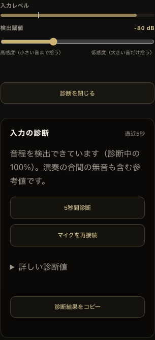

# Tuner detection investigation — 2026-11-06

Base: `88afd4f934e38219a089a2acb9207e95d159d689` (`origin/main`).
Candidate: Port **1.28.0**, Studio **0.86.0**. Draft only; no production deployment.

## What is established, and what is not

**The reported Home Screen-only failure has not been causally identified.**
The operator reported Safari working while the installed iPhone app failed even after its
“ページを更新” action and from the first microphone start. A connected Safari Web Inspector
confirmed the installed app (`navigator.standalone === true`), Port 1.27.2 and the released
capture/engine imports. Navigating that document to `?tunerDebug=1`, then starting a fresh
capture, restored detection. Returning to the ordinary URL also worked; the operator
confirmed both observations. No candidate code was installed on the phone.

Observed on the working phone session: AudioContext running with advancing audio time,
48 kHz track, echo cancellation false, live/unmuted microphone. E2 readings included
82.41 Hz/confidence .997 and 82.35 Hz/.990. The installed app's threshold was −69 dBFS;
the earlier working Safari screenshot used −91 dBFS. These independent saved values were
not changed. The Safari screenshot's 96 low-confidence frames do not prove the installed
app's failure mechanism: the operator reported Safari as working, and the screenshot can
include non-playing/decay frames. “Final” retained a historical valid E4 while Display was
neutral; the new detail label explicitly says “直近の有効音”.

No failed standalone waveform/session snapshot was captured before recovery. Therefore
neither a browser regression, stale cache, frozen context, microphone mode, nor the
noise weakness below is claimed to be the proven cause of that incident. The temporary
scalar-only probe was removed, the app was returned home, and audioSession was verified
as `auto`. No microphone samples were recorded, retained as a recording, saved or sent.

**A separate shared-engine weakness was reproduced and corrected:** YIN measured the
unfiltered full-band signal, allowing broadband noise to raise the difference floor,
reject valid fundamentals and sometimes choose later-period minima/octave errors, even
when raw RMS was well above the amplitude gate. The same deterministic decaying harmonic
signals, with the same thresholds and confidence checks, pass after a second-order
Butterworth low-pass at the configured maximum fundamental frequency (normally 1400 Hz).
This is a confirmed synthetic-input improvement, not proof of the Home Screen incident.
[YIN, sections IV and VI.E](https://www.ee.columbia.edu/~dpwe/e6820/papers/deChevK02-yin.pdf)
discusses low-pass preprocessing and additive noise with a different spectrum.

## History and pipeline findings

- `efffb4d06` (2026-09-05): initial YIN, .12 threshold, .82 minimum confidence, fixed-length
  lag comparison, octave reduction and unnormalized interpolation. Those decisions remain
  in the released engine through the investigation base.
- `e488406df`, `2a6ec7936`, `f3ad51412` (2026-09-06): diagnostic wrapper, ordinary-path
  allocation reduction, and threshold diagnostics. No subsequent YIN algorithm regression
  was found. Existing clean sine and a few stationary harmonics/noise tests missed the
  decaying noisy corpus in this change.
- `d30b61e90`: input dB threshold UI/level path; `2fe5b0e4e`: request play-and-record before
  getUserMedia for the previous iPhone-start regression.
- `a3717eb89`, `432154ffb` (2026-10-01): restore AudioSession after capture and pause capture
  during reference playback. These capture/release decisions are retained.
- Port gates *raw centered RMS* using `10 ** (dBFS / 20)`. Engine fallback .003 and Port/quick
  tuner defaults −80 dBFS are deliberately distinct. None was relaxed.
- Raw level, YIN candidate/rejection, and final UI output are different stages. Port keeps
  a previously valid reading for at most 150 ms and confirms large shifts in two frames;
  these rules and the 80 ms EMA are unchanged. Quick runtime still clears invalid frames
  immediately. Neither displays a new pitch from an invalid frame.
- Capture constraints still request EC/NS/AGC false and ideal mono. Browser/device support
  decides actual settings; Chromium's fake track reported stereo despite ideal mono.
- Actual context sample rate drives detection; analyser windows are power-of-two, initially
  4096 and at least 80 ms, with 50 ms analysis cadence. Frequency FFT smoothing does not
  smooth time-domain input ([Web Audio specification](https://www.w3.org/TR/webaudio/)).
- The released Studio normal surface embeds native Pro Port; `port-surface.js` needs no
  ownership/auth change. Its stopping of a separately owned quick runtime is unchanged.
  The retained `runtime.mjs` shares the engine and is tested independently. At this base,
  the current Studio release package does not include the old `tuner/panel.mjs` entry;
  independent-runtime tests are not presented as a complete current quick-tuner UI test.

## Implementation

1. Filter only the YIN input in reusable workspace memory. Validate/gate/report the
   original samples, preserve confidence .82 and range checks, and reset filter state
   for every overlapping analyser frame. Never modify the caller's samples or keep a
   recording between frames.
2. Put opt-in diagnosis **inside Input Settings**, available without a query string in
   Standard, Pro and Studio's embedded Port. “入力を診断” opens and runs a five-second check.
   It separates quiet input, unclear periodicity, unsupported range, interrupted track,
   stalled analysis/audio clock and detected/intermittent pitch, with specific next steps.
3. “マイクを再接続” stops the current capture and preview through the existing release
   path, requests the next context synchronously in the click gesture, and diagnoses again.
   It changes no threshold, tuning, capo, meter preference, storage schema or credentials.
   No invisible repeated retry loop or automatic permission acquisition was added.
4. Cancel diagnosis on close, route exit, hidden page and teardown. Generation checks
   prevent stale completions from updating the UI. Normal capture collects the additional
   diagnostic metadata only when opted in; bounded history stores scalar reasons only.
5. Copied diagnostics include app version, standalone state, context state/audio time,
   session type, track state/mute, actual whitelisted settings, candidate lag, durations,
   observed cadence and each rejection reason. Device/group IDs and audio are excluded.
6. Refresh Port/Studio release/cache identities, including both Port entries and the
   Studio Pro entry. Non-tuner JS diffs in Studio are only version/cache references.
   NEWS, other tool behavior, Pro verification, Sync and schema were not changed.

Mobile preview with generated input (not a microphone recording):



## Synthetic before/after (same generated corpus)

`synthetic-before.json` and `synthetic-after.json` contain all rows and definitions.
360 generated signals: six open strings, 32/44.1/48/96 kHz, three gains (.008/.08/.4),
five profiles (clean harmonics, fixed ambient hiss, weak fundamental, inharmonic partials,
clipping), pluck attack/pick transient and independently decaying partials. These are
synthetic signals, not recordings of an acoustic guitar or a calibrated microphone.

7920 total analysed frames; 6840 steady frames are evaluated at 200–1100 ms (pluck onset
50 ms). Correct = frequency within 10 cents of the specified fundamental; wrong includes
octaves. Raw high level alone is not considered a success.

| Metric | Before | Candidate |
|---|---:|---:|
| Noisy-decay correct frames | 345/1368 (25.22%) | 1368/1368 (100%) |
| Noisy-decay wrong frames | 123/1368 (8.99%) | 0/1368 |
| Noisy-decay rejected frames | 900/1368 (65.79%) | 0/1368 |
| Noisy-decay maximum first correct acquisition | 300 ms | 50 ms |
| Noisy-decay maximum consecutive null gap | 650 ms | 0 ms |
| Noisy-decay maximum absolute error, accepted frames | 2400.27 cents | 8.73 cents |
| Other four profiles, correct steady frames | 5472/5472 | 5472/5472 |
| Pure/noisy negative controls falsely accepted | 0/640 | 0/640 |
| Node mean detector work (single run) | 2.63 ms | 2.65 ms |
| Node detector work p95 (single run) | 6.70 ms | 6.76 ms |

Acquisition time excludes permission/device startup, follows a 50 ms sampling grid, and
is not a promised real-device latency. Negative controls cover silence, sub-threshold
input, DC, white noise, colored noise, 50 Hz hum, 69 Hz and 1500 Hz. Mixed strong hum is
not magically removed. This finite corpus does not prove rejection of all environmental
noises or precision on severely noise-dominated late decay. Clean harmonic maximum error
increased from .064 to 2.605 cents due to filtering/frame startup; it remains below the
10-cent criterion, while the existing separate sine/boundary tests also pass. This
tradeoff and real-attack response require physical-guitar confirmation.

## Validation and remaining checks

- Related unit/release checks: **144 passed**, including store migrations, tuning/presets,
  meter preferences, reference preview/capture, pending permission, stale starts, cleanup,
  Studio coordinator ownership, engine parity, and current release/cache graph.
- Guitar corpus: **22 passed**, including immutable input and filter independence across
  overlapping windows/sample-rate changes; baseline is run on the identical test file
  with only the imported engine swapped.
- `chromium-capture.json`: Chrome 156.0.8078.80 native getUserMedia/WebAudio with generated
  harmonic/noisy PCM, Port and quick owners at 44.1/48 kHz, E2/E4. **176/176 evaluated
  frames correct**, no wrong frame; largest absolute error under 3 cents. Observed
  intervals max 51.6 ms, detector work max 7.5 ms in that run. Two actual Port DOM note
  checks and two five-second in-app diagnosis/reconnect checks passed; old tracks ended,
  one context remained active after reconnect, all closed on leaving. Storage and −80 dB
  threshold unchanged. Mobile 393 px/desktop 1280 px layouts fit the viewport.
- Existing `tuner-audio-session-browser.cjs`: **PASS** after repairing its test server
  MIME handling for current `.mjs` imports, absolute app paths, and its readiness wait.
  Nine theme/width combinations retain baseline pixels/styles outside the closed input
  settings; preview pause/resume, repeated taps, route/hidden exit, denied permission,
  unsupported AudioSession, and generated reference-level checks pass. See
  `audio-session-browser.json`. No production workaround was introduced for the fixture.
- No microphones or network services are used by the synthetic corpus. Browser QA blocks
  external network access and uses generated WAVs. Tests do not bypass or mock Pro auth;
  full Pro Port inside the Studio shell is **not** covered by the Standard DOM check.
- iPhone Safari/Home Screen baseline recovery was observed; **candidate UI/filter has not
  been verified on the iPhone**. Chrome timing is not a Safari/iPhone CPU guarantee.

Before production approval, verify the candidate in iPhone Home Screen and Safari with
real E2/A2/D3/G3/B3/E4, near/far and weak/strong plucks, decay/environment noise, cold start,
permission prompt, screen lock/foreground, reference preview/repeated reconnect, and
Studio's authenticated normal embedded tuner and any active quick entry. Exercise the
new in-app check during the actual failing state; retain the scalar copy before retrying.
Only then decide whether the Home Screen incident is explained or requires a separate
capture/WebKit correction. Merge/main publication and production deployment require the
operator's separate approval; nothing here authorizes either.

## Reproduce

```sh
node --test apps/cruise-port/tuner*.test.mjs apps/cruise-port/app-version.test.mjs \
  apps/cruise-port/module-cache-keys.test.mjs apps/cruise-studio/tests/tuner.test.mjs \
  apps/cruise-studio/tests/audio-coordinator.test.mjs \
  apps/cruise-studio/tests/component-version-cache.test.mjs \
  apps/cruise-studio/tests/pro-edition.test.mjs apps/cruise-studio/tests/unified-release.test.mjs

git show 88afd4f934e38219a089a2acb9207e95d159d689:apps/cruise-port/tuner-engine.js > /tmp/tuner-before.mjs
TUNER_BASELINE=1 TUNER_ENGINE_PATH=/tmp/tuner-before.mjs TUNER_REPORT=/tmp/before.json \
  node --test apps/cruise-port/tests/tuner-guitar-regression.test.mjs
TUNER_REPORT=/tmp/after.json node --test apps/cruise-port/tests/tuner-guitar-regression.test.mjs

NODE_PATH=/path/to/playwright/node_modules \
  node apps/cruise-port/tests/tuner-capture.browser.cjs /tmp/tuner-capture
```
