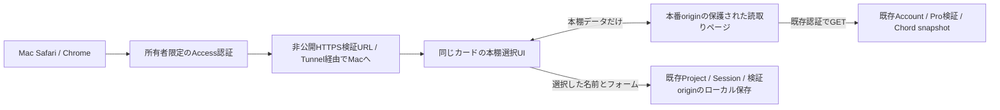

# 実Accountのコード本棚を同じ編集カードで選ぶ検証入口案

2026-11-12。**構成案のレビュー段階。実Account接続・外部設定変更・配信は未実施。**

## 利用者の操作

1. 所有者だけが開ける非公開の検証URLへアクセスする。
2. 譜面のコード欄で「コード本棚」を押す。
3. **同じ編集カード内**に、同期Accountの本棚のフォルダとコード図が表示される。
4. 選んだコード名とフォームを、選択中のマスへ一緒に入力する。既存SessionでUndo/Redoできる。元本棚は変更しない。

通常は別タブ、ブックマーク、JSONファイルを使わない。初回認証や期限切れ時だけ、必要なら同じタブで通常の認証画面へ移動して戻る。認証前の画面遷移には既存の未保存確認を適用し、未確定入力・保存失敗では移動しない。復帰URLは固定の許可リストで検証し、資格情報をURLへ載せない。

最初は**Cloudに保存済みの本棚**を表示する。他端末に残る未送信編集は含めない。通常のコードクルーズで同期した後、カードの「更新」で読み直せる。本棚そのものの編集や即時自動同期は今回含めない。

## 現状と接続できない理由

通常Studioには既存Pro・Account・AppDeviceを照合する接続がある。アカウント本棚を読めない設計ではない。18874は依頼された安全条件に従い、その認証・同期bootstrapを除外したテスト入口である。

- `scripts/local-ui-entry.mjs` は本番Account/Cloud接続を除外する。
- `scripts/serve-local-ui.py` は `connect-src none` / `frame-src none` 等を設定する。
- リポジトリのWorker設定では許可originとTurnstile hostnameは本番 `soundcruise.jp`。localhostをそのまま既存APIへ接続できない。

ブラウザのlocalStorage/IndexedDBはorigin別に分離される。別originのページ内部への直接アクセスも制限されるため、限定したメッセージ受渡し等が必要。[MDNの同一originポリシー](https://developer.mozilla.org/en-US/docs/Web/Security/Defenses/Same-origin_policy)

ここまではリポジトリの実装・設定を確認した結果。稼働中Cloudflareの設定・本番ヘッダーは未確認。

## 推奨構成

### 非公開HTTPSの検証入口

- 例：`https://score-dev.soundcruise.jp`。**未作成の仮URL**。利用可否・DNS管理状況は後で確認する。
- Macの別ポートを `127.0.0.1` のみにbindし、Cloudflare Tunnel経由で提供。Accessで所有者だけに制限する。恒久的なクラウドアプリやDB、Project Cloudは新設しない。
- **Accessの拒否設定とTunnel側のAccess検証を先に完成させてから経路を公開する。** hostnameを先に公開しない。[Cloudflare公式手順](https://developers.cloudflare.com/cloudflare-one/access-controls/applications/http-apps/self-hosted-public-app/)
- 独立originなので本番・18874のProjects/draftと混在しない。既存データの自動移行・書換えは行わず、合成Projectを使う。18874とその保存領域は維持する。
- localhost限定の合成認証アダプターは使わない。実Account連携用入口を別に作り、通常のPro/Account検証完了まで本棚を取得しない。

### 認証情報を本番originに留める専用ページ

- 本番origin内に既存Pro/Account検証を再利用する小さな読取り専用ページを追加する。既存Studio Shell・公開入口の挙動は変更しない。
- この専用パスもAccess保護する。非公開検証画面からの埋込みだけを許可するヘッダーを検討する。既存ページの埋込み制限は緩めない。
- 同じ所有者の有効Accountと、既に接続済みのChord AppDeviceを照合する。join/handoff、device新規登録、復元、初回移行を自動実行しない。未接続なら通常Studioでの接続を案内する。
- 資格情報は本番originのページだけで扱う。開発画面にAccount/device資格、Proトークン、Recovery情報をコピーしない。
- API通信は本番originから既存認証で行うため、**この構成では既存WorkerのCORS・Turnstile許可hostnameを変更する予定はない**。Tunnelだけで認証制限を解決する案ではない。
- 現行資格自体は読取りだけの権限ではない。読取り専用性は、信頼する専用ページの操作を固定し、書込み経路を持たせないことで確保する。汎用fetch代行やSync clientを開発画面へ公開しない。

### 同じカード内の選択UI

- 固定した送受信origin、送信元window、接続nonce、Account世代を照合する。`targetOrigin: '*'` は使わない。
- フォルダ、コード名、6弦フォーム、順序、削除状態、source revision、取得時刻、不透明な接続世代だけを受け渡す。個人ID・資格情報は渡さず、データの型・サイズ・件数を検証する。
- コピーはメモリだけに保持する。Project全体を送信せず、利用者が選んだコード名・フォーム素材だけを既存の承認済み互換保存契約でProjectへ保存する。
- 読取り前後と採用時にAccount・接続世代・Project ID・bar ID・tick・編集revisionを照合する。切替・失効・古い応答では採用を止め、古いコピーを破棄する。
- 新入口では専用読取りページだけをframe許可し、直接の外部API通信は遮断する。**18874のCSP・安全境界は変更しない。**

## 既存実装の再利用範囲

| 既存実装 | 再利用する契約 / 注意点 |
| --- | --- |
| `js/modules/series/internal-app.mjs` の `createNativeSyncHost` | Account一致、storage generation、有効AppDevice確認。通常native app全体を裏で起動しない。 |
| `js/core/port-pro-boundary.mjs` | 通常Pro入場検証。AccessログインだけでPro資格を付与しない。 |
| Chord `js/sync/sync-client.js` の `getServerSnapshot()` | 認証付き `GET /v1/sync/snapshot?appId=chord` と既存snapshot検証が接続点。client生成時の副作用・認証依存は実装前に切り分ける。 |
| 同clientの `captureSnapshot()` | 端末localStorageのsnapshotでありCloudの最新値ではない。今回のCloud保存済み本棚の代わりにしない。 |
| 既存Session / 素材保存 / Repository CAS | 名前とフォームの採用、Undo/Redo、明示保存。独立した編集データや新しい保存方式は作らない。 |

`syncNow`、background sync、outbox flush、push、hydrate、merge、applyFinalSnapshot、元本棚のlocalStorage書込みを専用ページから実行しない。ネットワークアダプターも必要な認証検証とChord snapshot読取りだけを許可する。

## 従来条件から例外として判断が必要な点

| 従来条件 | 今回の提案 |
| --- | --- |
| localhostだけで検証 | 実Account確認専用に所有者限定HTTPS入口を追加。18874は継続。 |
| 本番資格情報・APIを使わない | 保護された本番originの読取りページだけで既存認証と本棚GETを使う。開発UIへ資格情報は渡さない。 |
| 本番への追加配信なし | **専用読取りページの配信と、専用パスのAccess設定が必要。小さくても本番originへの追加配信に当たる。** 未承認のまま実施しない。 |

本番Pro認証・Account/Syncの既存動作、公開Coming soon、既存Worker/D1/R2の実装・データ形式は変更しない。本棚の更新・削除・pushは行わない。ただし、通常の認証検証・読取りに伴う既存アクセス記録や認証メタデータ処理まで「書込みゼロ」とは断定しない。

例外が認められない場合、現在の条件のまま実Account本棚を同じカードで読めるとは約束しない。JSON・別タブ経路で完成扱いにしない。

## 実装準備・受入・撤回

構成合意後、まず合成Accountと模擬APIで読取りページ・メッセージ契約・カードUIを実装し、独立Draft PRで差分をレビュー可能にする。Aライン担当箇所は既存認証検証の契約と限定provider接続点に絞り、認証・Shellへ無断で改変を広げない。

実データ接続前にDNS/Access/Tunnelの利用可否、パス単位のAccess保護、CSP/frame制限、既存資格の利用可否を確認する。実際の設定差分・配信ファイル・検証URL・撤回手順を提示し、実行の承認を受ける。**構成案への合意だけで外部変更を実行しない。**

受入条件：

- Chrome/WebKitで同じカードの本棚選択を確認。実SafariのAccess・埋込み・認証ストレージは別途実機確認する。
- 認証前・期限切れ・別Account・失効device・切替・古い応答を拒否する。
- 任意origin/window、再送nonce、不正・過大データを拒否する。
- push/merge/hydrateが発生せず、資格情報をログ・DOM・メッセージ・URLへ出さない。
- 名前とフォームを同一Undo単位で採用。Project/bar切替、未確定入力、保存失敗、Undo/Redo、保存・再読込み・JSONを確認する。
- 元本棚を変更せず、18874の遮断・公開ビルド混入防止・公開Standard/Pro制御を回帰確認する。
- 実Account試験も合成Projectを使用し、本棚データ・資格情報を成果物やスクリーンショットへ無断で残さない。

Safariで埋込み認証が成立しない場合はPASSにせず、同じタブでの認証と復帰を検証する。既存の保護を緩めて通さない。

撤回時は専用ページの受信・配信とAccess/Tunnel経路を停止し、メモリコピーを破棄する。元本棚、Project、18874の保存領域は削除しない。

**現時点：構成案のみ。実Account接続・Safari実機・新URLはHOLD。**
