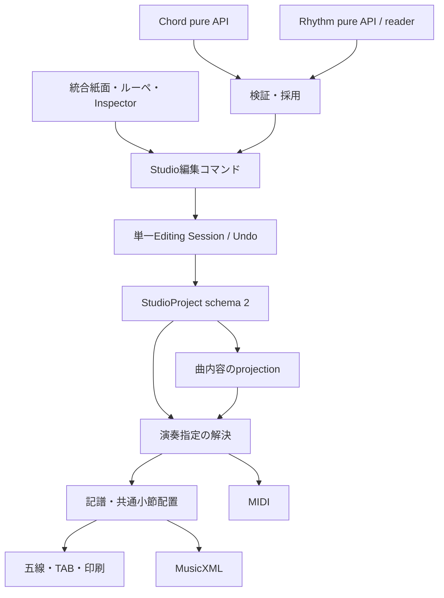

# Integrated Score Architecture Contract v1 — 正式設計

## 文書化の基準と現在の実装

- 文書化日: 2026-10-15。Studio metadata保守commit: `02a21d74a35e93d94a06b5827e1713fe5ae3efe0`（0.37.1）。
- 製品の実装済み保存schemaは **1**。本書のschema 2、stable ID、永続material/performance/notationは将来の確定設計であり、今回実装しない。
- 設計時の「現行事実」や「今回」は、レビュー基準 `0e651fb938e19e7b74b3c90166ba6d40fbc7bd88` / Studio0.37.0での調査記録。新規の試験実績として扱わない。
- Astra原文: **Integrated Score Architecture Contract v1**、SHA-256 `1628132daf084036820834a1d51513153d0390aaef575b0cb00db85af9d5583c`。
- Opus最終全文: **統合譜面制作 最終UX契約照合と静的モック制作の準備**、SHA-256 `1fd6b3dd92316b3fe639bc62cb6e031a9554a4f9e9c100c05f93870c09ce26cd`。先行案の撤回・修正とAstra §23への回答を含む最終照合を採用する。
- 承認済みモック: `2b754b0f78b8ba856f9f315e9c76d27420088168` の `_proto/integrated-score/` 9ファイル。独立・固定fixture・保存なしのUI資料であり、製品実装の正本にはしない。
- 参照: [Architecture](INTEGRATED_SCORE_ARCHITECTURE.md)、[UX](INTEGRATED_SCORE_UX.md)、[実装工程](INTEGRATED_SCORE_IMPLEMENTATION_ROADMAP.md)。

## 設計本文の扱い

以下は提供されたAstra契約の設計本文（§1〜23）を保存したもの。原文の過去Git確認§24は新規検証と混同しないよう省き、ローカル参照をリポジトリ相対リンクへ変換した。確定・暫定・未決の区別と技術的な設計内容は維持する。Opusの最終照合によるUX詳細は別文書で補完する。

---

**Integrated Score Architecture Contract v1**
**統合譜面制作アーキテクチャ契約 v1**

結論は、**内部は単一StudioProjectのHybrid方式、画面はStructureを拡張した統合紙面方式**とします。フォーム・リズム・音価の編集は共通のEditing Sessionを通し、五線譜・TABに別の保存データや履歴を持たせません。

ただし、Opus案の「同じコードすべてを既定で変更」「不適合な手動フォームをおすすめへ戻す」「音価編集を後半へ回す」は採用しません。局所変更、手動指定の保持、早期の音価編集を優先します。

以下の区分で記載します。

- **【現行事実】** 現行リポジトリで確認した契約・実装。
- **【確定判断】** 今回の統合契約で採用する設計。リポジトリへの反映・実装は未実施。
- **【暫定判断】** モックや実機確認で調整するUI上の選択。
- **【未決】** 別途決定が必要な事項。それに依存する機能は公開しない。

Opusの実画面に関する所見は、提供されたレビューを根拠としています。今回こちらでは画面撮影やサーバー起動を追加していません。

---

**1. 統合設計の結論**

【確定判断】

1. 編集正本は、一つのStudioProjectとそのEditing Session。
2. Structure、五線譜、TABは、同じ曲・演奏指定を扱う複数の表示・編集入口。
3. 曲の内容、採用素材、演奏指定、記譜調整を別の所有領域に分ける。
4. Common Music Model、演奏解決結果、描画結果は派生データ。保存正本にしない。
5. 表示は同じ紙面・同じ小節列へ統合する。五線・TAB用workspaceは追加しない。
6. 永続ID・採用snapshot・演奏指定を初めて保存する工程で、project schemaを2へ移行する。
7. 自動生成と手動確認を区別する。不適合な手動指定は保持し、勝手に置換しない。
8. 出力の完成度はメロディ五線譜・ギター伴奏五線譜・TABごとに判定する。
9. schema 2では、曲の実音とギターのカポ設定を分離する。
10. 印刷を製品として提供する前に、メロディの基本音価・休符を修正できるようにする。

「Structureが正本」は、**現行の文字入力欄で表現できるものだけを保存する**という意味にはしません。StudioProjectを正本とし、Structureの入力能力を必要な範囲で拡張します。

---

**2. Astra／Opusの一致点**

両レビューは、次の方向で一致しています。

| 一致点 | 統合契約での扱い |
|---|---|
| 正本を一つにする | 単一Project・単一Session |
| 五線・TABを独立した複雑な編集アプリにしない | 統合紙面と共通編集コマンド |
| Chordの既存推奨ロジックを使う | `getCommonForm()` → `getForm()` |
| Rhythmの既存資産を使う | owner側のpure APIと読み取り境界を設ける |
| 自動と手動を区別する | 採用方法・由来・確認状態を別々に保持 |
| 外部素材は採用時にコピーする | 出所付きsnapshot |
| Undo/Redoを共通にする | フォーム・リズム・音価も同じ履歴 |
| 最初から全面的な双方向編集をしない | previewから段階導入 |
| 音価の自動割当が信頼上のリスク | 表示・確認・編集を先行 |
| 未確定情報を隠さない | 該当箇所と出力単位で表示 |

AstraのHybrid方式とOpusの統合紙面方式は、担当する層が異なるため両立します。

---

**3. 相違点と採用判断**

| 論点 | Opus案 | 統合判断 |
|---|---|---|
| フォーム変更範囲 | 同じコードすべてが既定 | **このコードイベントだけが既定**。一括適用は明示操作 |
| 手動フォームが不適合になった場合 | おすすめへ戻し、通知とUndo | **保持して保留**。代替案を示すが自動置換しない |
| 手動フォームの保存 | CAGED型・位置の意図を重視 | **採用した具体形が正本**。意図は再提案用の補助情報 |
| 「Structureだけを入力」 | 初心者向けの製品原則 | 初期導線として採用。正確な音価・休符の編集入口は追加 |
| 音価編集の導入 | 本棚・手動運指より後 | **本棚・高度な運指より前** |
| 未確定表示 | 音価の説明は1回だけ | 操作案内は1回でもよいが、**未確認状態は確認まで残す** |
| 画面＝印刷 | 見えている紙面そのもの | 同じ譜面内容・配置計算を使う。選択枠・ルーペなどは印刷対象外 |
| モーダル | 原則使わない | 日常選択は非モーダル。既存の保存競合・破棄・認証境界は維持 |
| 狭幅切替 | 1024px未満 | 現行Shellの1280px／600px境界を起点に検証。独自境界を即追加しない |
| 最小製品 | 10分・8小節・A4一枚 | 体験目標として採用。**一枚への強制縮小はしない** |

現行ドレミ入力についても補正が必要です。実装は単純な「次の音まで伸ばす」ではなく、8分または16分スロットへ順に配置し、伸ばし記号で直前音を延長しています。いずれにしても原曲の音価を推定・検証する仕組みではありません。[現行実装](../js/core/song-model.js#L413)

---

**4. 推奨architecture**

【確定判断】



Project内の保存責務は次のとおりです。これは新規設計であり、現行フィールドの説明ではありません。

| 領域 | 保存するもの |
|---|---|
| `songInfo`、`sections`、`bars` | 曲情報、曲構造、コード、メロディ、歌詞、音楽的時間 |
| `instrument` | チューニング、カポ、弦番号規約 |
| `materials` | 採用したフォーム・リズムの不変snapshot |
| `performance` | 素材の割当、手動演奏指定、使用弦、消音、継続関係 |
| `notation` | 譜面スタイル、改行、連桁などの記譜指示 |
| 各対象の`provenance` | 由来、生成条件、確認状態、移行情報 |

**保存しないもの**は、VexFlowオブジェクト、SVG、描画座標、展開済み全TAB、変換キャッシュ、画面選択状態です。

【現行事実】Common Music Model v1はschema 1専用のmemory-only projectionです。現行契約をそのままschema 2へ適用したと見なさず、後続のconverter／service契約を版管理します。[正式契約](COMMON_MUSIC_MODEL.md#L1)

---

**5. Ownership matrix**

すべてのProject変更は共通編集コマンドを通します。描画処理や外部readerからの直接保存は禁止します。

| 情報 | 唯一の保存先 | 編集入口 | Undo | 自動との優先順位・再検証 | schema |
|---|---|---|---|---|---|---|
| A. 曲の内容 | `songInfo/sections/bars` | 曲情報、ルーペ、将来の音価編集 | 対象 | 曲内容が演奏生成の入力。変更後に関連指定を再検証 | v1既存、v2でID・音高契約更新 |
| B. フォーム選択 | `performance.formBindings` | フォームパネル | 対象 | 有効な手動選択を優先。自動選択は条件変更時に再提案 | v2 |
| C. 弦・フレット・運指 | `materials.forms`の具体形 | CAGED／本棚採用、手動指板編集 | 対象 | 編集時は新snapshotを作り参照変更。既存snapshotを破壊しない | v2 |
| D. リズム選択 | `performance`の曲基本・小節割当 | リズムパネル | 対象 | 小節明示指定が曲基本より優先 | v2 |
| E. 使用弦・消音・発音 | `performance.strokeOverrides` | ルーペ、詳細演奏編集 | 対象 | 有効な明示指定が採用パターンより優先。不適合なら保留 | v2 |
| F. 記譜調整 | `notation` | 表示設定、将来の記譜編集 | 対象 | 自動配置より優先。ただし音高・音価を変更できない | v2 |
| G. UI一時状態 | メモリ。端末設定のみ`appSettings`可 | ズーム、選択、パネル開閉 | 曲履歴の対象外 | 演奏生成を失効させない。削除対象への選択は解除 | Project外 |
| H. 外部素材 | 採用前は外部owner、採用後は`materials` | 素材選択パネル | 採用・差替えが対象 | 外部更新・削除では採用済み内容を変えない | v2 |

Cのフォーム全体とEの演奏指定に、同じフレット情報を重複保存しません。将来、特定の打点だけ別の押さえ方にする場合も、その打点が別のフォームsnapshotを参照する方式にします。

適用順位は、**有効な明示指定 → 採用済みsnapshot → 未採用の自動候補**です。不適合な明示指定がある箇所を、自動候補で黙って埋めて完成扱いにはしません。

---

**6. Stable ID contract**

【現行事実】sectionにはIDがありますが、bar・chord event・melody eventには永続IDがありません。Common Music Modelのevent IDはsnapshot内の識別用であり、保存用には使えません。[Song Model](../js/core/song-model.js#L35)

【確定判断】

永続IDを持つ単位は、project、section、bar、chord event、melody note/rest、歌詞イベント、material、pattern event、rhythm instanceとします。

- IDは不透明な識別子。小節番号、配列index、コード名、tickをIDにしない。
- `barNumber`は表示用の派生値とする。
- pattern eventはテンプレート内のイベント。
- stroke instanceは小節への展開結果であり、`rhythmInstanceId + patternEventId`で識別する。
- 小節順やtickが変わっても、同一イベントのIDは変えない。

| 操作 | IDの扱い |
|---|---|
| 新規作成 | 新しいIDを発行し、Project内の重複を検査 |
| 削除 | 対象と関連参照の処理を同一操作に含める |
| Undo／Redo | 元のIDを復元。再採番しない |
| 複製 | 複製部分に新ID。内部参照を対応表で付け替える |
| 小節移動 | bar・内部event IDを維持 |
| 再番号付け | IDは不変 |
| JSON export/import | 通常の往復はID維持 |
| 別曲として読み込む | project IDを新規発行。内部IDはproject内スコープなので維持可 |
| 既存曲へ一部取り込む | 取り込む部分を再採番し、内部参照を更新 |
| v1→v2 migration | 既存の有効なsection IDを維持。不足IDを再現可能に採番 |

移行採番は、**移行版・project ID・元の位置**から決定する方式とします。元indexを使うのは一回限りの移行処理であり、移行後の参照にindexを残しません。同じv1内容を複数タブで読んでも同じIDになります。

文字列の全置換では、対応が確実なイベントだけIDを維持します。対応が曖昧なイベントへ既存overlayを推測で付け替えず、関連指定を保留します。

パターン交換で旧strokeへの手動指定が対応しなくなった場合も、似たtickへ勝手に移しません。

---

**7. Chord form contract**

【確定判断】

推奨処理のownerはChord Cruiseです。

1. Studioが実音コードからカポ相対のフォーム用コードを導出。
2. Chordの品質定義へ対応付け。
3. `getCommonForm()`で候補形を取得。
4. `getForm()`で具体形を取得。
5. Studioの演奏adapterが、TABに必要な完全性を検証。

Studioは独自のおすすめ順位を作りません。ただし、**表示可能な候補かどうか**と**演奏譜として成立するかどうか**の検証は別責務です。

【現行事実】`getForm()`には範囲内の音だけを残す経路があります。また6／m6は基底フォームに追加候補を重ねる設計です。`available: true`だけでは、完全な演奏フォームとは判断できません。[getForm](../../chord-cruise/js/core/caged-forms.js#L991)

採用snapshotには、最低限次を持たせます。

- 弦ごとのフレット／非使用状態
- 分かる範囲の運指・バレー情報
- チューニングとフレット座標系
- 対象コード、カポなどの生成条件
- Chord owner版、adapter版、内容識別値
- 自動推薦／CAGED選択／本棚採用／手動編集の区別
- 確認状態
- CAGED型・希望位置などの補助的な選択意図

フレットは**カポからの相対値**です。画面のスクロール範囲を、フォーム生成のフレット範囲として渡してはいけません。

| 変化 | 自動指定 | 手動・固定指定 |
|---|---|---|
| コード変更 | 新条件で候補生成・採用を同じ編集操作に含める | snapshot保持。適合しなければ保留 |
| キー表記だけ変更 | 実音コード不変なら再生成しない | 維持 |
| 曲全体の移調 | 新コードで生成 | 意図から候補を出せるが、自動置換しない |
| カポ変更 | 選択した変更モードに従い再検証 | 同左。成立しなければ保留 |
| Chord owner版変更 | 採用済みsnapshot維持 | 維持 |
| 元の本棚項目の更新・削除 | 曲内snapshot維持 | 維持 |
| おすすめに戻す | 現在条件で新規採用 | 明示操作として固定指定を解除 |

**適用範囲の既定は「このコードイベント」**とします。「この小節」では、一小節に複数コードがある場合に曖昧になります。

一括変更は「同じコードにも適用：4か所」として用意します。対象はroot・quality・bass・楽器条件で判定し、文字列一致だけにしません。既存の手動固定を含める場合は別に明示し、一括操作全体をUndo一回で戻せるようにします。

---

**8. Rhythm contract**

【確定判断】

Rhythm本体の`script.js`をStudioへimportしません。必要な境界を次の二つに分けます。

| 境界 | 責務 |
|---|---|
| 公式pattern pure API | 版付き公式ID、拍子、時間単位、イベント、方向の取得 |
| 保存pattern reader | 許可された保存内容を読み、純粋なdecoderへ渡す |

pure API／decoderはDOM、Audio、localStorage、現在時刻、乱数、初期データ保存を使いません。readerも読取のみとし、補修・移行保存・Sync登録を行いません。

最初の対応は、4/4・一小節・基本8分／16分です。**基本8分は刻み幅を指すのか、特定の打点列を指すのかを分離**し、カードには具体的な矢印列と名前を表示します。現行Studioの既定ストロークとRhythmの「基本の8ビート」を同一内容と見なして置き換えません。

内部表現では、次を分離します。

| 要素 | 意味 |
|---|---|
| `attack` | 新しい発音 |
| `rest` | その声部の休止 |
| `sustain` | 既存の音を再発音せず継続 |
| `direction` | down／up／なし |
| 空振り | 発音を伴わない手の動作 |
| 使用弦 | その打点が対象とする弦 |
| dead stroke | 音高を持たない打撃 |
| stop／消音 | 既存の発音を止める操作 |

`tie`は継続元を持つ`sustain`へ変換します。直前に音がないtieは未解決とし、勝手にhitやrestへ変更しません。コードが変わってもtieによる継続音を新コードへ再発音させません。

【現行事実】Rhythmでは旧`ghost`をrestへ正規化し、rest／tieでも方向を保持しています。また`dirManual`は操作経路によって付くため、値がtrueというだけで「原曲どおりにユーザー確認済み」とは扱えません。[正規化処理](../../rhythm-cruise/script.js#L3783)

Rhythmの24 TPQから480 PPQへの変換は20倍で正確に行えます。三連符等は数値上変換できても、初期UIの対応範囲とは分けます。[時間定義](../../rhythm-cruise/script.js#L3642)

採用後は曲内snapshotが正本です。外部IDは出所であり、再生・表示に必須の参照にはしません。

---

**9. Pitch／Key／Capo contract**

ここはschema 2で明確に改めます。

【現行事実】

現行メロディ実音は概ね次の式です。

```text
60 + pitchClass(playKey) + capo
   + majorScale[step] + alter + 12 × octave
```

`originalKey`は、この実音計算の直接の入力ではありません。キーの整合判定はpitch class中心であり、オクターブの意図まで保証しません。[音高計算](../js/core/music-theory.js#L124)

【確定判断：schema 2】

- メロディの正本は、**実音の綴り付きpitch**：音名・変化量・オクターブ。
- MIDI番号はそこから導出する。独立した編集可能値として重複保存しない。
- コードの正本は、**実音基準のコード記号**。root／quality／bassの解析結果は派生。
- カポとチューニングは`instrument`が所有する。
- フォーム用コード、`playKey`相当の表示、TABフレット、ギター移調記譜は派生。
- 階名入力には独立した「階名の基準音・基準オクターブ」を持たせる。階名から実音へ変換して保存する。
- v1の相対階名・キー・カポは移行の由来として保持し、第二の音高正本にはしない。

解釈できないコード文字列は、実音コードに偽装せず、**未解釈テキスト＋元の音高基準**として保存します。コード譜への表示は可能ですが、自動伴奏や移調は対象部分の解決が必要です。

| 操作 | 契約 |
|---|---|
| キー情報の変更 | 調性・表示情報を変更。既存の音符・コード実音・フォームを動かさない |
| 曲全体の移調 | 符号付き半音数でメロディとコードを移調。関連演奏指定を再検証 |
| 実音を保つカポ変更 | 曲の実音を維持し、フォーム側を変更。実現不能なら保留 |
| フォームを保つカポ変更 | カポ差分だけ実音が変わる。初期UIでは「曲全体を同じ幅で移調する」操作として明示 |

例：

- B4＝71を半音上げると、C5＝72。キー名をCに置換してC4＝60へ落とさない。
- Cの曲・Capo 0を、実音保持でCapo 2へ変更すると、フォーム用コードはB♭になる。歌のC4＝60は維持。
- Cフォームを保持してCapo 0→2とする操作では、曲全体を+2し、歌のC4＝60はD4＝62、実音コードはDになる。
- ギターの確定済み低いE2＝40は、Capo 2で同じ実音を出せない。この場合、別オクターブへ黙って置換せず要確認にする。

「実音保持」は、同じコード名の別voicingへ自動で変えてよいという意味ではありません。確定した伴奏音の音域変更が必要なら、別の編曲変更として提示します。

ギターの通常の五線記譜は、実音より一オクターブ上へ表示します。歌のメロディへこの補正を適用しません。TABはカポ相対フレットを表示し、実音は次で求めます。

```text
openStringMidi + capo + relativeFret
```

弦番号は1が最高音側、6が最低音側です。この規約はMusicXML出力とも整合します。[MusicXML TAB仕様](https://www.w3.org/2021/06/musicxml40/tutorial/tablature/)

---

**10. Timing contract**

【確定判断】

- 初期対応は4/4、480 PPQ、一小節1920 ticks。
- onsetとdurationは音楽的時間。音符の見た目を保存値にしない。
- 8分＝240、16分＝120、付点4分＝720、8分三連＝160 ticks。
- 対応しない時間値を近い値へ丸めない。
- 自動配置の音価は`auto-assigned`、v1由来で識別不能なら`legacy-unknown`。
- 明示休符と、イベント間の空白から導出する休符を区別する。

一つの長い音を、拍・小節・改行位置に応じて複数の音符とタイに分けても、音楽的なnote IDは一つです。描画fragmentはそのnoteを参照する派生物とします。

MusicXMLでも発音上のtieと記譜上のtiedは区別されています。内部でも、持続と曲線の見た目を同じフィールドにしません。[MusicXML tie](https://www.w3.org/2021/06/musicxml40/musicxml-reference/elements/tie/)

将来拡張の方針は次のとおりです。

| 拡張 | 今決めること |
|---|---|
| 3/4・6/8 | 小節長は`480 × 分子 × 4 / 分母`。拍のまとまりは別情報 |
| 付点・連符 | durationと記譜上の分割・連符グループを分離 |
| 小節越えの音 | 音の同一性を保ち、表示だけ分割 |
| 複数voice | voice IDで所有を分ける。初期対応声部は固定 |
| 弱起 | 通常小節長と実際の小節長を区別 |
| 途中拍子変更 | 小節IDを基準にした局所的な拍子情報 |
| 480で正確に表せない連符 | 対応工程で時間表現を拡張。現段階で丸めや仮実装をしない |

【現行事実】Song Modelの小節長計算は分母を参照しません。既存の6/8データを、移行時に機械的に半分へ縮めることは禁止します。[小節長計算](../js/core/song-model.js#L101)

---

**11. Output readiness matrix**

完成度は、**構造的に生成可能か**と、**内容が確認済みか**の二軸で評価します。

| 出力 | 必要情報 | 自動で可能な範囲 | 不足時 | 印刷条件 |
|---|---|---|---|---|
| メロディ五線譜 | 実音pitch、onset、duration、拍子、声部 | 綴り・休符補完・連桁・分割配置 | 該当音／小節に不足を表示 | 自動音価は注記付き。確認済みなら注記を解除可 |
| ギター伴奏五線譜 | 各発音の実音集合、時間、継続・消音 | 採用フォームとリズムから演奏解決 | 未解決部分に理由を表示 | 同じ演奏解決結果から全音を記譜できること |
| ギターTAB | 弦、フレット、カポ、使用弦、時間、継続・消音 | 検証済みフォームと打点から生成 | 「フォーム未決定」等を局所表示 | 弦・フレット・発音対象が矛盾なく確定していること |

運指番号が未確定でも、弦・フレットが確定していればTABは生成できます。ダイアグラムを置けるだけでは、どの弦をいつ鳴らすかを示すTABが完成したとは判断しません。

UI上は次の三状態へまとめます。

- **生成可能**：自動生成か確認済みかは詳細と必要な注記で示す。
- **要確認**：表示できるが、自動音価・保留指定等がある。
- **生成不可**：その出力に必要な情報が不足・矛盾。

未完成部分を含む場合は「確認用として印刷」を明示し、不足箇所を空白で隠しません。通常の完成譜として出力する場合は、対象出力の必須情報を満たす必要があります。

**TABが未完成でも、有効なメロディ五線譜は表示・印刷可能**とします。

ただし現行Core v1はfatal時の部分結果採用を禁止しています。この契約を実現する際は、全体破損と声部別の未解決を分ける次版の検証設計が必要です。現行の`ok:false`を無視して部分描画する実装は禁止します。

---

**12. UI／UX contract**

【確定判断】既存Structure workspaceを育てます。表示名は「譜面」へ統一する方向とし、内部workspace IDの変更は不要です。

| 譜面スタイル | 基本構成 |
|---|---|
| コード譜 | コード・歌詞・必要に応じドレミ／ストローク |
| メロディ譜 | コード・メロディ五線・歌詞 |
| ギター譜 | コード・ストローク・ギターTAB |
| 弾き語り譜 | コード・メロディ五線・歌詞・ギターTAB。ストロークは表示選択可 |
| カスタム | 上記にギター伴奏五線等を組み合わせる |

「メロディ」と「ギター伴奏」を明示します。初期TABは伴奏用であり、メロディをギターへ自動運指する機能を含みません。

**紙面と配置**

- 全段で小節境界と時間位置を共有。
- 音符・コード・歌詞に必要な幅を集約してから小節幅を決定。
- 各段を別々に整形して、最後に同じ幅へ引き伸ばす方式は採用しない。
- 歌詞は一度だけ表示。
- 歌詞と音符の対応が未確定なら、自動で一対一に結び付けたと見せない。
- ズームは画面表示倍率。音楽データ・改ページ設定を変更しない。

現行には歌詞・ドレミのないセクションで小節数を倍にする処理があります。新しい統合譜面では、これを共通の密度判定へ置き換えます。[現行renderer](../js/modules/sheet-cruise/sheet-renderer.js#L311)

**編集入口**

- コード名 → コード内容の編集。
- フォームアイコン／TABのフォーム → 押さえ方の選択。
- ストローク段 → リズム選択。
- メロディ音符 → 元イベントの選択。後続工程で音価・休符編集。
- 曲情報行 → キー、カポ、BPM、拍子。キーとカポは操作の意味を選べるUIにする。

フォームはアイコンだけに頼らず、キーボードで到達できる名前付きボタンを用意します。

**ルーペ・Inspector**

【暫定判断】ルーペは選択システムの直下へ開き、紙面に重ねない方式を第一候補とします。ただし紙面データの一部にはせず、印刷配置から除外します。

ルーペ移動や紙面再描画で入力DOMを作り直さず、IME・caret・focusを維持することを必須条件とします。達成できない場合は、紙面外の固定編集領域を代替案とします。

Inspectorは詳細編集時だけ開きます。狭幅では既存Shellの配置ルールを基点に下部パネル等を検証し、Mainのスクロール所有を維持します。[現行Shell契約](PC_SHELL_LAYOUT.md#L7)

**操作バー**

保存状態・保存、Undo/Redo、譜面スタイル、出力を優先します。「ボタン5個まで」は目安に留め、到達性を犠牲にして数だけ合わせません。JSON読込は「ファイル／バックアップ」、印刷等は「出力」にまとめます。

**状態表示**

- 自動：常時細かい印は付けないが、Inspectorで確認可能。
- 固定：ピン表示。
- 保留：固定表示を残したまま、要確認を併記。
- 継承リズム：実効パターンを表示し、「曲の基本」を文字でも示す。

色の薄さだけで状態を区別しません。印刷時のコントラストも維持します。

モックでは、1440／1920幅、狭幅、長い歌詞、16分密集、複数コード、小節選択、ルーペ展開、要確認状態、A4の複数ページを確認します。

---

**13. Schema 2 migration design**

【確定判断】永続ID・snapshot・演奏指定の保存開始と同時にschema 2へ移行します。表示専用フィールドの例外は使いません。[現行migration規約](../DATA_MODEL.md#L201)

移行は次の順序です。

1. v1原文を変更せず読み取る。
2. 構造・範囲・対応条件を検証。
3. IDを採番。
4. メロディを旧実音式で評価し、同じ実音のpitchへ変換。
5. コードを旧フォーム基準＋カポから実音基準へ変換。
6. 既存ストロークを曲内rhythm materialへ変換し、基本／小節割当を保持。
7. 元のtick・durationを保持。欠損値を導出した場合は由来を明示。
8. 原文・旧音高基準・確認不明をprovenanceへ保持。
9. v2 validatorで参照整合と音高・時間の不変を検証。
10. ユーザーの明示保存で、旧raw revisionを比較してv2を書き込む。

**読み込んだだけでは保存しません。** migration中にフォームを勝手に生成・採用することもありません。

旧音高と新音高について、対応する全メロディイベントでMIDI値の一致を必須条件にします。キー関係が不整合なデータでは、元の実音計算を優先して保持し、不整合を確認事項として残します。

自動移行の初期対象は、正常な4/4・480 PPQデータです。非4/4、不正な音高、曖昧な時間構造を持つ曲は、v1互換経路と原データを維持し、v2機能の有効化を止めます。無断修正して移行成功にしません。

旧フィールドをv2で二重に更新し続ける互換方式は採りません。v1はv1 adapter、v2はv2 adapterを通し、既存のStructure・Pre-DTM・JSON処理を含め、v2利用時に旧解釈が混入しないことを確認します。

追加規則：

- JSON往復でID・snapshot・保留指定・由来を維持。
- schema移行自体は曲のUndo対象外。セッション開始前に行う。
- 新しいschemaを旧アプリで開いた場合は拒否する。
- v2→v1への情報欠落を伴う書出しは通常機能にしない。
- ロールバックに必要なv1原文を保持する。保存後は元データのバックアップから復元し、Undoでschemaを戻さない。
- 通常の保存は未解決状態も保持可能。壊れた参照や不正な構造は保存不可。

---

**14. Undo／Redo contract**

【確定判断】

履歴単位は「一つの音楽的操作」です。

| 操作 | 履歴単位 |
|---|---|
| フォーム採用 | snapshot追加＋割当＋関連状態変更で1回 |
| 同じコードへの一括適用 | 対象全部で1回 |
| リズム変更 | material採用＋割当＋関連指定の再検証で1回 |
| 移調・カポ変更 | 曲内容＋演奏指定の状態変更をまとめて1回 |
| 小節複製 | 新ID・内容・関連参照をまとめて1回 |
| 音価変更 | 音価と必要な周辺整合をまとめて1回 |
| パネル内の候補preview | 履歴へ入れない |
| ズーム・選択・開閉 | 曲履歴へ入れない |

外部素材の読込や重い候補計算は操作の準備段階で行い、採用時にsession tokenと対象IDを再検証します。古い候補を新しい曲状態へ確定しません。

Undoで同じ内容に戻っても、古い描画結果のtokenは復活させません。IDは同じでも、session世代は新しく進めます。

【現行事実】履歴は100件・8MiBの内容予算を持ち、大きすぎる単一操作は履歴を消去する経路があります。snapshotが増えるv2では、巨大な一括操作を実行前に検査し、**履歴が消えることを黙って発生させない**対策が必要です。[Editing Session](../js/core/editing-session.js#L24)

入力欄のnative Undo、IME、既存Modalの優先順位は維持します。

---

**15. External material snapshot contract**

【確定判断】

外部素材の採用は、**出所付きの値のコピー**です。

保存する出所は、owner、素材ID、素材schema、owner版、取得時の内容識別値、採用方法です。外部素材IDをStudio内部IDとして流用しません。

- 元素材の削除・更新で曲を変更しない。
- 「元の最新版へ更新」は差分を示す明示操作。
- 読めない・消えた・権限がない・未対応schemaを区別する。
- 外部IDがない素材に、架空のowner IDを作らない。
- 同じ不変snapshotは曲内で共有してよい。
- 使用中のsnapshotを直接編集せず、新snapshotへ参照を切り替える。
- localStorage／JSONに含まれる外部参照を根拠に、任意URLへ自動接続しない。
- 名前が同じだけでコード適合と判定しない。

Daybreak待機中の共有保存は解禁しません。外部readerのためにAuthority・Syncを初期化したり、移行書込を発生させたりしないことを接続条件とします。

Proについては、**Studioの機能権限を明示的に判定**します。ChordのURLや`data-app-edition`、ローカル素材の存在を、Studioの権限証明として使いません。

【未決】高度CAGED・本棚・マイリズムのStudio内課金範囲。ただし権限が失われても、保存済み曲のデータやsnapshotを削除・変換しないことは確定します。利用制限が必要なら操作を制限し、データ保持とは分離します。

---

**16. 具体例・反例**

| ケース | 正しい結果 | 禁止する結果 |
|---|---|---|
| 4小節目のCだけフォーム変更 | 該当chord eventへ適用 | 他のCも黙って変更 |
| 同じCへ一括適用 | 対象と固定指定の扱いを明示し、Undo一回 | 保存文字列がCなら無条件上書き |
| 固定CフォームのコードをDmへ変更 | 固定内容を残して要確認 | 固定内容を消してDmおすすめへ交換 |
| 本棚の元フォームを削除 | 曲内で継続利用可能 | TABが消える |
| 小節を先頭へ移動 | IDと関連指定が追従 | barNumberに付いて別小節へ移る |
| パターン交換 | 新打点を生成。旧打点指定は適合確認 | 同じtickへ手動指定を推測移植 |
| C6の基底フォームしか取得できない | 6thを含む実演奏形として検証できるまで保留 | C三和音を完成したC6 TABとして出力 |
| C/E | 最低発音がEか確認 | Eの候補マーカーがあるだけで成立扱い |
| メロディが正常、TABだけ未解決 | メロディを表示・印刷可能 | 曲全体を表示不能にする |
| ドレミ8音の自動配置 | 自動音価として表示 | 原曲のリズムを確定した扱い |
| フォームが見えるが使用弦が不明 | diagram previewは可、TABは要確認 | 全弦を鳴らすと勝手に確定 |
| 空のコード欄 | 未指定として扱う | 必ず前コードを引き継ぐ |
| 明示的なN.C. | 伴奏を発音しない指定 | 単なる空欄と同一扱い |
| tie中にコード変更 | 元の発音を継続 | 新コードを無音のまま発音したことにする |

前コードの継続は、明示的な`carry`またはユーザーが選ぶ曲の規則とします。現行Pre-DTMの継承挙動を、そのまま新しい譜面生成の正本にしません。

---

**17. 技術的リスク**

| 優先度 | リスク | 対応 |
|---|---|---|
| 最重要 | migrationで音高・音価が変わる | 全イベントの移行前後比較。対応外は変換停止 |
| 最重要 | 固定指定が自動再生成で消える | snapshot保持・依存条件・保留状態 |
| 最重要 | 表示用フォームを完成TABと誤認 | 弦・音高・使用弦・slash bassの検証 |
| 高 | schema 2を旧consumerが誤読 | schema別adapter、全読込・保存経路の点検 |
| 高 | 古い非同期描画が表示される | 最新token検証、描画直前の採用確認 |
| 高 | 入力ごとの全曲変換で遅くなる | 変更小節単位の計算・キャッシュ。IME中の再構築禁止 |
| 高 | 歌詞・五線・TABがずれる | 共通の時間アンカーと幅計算 |
| 高 | 印刷でシステムが切れる | 共通pagination、巨大システムの事前検知 |
| 高 | snapshotで履歴・保存容量が増える | 不変素材の共有、容量予算、巨大操作の事前検査 |
| 高 | 外部readerが初期化書込を起こす | 本体import禁止、読取専用接続試験 |
| 中 | SVGだけでは操作・読上げ不能 | DOM上の選択・説明・キーボード経路 |
| 中 | 版更新で描画が変わる | 描画ライブラリの版固定と回帰確認 |

【現行事実】Project保存はWeb Locksとraw revision比較を使いますが、複数localStorageキーの更新はブラウザ終了まで含む完全な原子トランザクションではありません。この制約を「解決済み」と扱いません。[Repository](../js/core/project-repository.js#L44)

VexFlowは五線・TABの描画層として利用候補にします。曲データや演奏意味のownerにはしません。[VexFlow公式](https://github.com/vexflow/vexflow)

現行vendorは4.2.3で、フォントを含む通知があります。再利用時は版と配布先を固定し、既存通知を保持します。[NOTICE](../../../NOTICE#L17)

---

**18. 必須の先行設計判断**

次の事項は今回確定し、後続工程の前提にします。

- 単一Project・Session・履歴。
- 統合紙面。別workspaceは追加しない。
- フォーム変更はコードイベント単位が既定。
- 手動指定は不適合でも保持。
- 曲の実音とカポを分離。
- schema 2で永続ID・採用snapshotを導入。
- 空欄・N.C.・前コード継続を区別。
- 音価の由来と確認状態を保持。
- メロディ／伴奏五線／TABを別々に検証。
- 外部素材はコピー採用。
- 印刷前に基本音価・休符編集を提供。
- 本棚・マイリズム接続に共有保存解禁を混ぜない。

各実装工程の着手前には、この契約を正式文書・データ定義・受入例へ反映します。今回は文書変更禁止のため、反映していません。

---

**19. 推奨implementation roadmap**

候補順序を修正します。特に、**schema 2を保存UIより前、音価編集を本棚連携より前、印刷を高度編集より前**に置きます。

| 工程 | 範囲・既存コードへの影響 | 保存schema | Pro／Account依存 |
|---|---|---|---|
| 0 | 本契約を正式文書へ反映 | 変更なし | なし |
| 1 | 統合紙面・スタイル・ルーペの静的モック | なし | なし |
| 2 | Core v1からメロディpreview。選択・状態表示 | v1維持 | なし |
| 3 | Chord pure adapterと完全性検証 | memory-only | 基本推奨のみ。高度機能は別判定 |
| 4 | Rhythm公式pure API／reader境界 | memory-only | 基本公式のみ |
| 5 | TAB previewと伴奏五線の同一演奏projection検証 | memory-only | なし |
| 6 | schema 2、ID、音高分離、migration、全consumer対応 | **v2** | なし |
| 7 | 基本フォーム／リズム採用UI、局所適用、一括適用 | v2 | 高度CAGEDは権限確定後 |
| 8 | メロディ音価・休符の基本編集、確認操作 | v2の定義範囲 | なし |
| 9 | 印刷／PDF、pagination、完成度別出力 | v2 | 基本印刷の製品方針に従う |
| 10 | 本棚・マイリズムreader、snapshot採用 | v2 | 権限・読取経路の確定が必要 |
| 11 | 手動運指、複数小節pattern、高度時間表現 | 追加保存項目は別schema判断 | 機能ごと |
| 12 | MusicXML／新演奏MIDI、将来GP検討 | exporter自体は保存変更不要 | 出力権限方針に従う |

Rhythmのpure API抽出など他ownerの変更が必要な工程は、Studio工程に紛れ込ませず、先にowner側で独立して提供します。

各工程の検証と停止条件は次のとおりです。

| 工程 | 自動試験 | 実機・目視確認 | 停止条件 |
|---|---|---|---|
| 0 | 仕様例の整合確認 | 関係者レビュー | 正本・音高・失効条件に矛盾 |
| 1 | 静的モックに不要な実装試験は作らない | 幅別・五スタイル・編集位置 | 段の対応や編集入口が理解できない |
| 2 | pitch／duration、古いresult拒否、書込ゼロ | 64小節、IME、選択、狭幅 | 音高差・入力破壊・原曲音価との誤認 |
| 3 | 代表コード、6th、slash、欠落弦、範囲依存 | 実ギターで代表フォーム確認 | 表示可能だけで完成判定 |
| 4 | hit/rest/tie/方向、24→480、読取副作用ゼロ | Rhythm表示との比較 | 意味不一致・本体初期化への依存 |
| 5 | 弦・フレット・実音、使用弦、声部別診断 | 歌と伴奏の識別、TAB可読性 | 五線とTABで演奏が不一致 |
| 6 | migration、JSON往復、ID、競合、旧schema拒否 | 既存曲・再読込・複数タブ | 音高／時間変化、無断保存、旧consumer混入 |
| 7 | 単一／一括範囲、固定保持、Undo、容量 | 初心者の範囲理解、キーボード | 意図しない全曲変更・固定消失 |
| 8 | duration／休符、重複、確認状態、Undo | 原フレーズとの照合、IME | 編集してもリズムを正しく表せない |
| 9 | 改ページ、段整列、状態別出力 | Safari、PDF、実プリンター、白黒 | 切れ・隠れ・読めない縮小・未確定の隠蔽 |
| 10 | 削除・更新・読取失敗・未対応版・権限 | 元アプリとの採用フロー | 書込副作用・権限境界不明 |
| 11 | 奏法／連符／声部ごとの意味と往復 | 実演奏と記譜の比較 | 暗黙の丸め・音の欠落 |
| 12 | XML構造・MIDI bytes・pitch／時間比較 | 対象譜面ソフト／DAW読込 | 音域・継続・発音の変化 |

加えて、各実装工程では既存のGit安全gateと該当する正式回帰試験を通します。過去の試験件数を、その工程でのPASSとして流用しません。

---

**20. 今すぐ実装可能な範囲**

次の別工程として、保存形式に触れず着手できるのは以下です。

- 統合紙面の静的モック。
- 五つの譜面スタイルの構成比較。
- メロディpreviewと自動音価表示。
- Chord pure adapterの単体検証。
- Rhythm公式APIのowner側設計・抽出。
- 一時的なTAB生成実験。
- 出力ごとの未確定状態の表示検証。

これらのpreviewでは、採用結果を保存済みのように見せません。永続保存やユーザーの固定指定を含める段階でschema 2へ進みます。

今回は実装していません。

---

**21. 保留すべき範囲**

- schema 1へ永続overlayを追加すること。
- フォームやリズムに独立した保存・Undoを設けること。
- 未確認音価を完成譜と見せる正式印刷。
- Rhythm本体scriptやstorage初期化処理の直接import。
- 権限未確定の高度CAGED・本棚・マイリズム公開。
- 音符pitchやTAB個別音の全面的な直接編集。
- Guitar Proの完全な往復互換。
- Shared／Authorityへの正式保存。
- 自動の外部素材更新。
- Pre-DTMの既存MIDIを新演奏モデルへ一括置換すること。

【現行事実】Pre-DTMの伴奏設定はアプリ設定側にあり、現在のMIDI出力も新しいギター演奏モデルと同一ではありません。今回のProject内演奏指定と自動的に同じものとして扱いません。[Pre-DTM設定owner](../js/modules/pre-dtm-cruise/pre-dtm.js#L1)

---

**22. 残る未決事項**

保存の所有先・ID・優先順位・手動指定の保持方針は、本契約で確定しました。残るのは次の事項です。

| 未決事項 | 決定時期 |
|---|---|
| 高度CAGED・本棚・マイリズム・高度出力のPro範囲 | 工程7／10の公開前 |
| ルーペの最終位置、Inspector幅、狭幅切替点 | 工程1 |
| 一システムの標準小節数と読みやすさの下限 | 工程1／9 |
| 初期対応するコード品質とフォームの具体的な許可集合 | 工程3 |
| ライブラリの版固定・配布配置 | 工程2着手前 |
| minor key／modeと階名入力の拡張 | 初期major基準の後 |
| 歌詞と音符の明示的な対応編集 | 基本メロディ編集の後 |
| 対応するMusicXML受入先・MIDI受入先 | 工程12 |
| Guitar Proの形式・対応範囲 | 独立した調査工程 |
| localStorageのクラッシュ整合性を強化する保存方式 | 保存容量・復旧要件を測定後 |

MusicXMLは記譜と演奏を分離したモデルから出力し、MIDIは実音と演奏時間から出力します。いずれもSVGやDOMから逆算しません。双方向編集も、将来同じProjectへ命令を返す方式とし、第二正本を導入しないことは確定です。

---

**23. Opusへ再確認すべきUX論点**

追加確認は、内部architectureを再び曖昧にするためではなく、操作として伝わるかを検証するために行います。

1. 「このコードだけ」を既定にし、一括適用を近くに置いた場合、初心者の操作負担は許容できるか。
2. 「固定・要確認・おすすめへ置換」の三つの関係が理解できるか。
3. 曲情報のキー変更と、曲全体の移調を取り違えないか。
4. カポ変更時の「実音保持／フォーム保持」の結果を、音名例付きで理解できるか。
5. 音価の自動割当表示を残しても、紙面が過度に騒がしくならないか。
6. ルーペを段の直下へ出したとき、入力中のスクロール位置が安定するか。
7. メロディ五線と伴奏TABが別パートであることを、見出しだけで理解できるか。
8. 歌詞と音符の対応が未確定な状態を、誤った完成形に見せず表示できるか。
9. 未完成TABを除いてメロディだけ印刷する導線が分かるか。
10. 「10分で8小節」の評価を、一枚への収容ではなく、読めて修正可能な譜面の完成で測れるか。

提供されたOpusレビューの「その場で直す」「曲の事実と表示設定を分ける」「小節の対応を保証する」は採用します。一方、手動データの保持と操作範囲の明示は、操作数削減より優先します。

---

## Git・公開・Daybreak境界

この文書化は既存Git safetyを拡張しない。metadata保守commit、設計文書commit、固定モックtopicを区別する。
現v1 integration gateのexact base/topic/head・2-parent順序・topic履歴・scope・fresh remote照合を維持し、複数枝を扱えない場合は候補生成前に停止する。
main更新・PR merge・Pages自動公開は今回の承認外。schema移行、owner API抽出、製品保存・共有write解禁、動的security probeを文書化と同時に実行しない。
