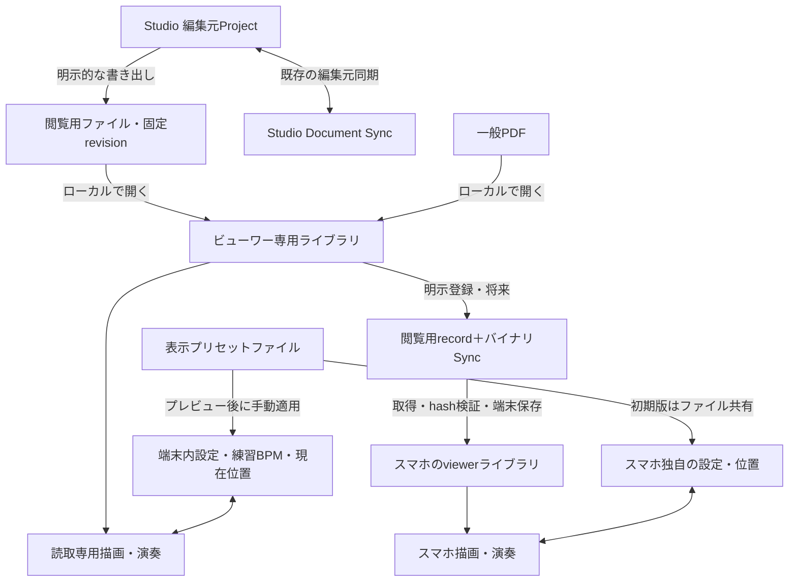

# 譜面ビューワー設計案

2026-11-16／調査・仕様・UI・開発計画のみ。製品実装は未着手。全体方針の確認後に実装する。

## 1. 結論と確認済みの方針

**独立した閲覧専用アプリを作り、Studioの「ツール」とPortの「ツール」から同じビューワーを開く。専用ファイルに譜面のスナップショットを封入し、元の曲と閲覧中の状態を分離する。** PCでは中央を広く使い、スマホでは画面全体を使う。演奏中に編集画面やフォーム登録画面へ入る操作は持たせない。

ユーザー回答により、次の3点は確認済み。

| 判断 | 採用する方針 | 設計への影響 |
|---|---|---|
| 初期版の音 | **伴奏・メロディ再生も含める** | 音とスクロールを同じ演奏時計で動かす。閲覧だけの段階は内部マイルストーンであり、初期版の完成とはしない |
| 設定の保存 | **端末別を基本に、表示プリセット共有も初期版に含める** | 位置・練習テンポは端末内。表示プリセットは独立したファイルとして受け渡せる。後の模擬Syncでも扱う |
| 元の曲の更新 | **再書き出し後に明示的に差し替える** | 更新を検出しても演奏中の譜面を変更しない。停止後に更新版を選び、適用する |

初期版の伴奏は、既存の登録フォーム・コード・ストロークによるギター音、メロディは既存のピアノ音を推奨する。独立したベース／ドラム生成、外部音源、録音再生は初期範囲に含めない。表示を隠しても音は消えない。「表示」と「再生設定」を分ける。

## 2. 調査基準と確認の限界

| 項目 | 確認結果 |
|---|---|
| 作業ディレクトリ | `/Users/murakamimasakuni/.codex/worktrees/score-feedback-one/Cruise_apps` |
| ブランチ／HEAD | `codex/score-toolbar-ui`／`bf533fe49b9cc5d28a7f9cbfab86e6479992fcb4` |
| ローカル候補／正式製品 | `0.143.2-dev.1`／`0.88.1` |
| 指定ローカルURL | `http://127.0.0.1:18874/`。今回、新規サーバー起動・画面操作は行っていない |
| 作業開始時のGit | 差分なし。別ブランチの旧レビューを現行仕様として扱っていない |
| 読んだ作業規則 | root `AGENTS.md`、Studio `ai-handoff/PROJECT_STATE.md`、`ai-handoff/AI_WORKFLOW.md` |
| 実施内容 | ローカルソース・文書の確認、既存の添付／Sync試験4ファイル、設計文書の作成 |
| 未実施 | アプリ実装、version bump、公開、実アカウント接続、認証・Sync設定変更、commit、push |

本書の「既存」は上記HEADのコードで確認した事実。「推奨」「予定」「目標」は未実装の提案。実機でのビューワー性能・スマホ音声・オフライン起動、実運用のSync設定は未確認である。

## 3. 既存資産と不足

### 3.1 Studio／Portの入口とファイル管理

| 対象 | 利用できるもの | 不足・必要な分離 |
|---|---|---|
| Studioツール | `shell.js`のworkspace、tool一覧、load/activate/deactivate、音声所有権の考え方 | 登録は複数箇所に分かれる。`centerTool`の許可対象も限定されており、ID追加だけでは中央表示にならない |
| Studio表示位置 | `workspace-scroll.js`のスクロールroot抽象化 | 現在のpx座標保存だけでは、回転・文字サイズ変更後の位置を復元できない |
| Portツール | `index.html`のカード、`practice-menu-app.js`のview/hash route、`tool-return.js`の戻り先 | 汎用登録APIではない。カード・route・画面ライフサイクル・戻る操作を追加する必要がある |
| Port添付保存 | IndexedDBにBlobを保存する添付ストア、上限検証、ローカルとクラウドの対応管理 | 練習メニュー所有の添付に限定。独立した譜面ライブラリではない。独自JSON MIMEも許可されていない |
| PDFを開く | 添付Blobを別ウィンドウへ渡す処理 | アプリ内PDF描画ではない。ページ座標、連続スクロール、回転後の位置保持を制御できるPDF描画層が必要 |
| 利用資格 | PortはStandard/Pro capabilityと既存認証を分離して管理 | 現行Standardでは添付書込・cloudSyncOperationsが無効。ビューワー追加を理由に既存資格を変更しない |

推奨配置は、新設候補 `apps/score-viewer/` に独立したビュー、保存、transportを置き、Studio/Portは入口とホストアダプターだけを持つ構成。埋込み表示／単独表示を同じ実装で扱う。共用する描画・音楽計算は、DOM・保存先・認証を持たないモジュールへ分離する。配置の細部は実装前に依存図で確定し、既存 `apps/shared/` へ安易に移さない。

Studioから開く場合は中央workspaceを既定とし、狭い右ツール枠を演奏画面の既定にしない。Portでもツール内の全幅画面へ遷移する。ホスト切替時には音声とRAFを確実に解放する。Studioの編集Projectをビューワーの保存先には渡さない。

### 3.2 譜面描画・再生・スクロール

| 既存処理 | 再利用の判断 |
|---|---|
| `sheet-renderer.js`、`paper-forms.mjs`、メロディ描画 | 譜面・フォームの投影と描画を再利用。現状は`CruiseStudio`／modelへの依存あり。モデル・フォーム解決器を注入する形へ分離する |
| 読み取り専用表示 | `editableSlots:false`だけでは不足。曲情報・セクションの編集属性、button role、編集用tabIndexが残る。明示的なreadOnly描画モードと専用操作ハンドラーが必要 |
| `paper-layout.mjs` | 正規化・レイアウト計算を再利用。現行のAppSetting／ブラウザ保存へ接続するUI部分は直接使わず、viewer専用保存へ注入する |
| `score-playback.mjs`、`score-harmony.mjs`、`chord-audition.mjs` | 和声の持越し、フォーム実音、上下ストローク、弦ごとの余韻の計算を再利用。既存の音楽的結果を変えないことを契約にする |
| `createPianoAudition` | AudioContext時計、ミキサー、音声調停、停止処理の考え方を再利用。ただし編集画面の大きなclosure内にあり、そのままビューワーから呼び出す設計にはしない |
| `followPlaybackBar` | 現在小節中心への平滑化とBPMに応じた速度制御がある。連続する行位置への補間と、手動閲覧を尊重する状態を別に実装する |
| 長い譜面の改善 | 現行の小節再利用、フォームSVGテンプレート、幾何更新の最適化を維持。スマホで全小節DOMを常駐させる性能は別途検証が必要 |

現行schema2は4/4、480 ticks/beat、1小節1920ticks、最大2048小節。任意拍子対応を初期版の既存機能として約束しない。曲内テンポマップも新設しない。既存の再生計画は作成時のBPMから秒へ変換するため、再生中のテンポ変更には拍基準の計画とスケジューラーの分離が必要である。

### 3.3 Syncのバイナリ対応：実装あり、用途は限定

**現行SyncはPDFのバイナリを扱える。** 根拠は練習添付用の`prepare → content PUT → commit → GET`、オブジェクトストレージへのput/get、Blobの取得後検証・ローカル保存までの実装である。関連するローカル試験61件が成功した。JSONに添付情報があるだけ、という判断ではない。

ただし、次の制限がある。

- Workerのasset prepareは`appId: port`と既知kindの許可リストに限定される。
- PDFは`practice_attachment_pdf`、所有者は`practice_menu`。ファイル名とownerRecordIdが必要。
- 現行添付は1練習につき10個、PDF／textは1個20MiBまで。これはビューワーの製品仕様として自動継承する値ではない。
- PDF内容の入口検証は`%PDF-`。完全なPDF解析・正常描画を保証しない。
- ダウンロード時にサイズ・MIME・SHA256を検証する。メタデータ同期済みでも、Blobの取得・保存完了まではオフライン閲覧できない。
- 書込・取得のfeature flag、Account/device/Pro資格の検証がある。今回、実環境の有効状態は確認していない。

推奨は、既存のバイナリ転送プロトコルを基に、**閲覧用ファイルのrecord種別とasset種別を明示的に追加する**方式。候補名は`viewer_document`、`viewer_score`、`viewer_pdf`。プリセットには別record種別を設ける。名称・appId・所有単位は模擬Sync段階で契約化する。

独自譜面JSONを`text/plain`に偽装したり、架空の練習メニューを所有者にしたりしない。旧クライアントが未知のrecordを削除しないよう、現行のcapability／対応schema交渉の考え方を適用する。Workerや実Syncの変更・接続は今回の作業に含まれない。

### 3.4 オフライン

Portには添付Blobのローカル保存がある。一方、調査したPort／Studioのアプリコードには、専用のService Worker登録や、必要資産一式のオフライン導入処理は見つからなかった。Studioの`app-refresh.js`は既存controllerを検知する処理であり、オフライン機能の実装ではない。manifestがあることもオフライン起動の証明にはならない。

したがって、**ファイルを保存済み**と**通信なしで起動・表示・再生できる**を分けて表示する。後者にはアプリ本体、描画ライブラリ、フォント、PDF worker、必要な音源の保存完了が必要。現行ギター／ピアノbankだけでもソースファイル合計は約5MBあり、復号後の音声メモリはさらに大きい。

将来の専用オフライン範囲はviewer配下に限定する案とし、既存認証やAPI応答を一括キャッシュしない。ホストの利用資格と通信なしの起動条件は別途確認する。認証を迂回してオフライン利用を成立させる設計にはしない。

## 4. ファイル方式と保存先

### 4.1 方式比較と推奨

| 方式 | 利点 | 不利な点 | 判断 |
|---|---|---|---|
| 現行の曲JSONをそのまま開く | 既存validator・描画への接続が早い | 編集元と閲覧配布物の区別が弱い。端末内表示設定を運べず、将来の形式判定も曖昧 | 移行用import候補。標準の受け渡し形式にはしない |
| 閲覧専用ファイル | 固定revision、初期表示、互換性を明示できる。更新を手動管理しやすい | 新しい外側の形式と書出し処理が必要 | **推奨** |

専用形式は、音楽内容を一から別schemaへ変換せず、**外側にviewer用の情報を設け、中に検証済みschema2の完全な音楽スナップショットを保持**する。二重の音楽仕様を作らず、登録フォームの欠落や音の不一致を防ぐ。編集履歴、Session、Account情報、同期資格、端末キーは含めない。schema内のprovenanceなどvalidatorに必要な情報は独断で削らない。

拡張子案は`.cruise-score.json`、識別子案は`format: "sound-cruise/score-view"`。一般JSONと区別する。閲覧専用はビューワーの動作制約であり、ファイルの暗号化や編集不能を保証するDRMではない。

### 4.2 含める情報

| ブロック案 | 内容・契約 |
|---|---|
| `format`、`formatVersion` | 外側の形式とversion。初期は1。ProjectのschemaVersionとは独立 |
| `viewerDocumentId`、`revisionId` | 同じ配布譜面の識別子と書出し版。別名で書き出す場合は新documentId、更新書出しは同じdocumentIdの新revision |
| `source` | projectId、書出し日時、Studio版、元内容のdigest。追跡情報のみ。自動同期や元Project書換えの権限にしない |
| `score` | schema2一式：曲情報、原BPM・拍子・ticksPerBeat、セクション、小節順、コード、歌詞、メロディの音高／開始／長さ／休符、キー・カポ・チューニング |
| score内の素材・演奏情報 | 登録フォームsnapshot、formBindingsとplayedStrings、基本／小節別rhythm snapshot、down/up/mute/rest・accent、対応する音価情報。素材ID参照だけにせず実体を同梱 |
| score内の譜面配置 | notationと`extensions.scoreLayoutV1`を保持。空き枠は表示専用で演奏時間を増やさない。スマホの自動折返しと、元の改行を尊重する表示モードを区別 |
| `defaultPresentation` | 書出し時の表示／非表示、文字・フォームの相対サイズ、書体の許可ID、ズーム方針、小節／行の希望。端末のpx位置は入れない |
| `requires` | 必須の形式・描画・素材encoding・再生能力。未対応の必須項目を黙って欠落させない |

原本ファイルのbyte hashと、音楽snapshotのcanonical digestを区別する。前者は転送検証、後者は音楽内容の比較に使う。自身を含むhash計算を避けるため、ファイル全体のhashはライブラリrecord側に持つ。書体や音源は同梱アプリの許可IDへ解決し、ファイル内のURL／スクリプト／任意HTMLを実行しない。

登録フォームの実体が欠けるファイルは、別フォームへ黙って置き換えない。譜面表示が成立する場合は閲覧を許可し、再生不可のパートと理由を示す。参考和音による代用は利用者が明示的に選ぶ場合に限る。再生に未対応のタイ等も、表示できることと同じ意味にしない。

### 4.3 端末設定・共有プリセット・更新

| 保存物 | 保存先案 | 同期・更新 |
|---|---|---|
| 独自譜面／PDFの原本 | viewer専用IndexedDBのdocuments/revisions。Blobまたは元JSON bytesを保持 | 将来、明示的にSyncへ登録。編集元Projectとは別record |
| ライブラリ索引 | 文書ID、revision、hash、名前、種類、保存状態 | 将来の閲覧用record。演奏中のactive revisionと別管理 |
| 表示・練習BPM・ミキサー・閲覧位置 | viewer専用preferences。端末／ブラウザprofile内、文書ID＋revisionに紐付け | 自動同期しない。StudioのAppSettingを上書きしない |
| 表示プリセット | viewer専用presets＋`.cruise-view-preset.json`の入出力 | 初期版でファイル共有。後の模擬Syncでrecord共有。受信後の適用は手動 |
| PDF送り設定 | PDF byte hashに紐付く端末設定 | 初期は端末別。共有する場合は将来の譜面別送り設定として、一般表示プリセットと分ける |

プリセットは表示項目、文字・フォーム倍率、配色、折返し方針を対象とする。**練習テンポ、現在位置、音量、個別曲のPDF送り設定は含めない。** 端末幅に合わない固定列数は適用前に案内し、自動折返しへ変換できるようにする。適用前にプレビューし、取消可能にする。

初回はファイルのdefaultPresentation、既読なら端末保存設定を復元する。明示的にプリセットを適用したときだけ端末設定を更新する。縦横では折返し・ズームの設定を別にできるが、曲の現在拍は共通とする。StudioホストでlocalStorageを使う小設定は`cruiseStudio.viewer.*`に分ける。機微な情報は保存しない。

同じ譜面の新版を受け取ってもactive revisionを即時変更しない。「更新版あり」を表示し、停止後の「差し替える」で切り替える。同じbarIdが残る場合のみ位置を移せることを案内し、ない場合は先頭を選ぶ。PDFは新版の座標を自動継承せず、先頭へ戻す。旧版は差し替え完了まで残し、少なくとも直前版へ戻せる。演奏中の削除も保留し、参照中Blobを破棄しない。

## 5. 演奏・連続スクロールの動作仕様

### 5.1 共通時計

状態は「未読込／読込中／準備完了／演奏中／一時停止／再開操作待ち／読込失敗」。練習BPMは原BPMと別値にし、20〜400の現行対応範囲を初期候補とする。「原曲に戻す」で原BPMへ戻る。元scoreを更新するsetterは提供しない。

音を使うときはAudioContext時計、音声なしでは単調増加時計をtransportへ注入する。現在位置は秒だけでなく`barId + tickInBar`で保持する。全音量ゼロでもtransportは進む。

テンポを変える瞬間の現在tickを確定し、そのtickを新しいBPMの起点にする。先の音は短い範囲だけ予約し、変更前の未発音予約を失効させて再計算する。鳴っている弦を毎フレーム作り直さない。音高は変えず、音価による停止時刻・次の打弦を拍位置に合わせ、自然減衰の音色処理と分ける。音の重複、古い予約の鳴り残り、テンポ変更のたびに先頭へ戻る挙動を試験で防ぐ。

### 5.2 連続スクロール

独自譜面は小節・行の描画座標と拍位置を対応させ、**1行に含まれる演奏時間に応じて縦位置を補間**する。小節が変わるたびに中央へジャンプする方式を主にしない。行の高さが文字サイズや表示項目で変わっても、音楽の長さは変わらない。読み取り基準線は画面上部から約1/3を初期案とし、冒頭・末尾は範囲内に収める。

「ページ送り」は別モード／将来候補。連続スクロールの速度や位置をPDFのページ切替へ読み替えない。手動の前後移動は初期版にも持てるが、自動ページめくりは後回しとする。

| 操作・事象 | 推奨する挙動 |
|---|---|
| 開始 | 必要資産の準備後、ユーザー操作で開始。既定は保存した拍から。初回は先頭 |
| 一時停止／再開 | 音と時計を止め、同じ拍から再開。停止ボタンで勝手に先頭へ戻さない。「先頭へ」は別操作 |
| 再生中の手動スクロール | viewportの自動追従だけを解除。演奏時計と音は継続。「現在の演奏位置へ」を表示。次の小節で勝手に戻さない |
| 「現在の演奏位置へ」 | 現在拍へ移動し、連続追従を再開。演奏位置を変更しない |
| 別の場所から演奏 | 一時停止後、小節を選んで「ここから再生」。単なるスクロールをseekとみなさない |
| 停止中の手動閲覧 | 閲覧位置を保存。演奏再開位置は維持し、再開時はその拍へ戻ることをボタン横に表示する |
| テンポ変更 | 拍位置を保持。自動追従中は新テンポに連動、追従解除中は手動の表示位置を保持 |
| 文字サイズ・表示項目の変更 | 基準のbarId／拍／画面内相対位置を取得して再配置。音の時計は継続。再配置が間に合わない場合は音と時計を一緒に一時停止 |
| 回転 | 閲覧中は先頭に見えている小節＋画面内相対位置、演奏追従中は現在拍を保持。音の時計を継続して座標を再測定し、元の追従状態を復元。PDFはpageIndex＋ページ内比率で復元 |
| 音声Context中断・画面非表示・ホスト離脱 | 音とtransportを一緒に停止。復帰時に経過分を飛ばさず、保存拍から明示的に再開。回転だけでContextが中断された場合も同じ |
| 最終小節／PDF末尾 | 末尾で停止。勝手な先頭戻り・ループをしない |
| ファイル変更／新版適用 | 再生中は適用不可。停止後、検証済みデータへ原子的に切替 |

native位置は小節ID＋拍、PDF位置はページ＋正規化座標を正とする。scrollTopは復元の最終計算結果であり、唯一の保存値にしない。手動閲覧のanchorと演奏cursorも別に保存する。

### 5.3 PDFの送り

通常PDFから拍・小節・コード・音符を取得できる前提にしない。初期PDFは以下の2モードとする。

1. **時間で送る：**「1ページを何秒で送るか」を入力する。連続配置したページをその時間で縦移動する。ページ間隔は演奏時間を増やさず座標上の余白として扱う。BPMと同期しているとは表示しない。
2. **拍数で送る：** BPMと「1ページの拍数」を利用者が入力する。必要ならページごとに拍数を上書きできる。1ページの時間は`拍数 × 60 / 練習BPM`。ページ内は等速という近似であり、余白・不均等な段・反復に完全追従しない。

PDFを開いただけでは自動送りを開始せず、初回に送り設定を求める。送り速度の試走と先頭位置調整をできるようにする。ピンチズームの倍率とページ寸法から移動距離を再計算する。横方向は利用者の操作を保持し、自動では移動しない。PDFには原曲BPMがないため、入力値は「送り用BPM」と呼ぶ。

PDFで鳴らせるのは任意の拍音／カウントインのみ。伴奏・メロディの生成やOMRは行わない。精密な追従が必要な場合の「ページ内位置と累積拍のアンカー登録」は追加候補。D.C.などの演奏順も自動解釈せず、初期はファイルのページ順で進む。

## 6. UI案

全画面共通で、演奏中の主操作は「開始／一時停止」「テンポ」「現在の演奏位置へ」。編集用ツールバー、保存／Undo、フォーム登録、文字入力による譜面編集は表示しない。原BPMはテンポ設定内に示し、練習BPMと取り違えない。

### PC：中央の広い譜面、下部の演奏バー

```text
┌ Studio ツール → 譜面ビューワー ───────────────────┐
│ [ファイル]  曲名・版       [表示] [再生設定] [全画面]│
├─────────────────────────────────────────────────┤
│ Aメロ                                            │
│ C            G             Am            F       │
│ フォーム ／ ストローク ／ 歌詞 ／ メロディ          │
│                                                 │
│             次の行がゆっくり近づく                │
│                                                 │
├─────────────────────────────────────────────────┤
│ [▶ 開始] [先頭]     −  96 BPM  ＋    12 / 64 小節 │
│             [現在の演奏位置へ] ※追従解除時のみ     │
└─────────────────────────────────────────────────┘
```

「ファイル」は開く／ライブラリ／更新版へ差し替え。「表示」はパート、文字、フォーム、ズーム、表示プリセット。「再生設定」は伴奏・メロディ・拍音の音量とカウントイン。通常時に設定パネルを常駐させない。

### スマホ縦：1〜2小節で折り返し、下部に大きな操作

```text
┌────────────────────────┐
│ ‹ ツール  曲名       ⋯ │
├────────────────────────┤
│ Aメロ                  │
│ C           G          │
│ フォーム・歌詞         │
│ メロディ               │
│                        │
│ Am          F          │
│ 次の行                 │
│                        │
├────────────────────────┤
│ [▶ 開始]  [− 96 ＋] [⚙]│
│ 12 / 64   [演奏位置へ] │
└──── 下端safe area ──────┘
```

下部から設定シートを開く。表示／再生はシート内で分ける。主ボタンは最低48px程度の押しやすさを目標にする。文字サイズを読める範囲に保って折り返し、A4全体の縮小を既定にしない。PDFはページ画像なので文字だけの拡大はできず、幅合わせ／ズームで対応する。

### スマホ横：ヘッダーを畳み、低い演奏バー

```text
┌──────────────────────────────────────────────────┐
│ 曲名                                      [⋯]    │
│ C          G          Am          F              │
│ フォーム ／ ストローク ／ 歌詞 ／ メロディ         │
│ 次の行                                           │
├──────────────────────────────────────────────────┤
│ [Ⅱ 一時停止]   [− 96 ＋]   12/64  [位置へ] [⚙]   │
└──────────────────────────────────────────────────┘
```

回転時に譜面先頭へ戻さない。ノッチ・safe areaを避ける。演奏中も一時停止は隠さず、その他の説明や装飾を畳む。全画面APIが利用できない場合でも、ホストUIを畳む「譜面を広く表示」を提供できる設計にする。

## 7. 独自譜面とPDFの機能比較

| 機能 | 独自譜面 | 通常PDF |
|---|---|---|
| 内容の編集 | 不可 | 不可 |
| コード／フォーム／歌詞／メロディ等の表示切替 | 可 | 不可。1ページの画像として表示 |
| 文字／フォームの個別サイズ | 可 | 不可。ページ全体のズームのみ |
| 幅合わせ・ズーム・縦横対応 | 可。再折返し | 可。ページ配置と倍率を変更 |
| 原BPMと練習BPMの分離 | 可 | 原BPM不明。送り用BPMを利用者が入力 |
| 連続自動スクロール | 小節・拍位置を使用 | 秒／ページ、または設定した拍数／ページによる近似 |
| 伴奏・メロディ再生 | 対応する素材／音域の範囲で可 | 不可。PDFからの音楽認識は対象外 |
| 拍音／カウントイン | 可 | 設定BPMに対して可。楽譜の拍との一致は保証しない |
| 表示プリセット共有 | 表示パート・文字等 | 配色・倍率方針等、対応項目のみ |
| 再開位置 | 小節ID＋tick＋閲覧anchor | ページ＋ページ内相対位置 |
| オフライン | 本体・譜面・音源等の保存後 | 本体・PDF・描画資産等の保存後 |
| 将来Sync | 新しい閲覧用record／assetが必要 | バイナリ基盤は既存、閲覧用の所有関係が必要 |
| 自動ページ送り | 後の追加候補 | 後の追加候補。連続送りと別設定 |

## 8. データの流れ



編集元Syncと閲覧用Syncに自動的な書戻し経路を作らない。共有プリセットは設定のスナップショットであり、受信した端末の表示を自動変更しない。現在位置／練習BPMはSyncへ送らない。

将来の転送は、①Blob保存 ②アップロード完了 ③閲覧recordで参照 ④他端末に索引を取得 ⑤Blob取得・検証 ⑥ローカル保存完了、を区別する。途中失敗は再試行可能にし、索引だけ届いた項目を「保存済み」と表示しない。端末容量不足でも現在開いている譜面を削除しない。

初期プリセット共有は書出し／読込ファイルで完成させる。端末間Sync経由の共有は模擬Sync段階で契約と動作を検証し、実アカウントでの利用は別工程とする。

## 9. 性能・互換性・失敗時の扱い

- **長い譜面：** 12／128／256小節を既存基準にし、2048小節の上限例も追加する。行の高さ索引と安定IDを持ち、画面付近の描画へ絞れる構造にする。音声は短い先読み予約とし、全曲のAudioNodeを一括作成しない。現在版の幾何更新最適化を退行させない。
- **PDF：** ページ寸法の軽い索引を先に作り、見えているページと前後だけ描画する。遠いページのcanvasは解放し、高倍率・DPRを制限できるようにする。初期候補上限は20MiB／200ページ。大量画像PDFでは、byte数だけでなく総画素・復号メモリにも上限が必要。数値は実機計測で確定する。
- **独自ファイル上限：** 現行schemaの2048小節と`JSON.stringify(project).length * 2 <= 8MiB`という検証予算を維持する。これはUTF-8ファイルサイズ8MiBと同じ意味ではない。外側ファイルにも別のbyte上限を設け、実装前に正常fixtureの最大サイズから決める。巨大入力をparseする前に拒否する。
- **性能目標：** 対象スマホを1台以上決め、連続送りの95%のフレーム間隔が33ms以内、テンポ変更で現在拍の飛び・重複発音なし、回転後に同じ小節／PDF内の目印を保持することを測る。現時点の達成値ではない。10分再生や連続20回の開閉・回転でもDOM／canvas／音声メモリが増え続けないことを確認する。
- **互換性：** formatVersion、schemaVersion、必須能力を個別検査する。未知の必須音楽形式は開けない理由を示す。未知の任意表示設定のみ安全な既定値へ戻し、そのことを知らせる。旧曲JSONの互換importはコピーに対してのみ行い、元JSONを上書きしない。
- **読み込み失敗：** 検証と最初の描画準備が完了するまで今の譜面を保持する。JSON破損、参照不整合、未対応形式、サイズ超過、PDF解析失敗、容量不足を区別して案内する。失敗した入力を一部切り捨てて成功扱いにしない。
- **PDFの制約：** 暗号化／パスワード付きPDFは初期対象外として明示。破損ページはページ番号と再試行を示し、継続不能なら送りを停止する。PDF内スクリプトを実行せず、外部リンクは演奏中の誤操作を避ける。PDFエンジンとworkerは導入時に公式資料・ライセンス・対応版を確認し、固定して同梱する。今回は導入もネットワーク調査も行っていない。
- **保存不可：** 閲覧できても端末保存に失敗した場合は「今回のみ」と表示し、オフライン保存済みにはしない。ブラウザによる容量解放の可能性もあるため、起動時に実体を確認する。

## 10. 段階的な開発計画と完了条件

今回の成果はこの設計まで。以下は承認後の実装計画であり、実施済みではない。各段階で本番・実アカウントを使わず、ローカルfixture／模擬adapterを使う。

| 段階 | 作るもの | 完了条件 |
|---|---|---|
| 0. 契約と再利用境界 | ファイルschema、readOnly描画境界、拍時計、保存adapter、基準fixture | Studioの登録フォーム・歌詞・ストローク・メロディ・空き枠を欠落なく表現。Editor/Repositoryへの書込依存がない。再利用部分の現行描画・発音結果と比較できる |
| 1. 独自譜面のローカル閲覧MVP | 書出し、読込、独立viewer、Studio入口、最低限の縦横layout | ファイル検証後に表示。編集操作ゼロ。開閉・表示変更でも元Projectとファイルのdigest不変。破損入力でも現在譜面を保持。これは内部MVP |
| 2. 表示・音・テンポ・連続送り | パート切替、文字・zoom、表示プリセット入出力、伴奏／メロディ／拍音、練習BPM、一時停止、追従解除／復帰 | **ユーザー回答を満たすローカル初期版**。別profileでプリセット往復。登録フォームどおりの発音、上下ストローク・余韻、テンポ変更・停止・再開・手動scroll・回転を確認。曲JSONへの書戻しゼロ |
| 3. PDF | アプリ内描画、仮想化、ズーム、秒／ページと拍数／ページの送り | 一般PDFで連続送り。拍情報なしでも設定から使える。20MiB／200ページ候補を測定し上限確定。パート切替不可等をUIに明示。破損・暗号化・回転を確認 |
| 4. Port・スマホ・オフライン | Port入口、戻る操作、縦横調整、専用保存・必要資産のoffline準備 | PC／スマホ縦横で停止操作と現在位置を保持。通信遮断後の冷起動で保存済み独自譜面・PDFと音を使える。資格に依存する経路は既存方針を確認し、模擬検証と実機未確認を区別する |
| 5. 模擬ストア／模擬Sync | 閲覧record・score/PDF asset・表示preset、revision差し替え、再試行 | 分離した2つのbrowser profile間でファイル実体を転送・hash確認。索引だけの状態、破損、容量不足、競合revision、未知record、旧client、削除、転送中断を検証。演奏中の内容は固定。元Project同期へ影響なし |

基本のスマホ折返し・回転試験は段階1から行い、段階4で実機とオフラインを完成させる。段階4のService Worker／manifest、段階5のWorker変更は、既存の「不触」規則を越えるため、その段階の実装範囲を明示して確認してから行う。今回は変更しない。

実Syncへの接続、Standard/Proへの提供範囲、公開手順は上記の完了条件に含めない。別の承認・運用工程が必要で、現在の認証やSync設定を変更して先回りしない。

## 11. 優先順位と確認事項

### 着手前に守る優先順位

| 優先度 | 項目 | 理由 |
|---|---|---|
| P0 | 元データ不変、readOnly境界、登録フォーム／素材の完全性 | 演奏用ファイルが曲を変えたり、意図しない音を出したりしないことが前提 |
| P0 | 拍時計を中心に音・テンポ・送りを統合 | 初期版に音を含めるため、スクロールだけ先に独自時計で完成させると手戻りが大きい |
| P0 | 連続送り、手動追従解除、停止・再開、回転位置保持 | 演奏中の操作と読みやすさに直接関わる |
| P1 | 独自ファイルと端末設定、presetの保存分離 | 端末間共有と演奏中の固定を両立する |
| P1 | PDFと大量ページ、オフライン完了状態 | PDFの既存添付機能だけでは要件を満たせない |
| P1 | 閲覧専用record／assetの模擬Sync | 編集元同期との混同、旧clientとの不整合を避ける |

### 必須機能と追加候補

ユーザー要件にある読取専用、独自譜面／PDF、表示調整、音、練習テンポ、連続送り、縦横対応、端末別設定、表示preset共有、閲覧ファイルのSync設計は必須。オフラインは演奏用途の信頼性のため段階4の必須完了条件にする。

| 候補 | 優先度・導入時期 | 評価 |
|---|---|---|
| 全画面／ホストUIを畳む | P1、段階2〜4 | 譜面面積への効果が大きい。API非対応でも画面内拡大を残す |
| 画面ロック防止 | P1、段階4 | 演奏中に有用。対応検出、取得成功／解除状態を表示。復帰時の再取得と停止後の解放を確認する |
| 任意の1小節カウントイン | P1、段階2 | 既存実装あり。両手を構えて開始できる。既定OFF、停止からの単純再開では毎回鳴らさず、開始設定と区別 |
| キーボード基本操作 | P1、段階2 | Spaceで開始／停止、明示的な前後移動。入力欄・IME・dialog内では奪わない |
| 足踏みペダル | P2、段階4以降 | キーボード信号を出す機器から始める。割当変更と長押し／連打抑制を追加。独自Bluetooth接続は初期に行わない |
| セットリスト・次の曲 | P2、基本viewer安定後 | 演奏準備に有用。曲切替と音声停止の契約が固まってから |
| A–Bループ・しおり | P2 | 練習に有用だが、まず一方向の送りを安定させる。既存ループを直結して状態を増やさない |
| PDF内の拍アンカー／演奏順指定 | P2 | 不均等な段や反復に有効。追加設定UIが増えるため単純送りの次 |
| 自動ページ送り | P3 | 連続送りとは別モード。初期の中心機能にしない |
| OMR・手書き注釈・外部音源 | 保留 | 認識精度、編集との境界、保存形式が増える。今回の目的に不要 |

### 回答が必要な判断と、回答不要で進められること

最初の重要な3問は回答済みで、追加の同じ質問はしない。**実装着手に必要なのは、この設計全体と段階0〜2の範囲への確認**である。回答待ちを理由に残す調査事項はない。

確認時に変更希望があれば優先して扱う論点は、①伴奏の初期範囲を既存ギター＋メロディのピアノとすること、②表示プリセットの初期共有をファイル入出力で完成させること、③PDFの送りを秒／ページまたは手入力の拍数／ページで始めること。いずれも本書では推奨案を置いてあり、今回の調査を止める質問ではない。

将来の実アカウント接続前には、提供エディション、viewer recordの所有者／appId、オフライン時の利用資格を運用上決定する必要がある。現在の資格を推測で変更せず、模擬Syncまでの設計・検証とは切り分ける。

## 12. 根拠ソースと実施した検証

以下は調査したHEADにおける位置。行番号は今後の変更で動く。

| 確認内容 | ローカルソース |
|---|---|
| Studioツール・中央表示 | `apps/cruise-studio/js/shell.js:8,65,70,77,90,110` |
| スクロールroot | `apps/cruise-studio/js/core/workspace-scroll.js` |
| 読取専用化の不足 | `apps/cruise-studio/js/modules/sheet-cruise/sheet-renderer.js:242,300,329,341` |
| 描画設定・フォーム | `apps/cruise-studio/js/modules/sheet-cruise/paper-layout.mjs`、`paper-forms.mjs` |
| 音声時計・追従 | `apps/cruise-studio/js/modules/sheet-cruise/sheet-cruise.js:1667,1756,1798,1809,1848` |
| 音楽計画・和声 | `apps/cruise-studio/js/modules/sheet-cruise/score-playback.mjs:6,62,80,103`、`score-harmony.mjs` |
| schema制約・フォーム・配置 | `apps/cruise-studio/js/core/schema2.js:8,182,189,196,231,243` |
| Studio編集元JSON同期 | `apps/cruise-studio/js/cloud/document-codec.mjs:7` |
| Port入口・routing | `apps/cruise-port/index.html:94`、`practice-menu-app.js:899,970`、`tool-return.js` |
| 添付Blob・上限・PDF別窓 | `apps/cruise-port/practice-menu-attachment-store.js:3`、`practice-menu-file-open.js:1` |
| バイナリ転送・取得・実体保存 | `apps/cruise-port/port-asset-sync.js:47,373,422,584` |
| 添付kind／owner／MIME制約 | `workers/sound-cruise-sync/src/asset-validation.js:1,55,86` |
| 添付record契約 | `workers/sound-cruise-sync/src/record-schema-registry.js:130` |
| 実体put/get | `workers/sound-cruise-sync/src/app.js:353,384,425,436` |
| エディションと資格境界 | `apps/cruise-port/cruise-port-capabilities.js:14`、`sync-capabilities.js` |

実行した既存試験：

```sh
node --test \
  workers/sound-cruise-sync/test/asset-validation.test.js \
  workers/sound-cruise-sync/test/asset-app.test.js \
  apps/cruise-port/port-asset-sync.test.mjs \
  apps/cruise-port/practice-menu-attachment-store.test.mjs
```

**61成功、0失敗、0skip。** ローカルfixture／模擬ストレージによるprepare/upload/commit/download、PDF所有関係、内容偽装拒否、取得内容検証、ローカル保存などの確認。実サービスの設定や接続状態の検証ではない。ログは`/tmp/score-viewer-research-assets-20261116.log`。

今回の変更は本設計書とPROJECT_STATEの調査記録のみ。アプリコード、公開HTML、音源、認証、Sync設定、Worker、Service Worker、manifestは変更していない。
