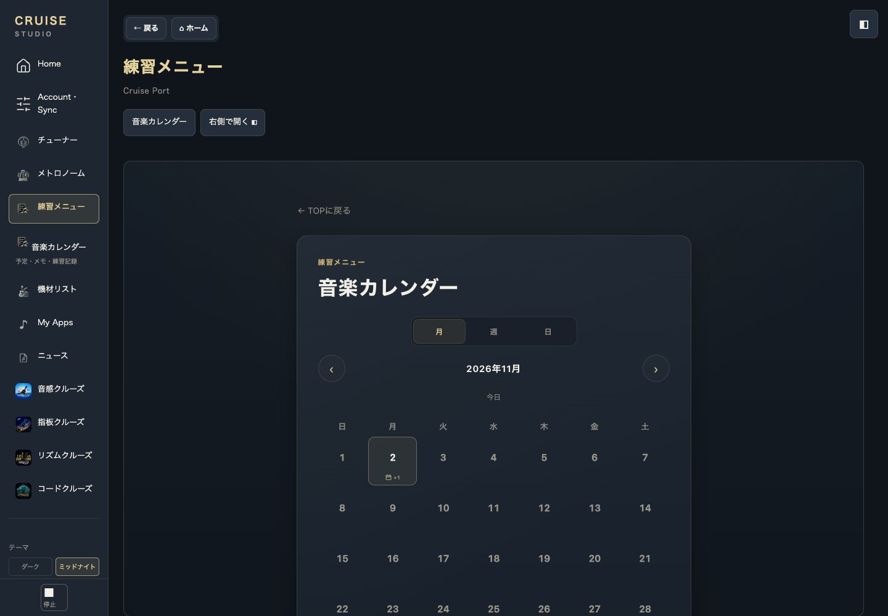
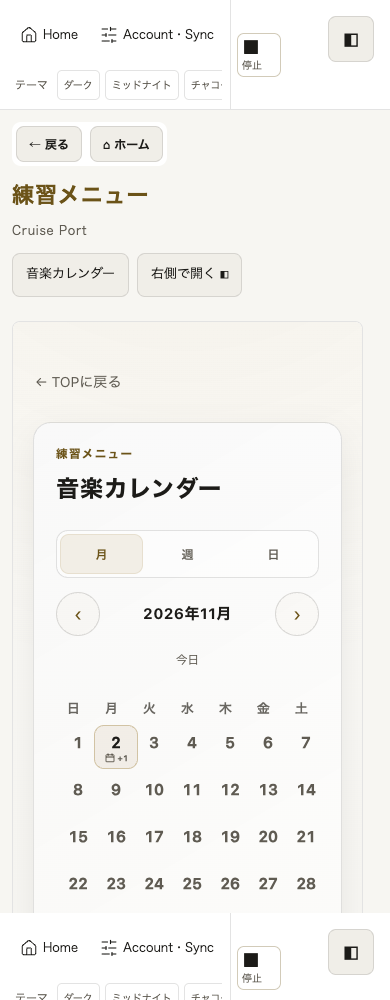
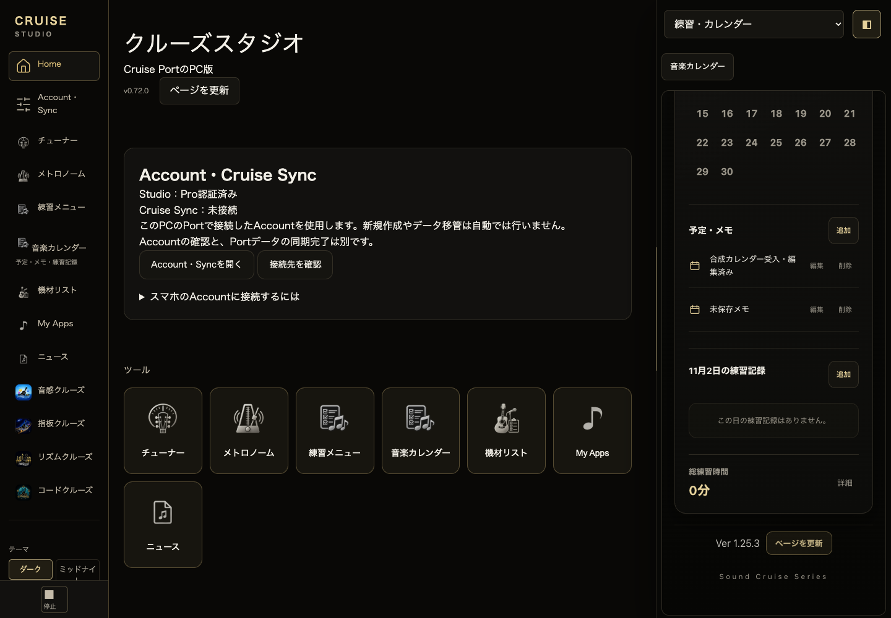

# Studio 0.72.0 candidate: native calendar and four-app Sync diagnosis

## Completion boundary

The native Port calendar is connected and synthetically accepted. **Four embedded apps still do not perform Cloud Sync. This draft is partial delivery and does not complete the requested four-app integration.** No main merge or publication is authorized or performed.

Base: public main `17f29d54f9c8f74657f2b0d74a8492f80caede10`, tree `3670d65d5e1a81b300da63a7551b0c33858fb5ed` (merged #171). Port remains 1.25.3. New isolated branch: `codex/studio-app-sync-calendar-20261102`.

## Four-app root cause (confirmed)

`js/modules/series/internal-app.mjs` fetches the original Pro HTML into an inherited-origin srcdoc iframe, preserving original application controllers and local stores. Its script filter deliberately removes shared scripts and all `/sync/` scripts. It also hides `[data-sync-join-entry-host]` and drops the native Sync styles. Thus neither native AppDevice binding nor native startup/first-receive runs in Studio. Pro admission and Port dataset Sync do not establish four independent AppDevice sessions.

The canonical Pro URL supplies resource resolution through `<base>`; it is not a separate Studio storage copy. Merely reconnecting Port Account or changing the app URL cannot restore the removed runtime. A standalone app connection alone also cannot make this embedded page keep synchronizing while its scripts are excluded.

Read-only inspection of the existing Chrome Clooney Studio tab found an authorized entrance and no mounted app frames at observation. Existing database metadata: pitch/fretboard/rhythm Sync DBs absent; Chord DB present at version 2 but no object stores. No Account IDs, credentials, payloads, images or phone records were exported. No real app was opened to trigger Sync, and no real synchronization or storage mutation was performed. These observations prove absent local bindings, **not** phone/Mac record equality or the cause of any individual record difference.

Port Sync Center's app membership/device `synced` presentation is server-side connection information. It is not a comparison of this Mac's embedded local records with the phone. The candidate labels each embedded app as using local data with embedded app Cloud Sync unsupported, so the limitation is visible.

### Why simply restoring all scripts is unsafe

Pitch/Fretboard/Rhythm use `multi-app-sync-bootstrap.js` and the existing MultiApp runtime; Chord uses its native `sync-bootstrap.js`, `sync-account-orchestration.js` and bridge/client. Legacy stores are app-scoped and may retain a different Account's credential, shadow, pending writes or local records. The three-app bootstrap does not pass its runtime's available `assertCurrent`, `assertCurrentAsync` or host lifecycle options. A native handoff can initialize/merge a local snapshot. Enabling those paths unconditionally would fail the explicit no-foreign-adoption requirement. No new engine, copied sync algorithm, fixed Pro credential or unconditional handoff was added.

**Remaining minimal implementation:** retain the native startup modules and connection/merge UI, bind each native owner to the admitted Studio Account/lifetime using existing runtime guards, validate the native AppDevice binding and local/shadow/pending attribution before resume, and use existing Account handoff only for a proved empty/same-Account connection. Chord needs its existing bridge path, not the three-app runtime. Accept all four using synthetic native app datasets, foreign credentials/pending data, Account changes/revocation and lifecycle tests before removing the unsupported label. The exact factory wiring is not yet implemented or accepted.

## Calendar implementation (completed)

The native calendar already existed at `#practice-menu/calendar`, previously accessible only through the practice list's history icon. Studio lacked a direct Home/sidebar entry.

- Home, sidebar and practice actions now open that route through the existing single `portPractice` owner and original Port iframe.
- A direct Calendar entry waits for native `studio-port-ready`, because asynchronous native boot normalizes the hash. The existing practice/Sync initial routing remains unchanged.
- Existing native calendar render, memo editor, records, repository and `cruisePort.practiceCalendar` are reused. `calendar_event` remains part of normal Port dataset Sync. No calendar model or save path was copied.
- Calendar form navigation is confirmed before discard, cancellation retains input; explicit discard invokes the native Calendar cancel action so pane close can finish. A reproduced Global Stop bug destroyed the iframe through coordinator cleanup before the existing local preserve-editor handler ran. That cleanup now also honors preserve-editor for global-stop: the existing timer is paused, tracked microphone streams stopped, the audio lease is released, and the form/document and native save path remain usable. Visibility handling also retains the editor.
- Same iframe survives center-to-right transfer, including current calendar/editor state. Reopening/reloading restores native persisted notes.
- Release manifest now reads the version from the actual `CS.portPC` bootstrap instead of emitting the stale fixed 0.71.1.

## Synthetic acceptance

- Actual release Studio entrance + native Port, local Miniflare/SQLite/R2 only: **41/41**, no page errors, zero Production requests. Includes calendar UI save -> Port Sync -> standalone Port displaying the same note.
- Existing native photo/icon/attachment/ACK-loss/CAS/conflict recovery: **12/12**.
- Actual Studio product UI: **16/16** (5 internal-app/calendar/layout tests + 11 Account/NEWS tests). App tests establish local native UI/preset/theme/ownership behavior, **not Cloud data equivalence**.
- Related Studio admission/Account/license Node: **36/36**. Native calendar/keyboard/Port adapter Node: **87/87**. No skip or assertion relaxation.
- Calendar UI: add, edit, delete, reload, cancel unsaved navigation/pane close, explicit discard, Global Stop draft retention/lease release/subsequent save, same-frame right transfer, five themes x 1440/1024/768/390, no outer horizontal overflow.
- Actual safe Jekyll build: exactly **34** release files with matching hashes; development Project/Pre-DTM/Project Sync files absent; **811** Port/apps/shared distributed files byte-identical to source. Native product and Worker Git trees unchanged (hashes in RESULTS.json).

During validation, selecting the default practice route after readiness disturbed a pre-existing Sync reload route; it was restricted to the new direct Calendar route. Recovery initially stopped 8/12 at a now-hidden route control; after this product fix the unchanged recovery suite passed 12/12. A separate synthetic old-Account fixture raced its native `gear_order` capture against manual Outbox seeding. It now finishes the genuine A save and disposes that synthetic runtime before seeding the exact retained pending operation. Full equality/no-foreign-request assertions are unchanged. A later concurrent product/recovery run timed out at the unchanged standalone Pro-detach case after 8 passes; its cause was not established and no production code or timeout was changed to make it pass. The final candidate then passed the entire product suite 41/41 serially; final recovery passed 12/12, and the final calendar UI test passed with Global Stop draft retention and audio-lease release. Do not interpret this as repeatability or real-device acceptance.

## Screenshots

## Real acceptance and next steps

Production remains Studio 0.71.3 / Port 1.25.3. The candidate is 0.72.0 because it adds a visible direct Calendar entry. No real credentials, Account changes, sends, deletion or disconnects were used. Phone native product files, all four native apps, shared, Worker and Pages settings are unchanged.

Loopback synthetic UI preview: `http://127.0.0.1:52241/apps/cruise-studio/index.html`. **Use synthetic data only; do not enter real Account/Pro credentials.** This fixture substitutes authorization only on loopback and blocks external connections. It is not real Sync acceptance.

After an explicitly approved later release, Calendar can be checked with one identifiable memo on one device, existing normal Sync, then display on the other device. Four-app real data equality remains unaccepted; do not clear storage, disconnect/rejoin, or press native app handoff controls as an assumed repair. Complete the native embedded Sync connection described above and its synthetic acceptance first, then have the operator compare one known supported saved item per app on the same Account. Device-only preferences are not necessarily a Sync mismatch. Native adapters define the actual synchronized fields.
