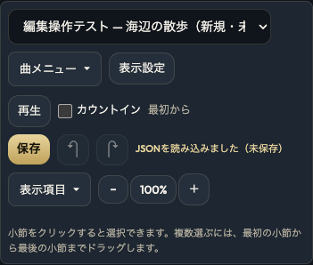

# 譜面再生の1小節カウントイン — 2026-11-16

ローカル候補 **0.136.0-dev.1**、基準`7f69b433`、ブランチ`codex/score-toolbar-ui`。0.132〜0.135.1の未コミット差分を保持。正式0.88.1・本番配信・公開HTML・認証・実Account/Sync・他アプリは無変更。コミット・pushはしていない。

## 操作

上部の「再生」の隣に「カウントイン」のチェックを追加。初期値はオフ。オンにすると曲のBPMで1小節（現行Projectの4/4、4拍）を鳴らしてから再生する。最初の拍だけ高いクリック音とし、「カウント 1 / 4」から拍数を表示する。

譜面の「再生」ボタンと譜面上のSpaceが対象。最初から／選択小節から／選択セクションからの既存の開始位置を維持する。範囲ループでは開始時の1回だけカウントし、2周目以降の周期へカウント時間を含めない。編集カードの1／2小節試聴、単独コード、コード進行、メロディ試聴には付けない。

カウント中は譜面の再生ハイライト・現在地の棒・追従スクロールを進めない。選択状態はそのまま保持する。停止・全停止・画面離脱・曲変更・Session無効化・非表示で予約済みのクリックと曲を停止し、戻っても自動再開しない。未保存の画面移動確認を開く場合も、確認を出す時点で停止する。確認をキャンセルしても停止のまま。

チェックは既存`cruiseStudio.appSettings`の`scoreCountIn`にbooleanで保存する。他の設定を保持し、欠損時はfalse。曲Project・Undo・JSON・MIDI・Account/Syncには追加しない。保存失敗時はこの画面内だけに適用し、既存の設定原文を保持する。不正な入力やIME変換中は変更できない。編集カードの「？」にも説明を追加した。



## 音声と状態の境界

`score-playback.mjs`の`buildCountIn`はBPMと現行の4/4を検証して、独立したpre-rollを生成する。Projectのtick・音符・BPMや通常の再生planは変更しない。音源は短い減衰クリックをローカルで生成し、外部取得・別AudioContext・別schedulerは追加しない。

既存`createPianoAudition.playEvents`へ任意のpre-roll引数を渡し、同じCoordinatorのleaseと音声時計でクリックを1回だけ予約する。曲のスケジュールの基点をカウント時間だけ後へ置き、ループの周期と反復イベントは元の曲時間のまま。現在地の描画／停止位置の判定からだけpre-roll時間を差し引く。読込後のepoch・frame・lease照合は維持し、停止後に音源読込が完了しても復活させない。

## 検証

- 全Node **2,200成功・0失敗・1skip**。skipは従来の専用backend E2E。fake-indexeddb用の既存一時runtimeを指定。
- 専用Chrome/WebKit **18件**：初期オフ・保存／再読込・Project/Undo/JSON不変・開始小節・.6秒のカウント後の音声時刻・カウント中の非追従・Space停止・ループ初回のみ・読込中の停止・未保存確認／画面移動・全停止・不正入力／IME・不正設定保持・クリック波形の異なるアクセント・390/768/1440px。
- Chrome譜面 **122件**成功。
- 関連Chrome/WebKit **45件**成功：範囲選択、ループ、キー／カポ、音声5入口、操作ガイド、表示／選択案内。
- Chrome印刷 **4件**成功：短い譜面1ページ・長い曲の印刷レイアウトとデータ保持。

件数にはrunnerの親試験を含む。詳細集計は[verification.json](verification.json)。

```bash
# 既存の一時runtimeのnode_modulesをNODE_PATHに指定。
node --test apps/cruise-studio/tests/count-in.browser.cjs
node --test apps/cruise-studio/tests/count-in.test.mjs
SCORE_OWNER_UI=1 node --test apps/cruise-studio/tests/score-view.browser.cjs
# fake-indexeddbを含むruntime/package.jsonをSTUDIO_TEST_RUNTIMEに指定。
node --test apps/cruise-studio/tests/*.test.mjs
```

既存のloopbackサーバー`http://127.0.0.1:18874/`を再利用し、新規サーバーは起動していない。すべて隔離profileと模擬データで、外部origin／本番backendの要求を遮断した。Safari実アプリ、実OS音声・スクリーンリーダー・聴感評価・実アカウント本棚は未検証。
