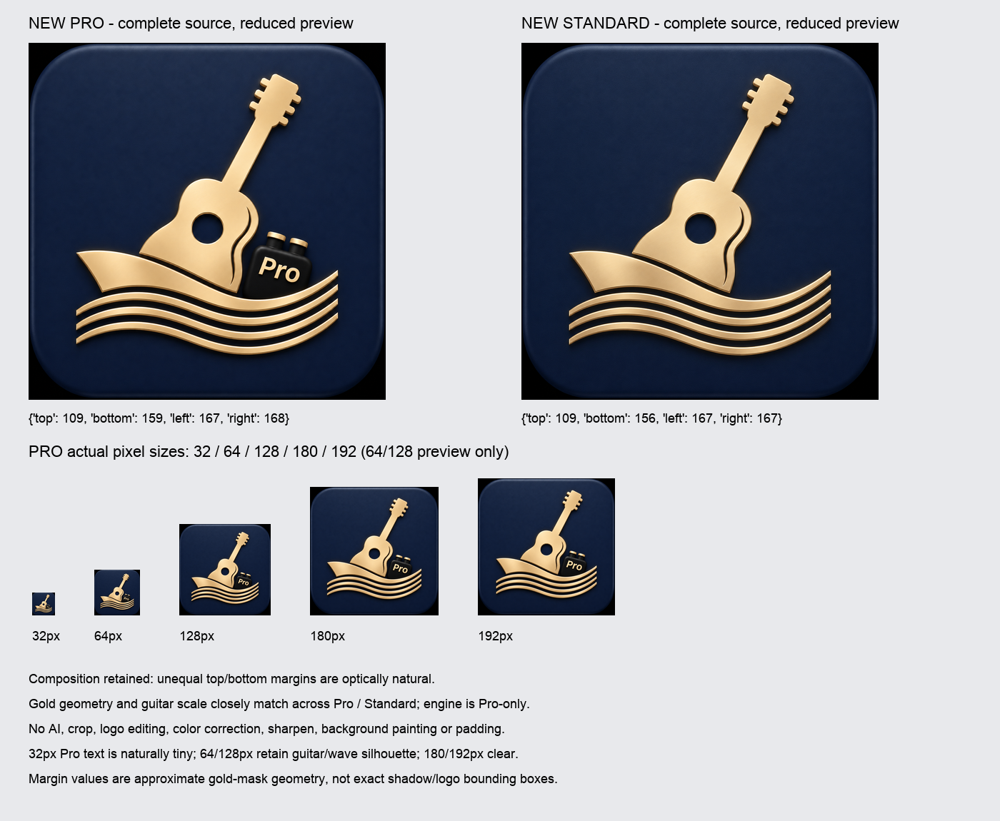
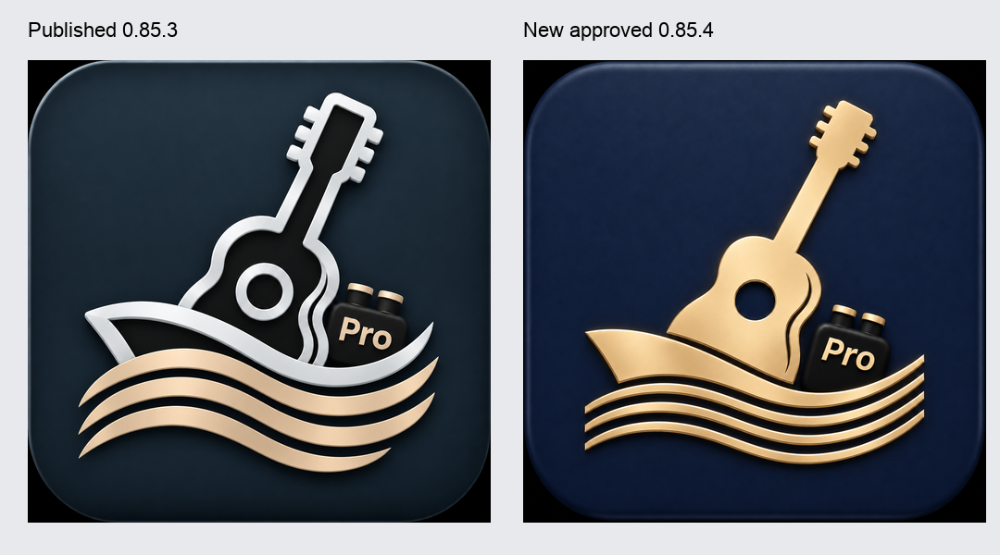

# Studio 0.85.4 — final supplied artwork, composition preserved

Base main: `d13d81f3649ee2a4929342beccf3cf778e7ebca4` (Studio 0.85.3 / Port 1.27.2). Independent branch; no merge, Pages publication, installed-app modification or real data operation.

## Approved originals and geometry

Both actual files were found under the supplied Mac folder despite decomposed Unicode directory names, opened, and visually inspected. Pro includes the engine and Pro lettering; Standard does not. Both are 1254×1254 RGB PNG, no alpha or DPI metadata.

| Edition | Actual filename | Bytes | SHA256 |
|---|---|---:|---|
| Pro | ChatGPT 画像 2026年11月6日 14_41_55.png | 1,850,048 | `7c51ecc3b08199e9e6ab506869121cb565f09a76482b3249a623cf1567d79ee0` |
| Standard | ChatGPT 画像 2026年11月6日 14_38_51.png | 2,112,351 | `ada2b89bdfcc61372fd484f2678ea55fee7bf1f740d86e0981591b6dbc011cbd` |

Original bytes were copied unchanged to `icon-sources/{pro,standard}/source.png`, metadata updated, and original/source equality rechecked after generation. The existing image generator is unchanged. Every generated pixel buffer equals independent full-image Pillow LANCZOS reduction; no crop, padding, geometry edit, recolor, sharpening, inpainting or AI generation.

Approximate gold-silhouette margins in original pixels (top/bottom/left/right): Pro **109/159/167/168**, Standard **109/156/167/167**. Gold-pixel centroid is Pro **634.6,735.1**, Standard **628.2,734.0**; this is a measurement aid rather than a claim of perceptual center and excludes the dark engine/shadows. Guitar height/position and wave spread closely match. The roughly 50px upper/lower difference is optically natural with the diagonal head and wide lower waves; equalizing margins would not improve fidelity. **Use original composition unchanged.** Background corners/rounding remain exactly as supplied.

32px retains the recognizable guitar, boat and wave silhouette; literal Pro lettering is naturally too small to promise readability. 64/128px preview-only sizes preserve the silhouette and Pro badge; 180/192px are clearly recognizable. 512/1024px are exact full-image reductions. Only 32/180/192/512/1024 are distributed; no maskable purpose was added.

[Source, margin, output hash and pixel equality record](image-verification.json).

## Identity, source and distribution

Studio patch **0.85.4**; Port **1.27.2 unchanged**. Canonical source regenerated using `generate-pro-entry.mjs`; no manual edit of generated HTML. HTML Manifest/favicon/apple-touch references and Manifest icon URLs use `?v=0.85.4`. Parsed Manifest comparison permits only icon cache URLs to differ.

App name/short_name **Cruise Studio**, Pro id/start_url/scope `/apps/cruise-studio/pro_969e958c31433f99c30b/`, standalone display, future Standard id and Pro authentication remain unchanged. Existing runtime diffs are exclusively 0.85.3→0.85.4 version/cache literals. No UI CSS, tool icons, auth, Account, Sync, schema/CAS, Outbox/UNKNOWN, Project logic, Port/four-app/shared/Worker changes or new Service Worker.

Standard source is preserved privately in the repository; Jekyll excludes source materials, docs, scripts/tests and canonical root HTML. No Standard icons or Manifest generated. The frozen canary compatibility bytes remain unchanged.

## Focused acceptance

- Node **12/12 PASS**: install metadata/source hash, edition and version/cache contracts.
- Chrome **2/2 PASS**, WebKit **2/2 PASS**, captured page errors **0**: readable metadata/icons with unqualified Pro shell locked; qualified launch/reload, existing embed routes and guidance. Disposable synthetic profiles only; no Mac/Windows installation or real credential migration.
- Safe Jekyll build: **198/198 package SHA256 match**.
- Local HTTP from Jekyll output: Pro entry/Manifest/all five versioned icons **200** with hashes matching package; Standard root/index/Manifest/source materials **404**. The local static handler returns 404 for directories with no index, matching the hosting contract.
- Original Mac files rehashed after generation; copied source bytes still identical.

The existing browser harness requires its retained synthetic Worker/schema and release/profile flags. Initial invocations without that complete fixture configuration did not initialize; corrected configuration passed without modifying product logic, test selectors or expectations. The unrelated full Sync suite was not rerun.

Records: [distribution](distribution.json), [verification](verification.json), [Chrome](chromium-result.json), [WebKit](webkit-result.json), [Chrome metadata](chromium-metadata.json), [WebKit metadata](webkit-metadata.json).

Reproduction: run the existing icon/Pro entry generators, then `node --test apps/cruise-studio/tests/install-metadata.test.mjs apps/cruise-studio/tests/pro-edition.test.mjs apps/cruise-studio/tests/component-version-cache.test.mjs`; package with `package-port-pc.mjs --out <new external directory>` and safe Jekyll build. Browser acceptance uses `STUDIO_INSTALL_METADATA_ONLY=1` with the existing isolated release/native fixture.

**PASS: candidate ready for visual review and publication approval.** No main merge or publication performed. Existing OS-installed icons may require user-approved browser/OS identity update; no automatic universal icon replacement promised and no deletion/reinstallation performed.
