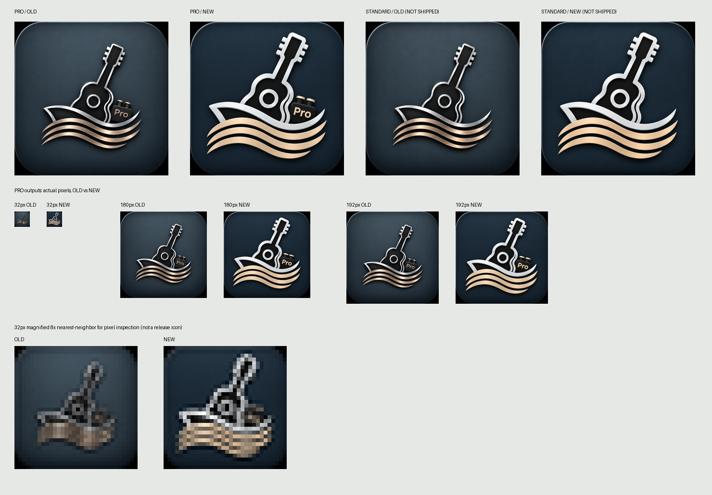

# Studio 0.85.3 — replacement of approved app artwork

Base main: `5aad456a74175570700c8b9b920fbbeed24526ff` (Studio0.85.2 / Port1.27.2). This candidate changes app artwork and version/cache references only. No merge, Pages publication, user-data operation or installed-app modification.

## New source verification

Both actual Mac files were resolved component-by-component with Unicode NFC comparison, opened and visually inspected before copying. No source file was overwritten or deleted. Exact original bytes, including PNG metadata, are copied into the existing source paths.

| Edition | New actual filename | Pixels / format | Bytes | Alpha / DPI |
|---|---|---|---:|---|
| Pro | ChatGPT 画像 2026年11月6日 13_35_29.png | 1254×1254 PNG RGB | 1,691,552 | no alpha; no DPI tag |
| Standard | ChatGPT 画像 2026年11月6日 13_36_09.png | 1254×1254 PNG RGB | 1,694,184 | no alpha; no DPI tag |

- Pro source: `icon-sources/pro/source.png`, SHA256 `bbce780c2acaf2c56bfb3e57bb74b1e14d3d734fc32c5da4e55b423efe61abfa`.
- Standard source: `icon-sources/standard/source.png`, SHA256 `6765fd4c0030a61de885de44775ff5fe3f527531f9ed21bae7805c74c36d32f2`.
- Each source.json records the new filename, exact size, format and hash. Node expectations match these independently recorded approved hashes and metadata.
- Original Mac files were rehashed after generation and remain unchanged.

## Old / new comparison and quality

The new approved design uses a larger guitar/wave silhouette, thicker silver edges and gold bands, and a larger Pro badge. The new Standard image shares that composition without the Pro badge. We did not redraw, recolor, trim, add padding or remove the supplied opaque black corner pixels.

The **unchanged** `scripts/generate-app-icons.py` regenerated the five Pro files below using full-image LANCZOS reduction. Every decoded output pixel buffer was independently checked against the same-size full-image reduction of the new approved source. Source and output format remain RGB PNG. No maskable purpose was added.

| Output under assets/app-icons/pro/ | Visual result |
|---|---|
| favicon-32.png | Guitar/waves are clearer than the thin old contours; badge region remains distinct. Literal Pro lettering is naturally tiny and should not be described as fully readable at32px. |
| apple-touch-icon-180.png | Guitar, wave bands and Pro lettering clear at actual size; no clipping. |
| icon-192.png | Clear silhouette and Pro badge at actual size. |
| icon-512.png | Inspected actual generated image; edges, badge and dark background remain clean. |
| icon-1024.png | Inspected actual generated image; no new crop, distortion or large-size blur. |

The comparison includes actual-size32/180/192 outputs. The lower32px panels are explicitly labeled8×nearest-neighbor magnifications for pixel inspection, not alternate release assets.

Detailed [source comparison](source-comparison.json) and [generated-image pixel/hash record](generated-images.json). Old images in earlier installation documentation are historical records and are marked superseded; no active source/manifest/HTML reference points to old image bytes.

## Stable identity and cache update

Candidate patch: **Studio0.85.3**, Port1.27.2 unchanged.

HTML manifest link, favicon, Apple touch icon and all manifest icon URLs use `?v=0.85.3`. The single canonical HTML source and existing generated Pro HTML/Manifest pipeline remain intact. The two generated files were rebuilt using the existing command. No hand-edited generated entry.

Unchanged:

- name / short_name / application-name / apple-mobile-web-app-title / browser title: **Cruise Studio**
- Pro id / start_url / scope: `/apps/cruise-studio/pro_969e958c31433f99c30b/`
- display: standalone; purpose:any; theme/background colors
- future Standard reserved id, source exclusion and root/index404
- production Pro URL and Pro authentication

The parsed old/new manifests were compared with only icon cache URLs allowed to differ. No old cache token remains in active install references.

## Focused verification

- Related Node **13/13 PASS**: new source hash/filename/metadata, image dimensions, cache refs, stable identity, generated-entry/manifest and edition/package contracts.
- Chrome **2/2 PASS**, WebKit **2/2 PASS**, captured page errors0. Existing isolated acceptance checks manifest/icon reads and natural dimensions, unauthenticated shell lock, qualified launch/reload and unchanged embedded routing. These are synthetic profiles; no real credentials or user data.
- Actual Jekyll safe build: **198/198 package hashes match**. Standard source directory and root entry are physically absent.
- Local HTTP from that Jekyll output: root/index404, Standard manifests/source PNG404, Pro entry200, Pro manifest200 and all5 PNGs200.
- Existing Studio runtime changes are only0.85.2→0.85.3 version/cache literals. Existing UI CSS and all tool SVGs are byte-identical to baseline. No Port/shared/four-app/Worker changes, no Service Worker. Auth, Account, Sync, schema/CAS, Outbox/UNKNOWN and creation functionality are untouched.

Records: [verification](verification.json), [Jekyll / HTTP](distribution.json), [Chrome metadata](chromium-metadata.json), [WebKit metadata](webkit-metadata.json).

## Installed app cache / publication

**Existing installed Web apps were not modified, deleted or reinstalled.** An OS/browser may retain its existing app icon even after these versioned resources are published. This candidate does not promise automatic replacement of a pinned Dock/Start menu icon. If an installed app continues showing the old icon, treat its OS icon-cache update as a separate device acceptance step; do not clear saved website data or automatically delete/recreate the app.

No new Mac/Windows installation or installed-icon update PASS is claimed. After approved publication, verify public resource hashes and compare the installed icon if it refreshes normally. No credential or Project migration is needed or implemented by this change.

**PASS — unpublished release candidate for final image review and publication approval.** main merge/Pages publish and real-device cache follow-up remain separate actions.
