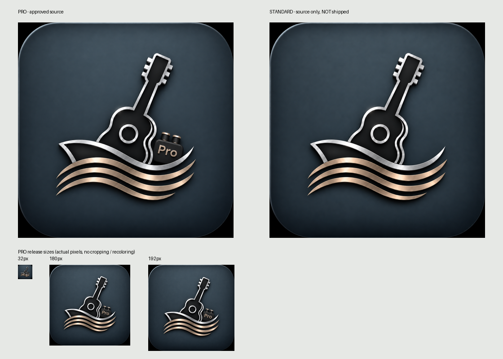

# Cruise Studio 0.85.2 — install metadata and approved artwork

**Historical record:** original artwork below was replaced by the [0.85.3 icon candidate](../icon-refresh-20261106/README.md). The active source PNGs/metadata and generated Pro icons now use the newly approved files. This record is not the current artwork specification.

Base main: `5e2d1ab8fbfdac4873e9438ebcd15524f6c23eb3` (Studio Pro0.85.1 / Port1.27.2). This is an unpublished patch candidate. No main merge, Pages deploy, actual Account/Project operation or OS app installation was performed.

## Approved originals and reductions

Both explicitly supplied Mac PNGs were resolved by comparing Unicode NFC path components, then opened and visually inspected before conversion:

| Edition | Actual filename | Dimensions / format | Bytes | Alpha / DPI |
|---|---|---|---:|---|
| Pro | ChatGPT 画像 2026年11月6日 09_56_54.png | 1254x1254, PNG RGB | 1,823,652 | no alpha; no DPI tag |
| Standard | ChatGPT 画像 2026年11月6日 10_04_28.png | 1254x1254, PNG RGB | 1,718,058 | no alpha; no DPI tag |

Exact source bytes are preserved in `icon-sources/pro/source.png` and `icon-sources/standard/source.png`, with original filename/size/hash metadata beside each. The original Mac files were never overwritten and their SHA256 values were rechecked after conversion. Source hashes:

- Pro: `6469d401526bd0774d2da839ab1ad5685afeb31d0b0b0dc621a10bd615346b13`
- Standard: `8f35036d69f8a7ca1a33b079caf281886422284230b0a4c41495a5484837a39b`

`python3 apps/cruise-studio/scripts/generate-app-icons.py` (Pillow11.3.0) performs only whole-image LANCZOS reduction, no crop, distortion, recolor, alpha removal or generative redesign. The supplied black corner pixels and baked-in rounded frame remain as authored. Public Pro resources:

- `assets/app-icons/pro/favicon-32.png`
- `assets/app-icons/pro/apple-touch-icon-180.png`
- `assets/app-icons/pro/icon-192.png`
- `assets/app-icons/pro/icon-512.png`
- `assets/app-icons/pro/icon-1024.png`

No maskable purpose is advertised: preserving the supplied design does not guarantee all important detail fits every mask safe area. Standard artwork is **source only**; no Standard app, manifest or public icon set was generated. The source directory and this documentation directory are excluded by Jekyll. Future Standard work can reuse the same reduction recipe with its own approved source/output and the shared Studio runtime; it must separately approve and add a Standard manifest before exposing assets.

## Stable names and edition IDs

The browser title, application-name, apple-mobile-web-app-title, manifest name and short_name all provide **Cruise Studio**. The screen still displays Japanese クルーズスタジオ and its existing Pro badge.

Pro manifest: `/apps/cruise-studio/pro_969e958c31433f99c30b/manifest.webmanifest`.

- id / start_url / scope: `/apps/cruise-studio/pro_969e958c31433f99c30b/`
- display: `standalone`
- icons: only Pro192/512/1024, `purpose: any`
- background/theme color: Midnight `#10151c`
- reserved future Standard id: `/apps/cruise-studio/`, different from Pro; not a shipped manifest

The existing `edition-layout.mjs` renders both Pro HTML and its manifest, while `index.html` remains the one canonical UI template. Run `node apps/cruise-studio/scripts/generate-pro-entry.mjs` after changes. Packaging rejects stale generated HTML/manifest. Version/cache strings use0.85.2, but the app id/start_url/scope have no version/query and remain stable.

The narrow scope controls top-level app navigation; it does not broaden Studio privileges or prohibit native Port/four-app iframes outside that path. The actual packaged entry was tested opening all five native surfaces while the top-level URL stayed Pro. Existing outside-scope legal links keep target=_blank. No runtime navigation, URL or authentication code was changed.

## Platform behavior and instructions

### Mac Safari

Safari17/macOS Sonoma14 and later provide File > Add to Dock. Name/icon can be changed by the user. [Apple Support](https://support.apple.com/en-gb/104996), [WebKit Safari17](https://webkit.org/blog/14445/webkit-features-in-safari-17-0/).

**Actual Mac Safari preview** on macOS26.6.2: a fresh tab opened the local Jekyll candidate. File > Add to Dock showed initial name **Cruise Studio**, the matching Pro guitar/wave artwork and the same Pro path under the local preview origin. The dialog was cancelled, then only the preview tab was closed. No Dock app was added, deleted or reinstalled. This verifies the real Safari dialog, not a production installed-app launch.

Safari copies cookies at creation but does not copy other local storage into a Dock app; thereafter the data store is separate. Therefore Pro authentication and optional existing Account connection may be needed in the newly installed app. No automatic Project/Outbox transfer is implemented. This guidance is also visible in the existing Studio Information dialog. [WebKit storage explanation](https://webkit.org/blog/14787/webkit-features-in-safari-17-2/).

After approved publication: open the formal Pro URL in Safari, File > Add to Dock, confirm Cruise Studio and the Pro icon, Add, launch the newly installed app, and perform normal Pro entry if prompted. Existing Account connection remains optional for local creation and is managed only through native Cruise Sync. Do not delete/reinstall an existing Dock app or assume its Projects are copied from Safari.

### Windows Edge / Chrome

Use the browser menu's install-site-as-app action. Edge installation does not require a Service Worker; Chrome removed the fetch-handler Service Worker requirement for menu installation on desktop112+. No offline capability or custom install prompt is promised. [Microsoft](https://learn.microsoft.com/en-us/microsoft-edge/progressive-web-apps-chromium/get-started), [Chrome](https://developer.chrome.com/blog/update-install-criteria).

No Windows machine or Edge installation is available in this environment. **Windows installation, Start menu, taskbar pinning and actual installed-session persistence are untested.** Mac Chromium metadata/app-mode acceptance below is not labeled Windows PASS.

## Focused verification

- Node12/12: exact approved source hashes, PNG dimensions, canonical generation, name/ID/scope, edition separation, package allowlist and cache/version refs.
- Isolated Chrome2/2 and WebKit2/2 product cases, zero captured page errors: unauthenticated entry stays inert, metadata and icon reads work without unlocking Home, valid synthetic Pro enters Home without Account, reload stays valid, native Sync/four-app surfaces load and existing external links retain target semantics. All fixture requests are intercepted; no real credentials are used.
- Actual local Jekyll HTTP + disposable Chromium `--app` window: `display-mode: standalone=true`, secure localhost context, name Cruise Studio, correct formal Pro path, unauthenticated/inert gate retained. Native `Page.getAppManifest` and `Page.getInstallabilityErrors` both report **zero errors**. This launches an app-style browser window only; it does not register an OS app or create a shortcut.
- In the HTTPS interception fixture the separate installability diagnostic reports not-from-secure-origin because interception is not a real secure delivery origin. The real localhost Jekyll/CDP check is authoritative for installability; no certificate/security guard was bypassed.
- Local HTTP root/index404, Standard source PNG404, Pro200, manifest200, all five icon resources200. Actual Jekyll matches all **198** release hashes (6 install files added to the prior192), Standard entry/source art absent. In total there are108 Studio resources and90 frozen canary compatibility resources.
- All existing Port/shared/four-app/Worker files unchanged. Every existing Studio runtime JS difference is solely0.85.1 ->0.85.2 version/cache text. Auth, Account, schema2, localStorage/IDB keys, Web Locks, CAS, Outbox/UNKNOWN, Project Owner admission and NEWS logic are untouched. No Service Worker added or registered by product code.

Records: [verification](verification.json), [Chromium metadata](chromium-metadata.json), [WebKit metadata](webkit-metadata.json), [local native Chromium manifest/app-mode/HTTP](chromium-app-window.json).

To reproduce browser app-mode checks, serve an actual safe Jekyll output on127.0.0.1 with missing directories404, then run `tests/install-window.browser.cjs` with STUDIO_INSTALL_URL and a /private/tmp/ STUDIO_INSTALL_OUTPUT; Playwright is required. Full unrelated Sync tests were not repeated.

## Decision

**CONDITIONAL PASS**: metadata, artwork, generation and local distribution are complete and ready for publication review. No production URLs for new assets/manifest are claimed to be200 before publication.

After approval: verify actual Pages root404/index404/Pro200 and icon/manifest hashes; install in Mac Safari and Windows Edge/Chrome, confirm OS icons/names, independent window, startup URL and normal Pro session. Check a fresh Safari app's expected separate storage without automatically moving Account credentials or Projects. Check Windows Start menu/taskbar in the actual OS. Those device checks remain distinct from the completed Mac dialog and isolated browser checks.
