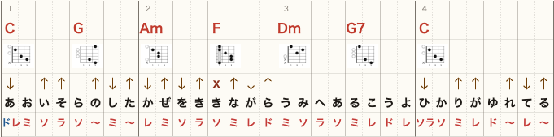

# 長い曲の初回表示・フォーム拡縮・小節配置 — 0.143.2-dev.1

2026-11-16。基準はpush済みの `cd5c54a4`、作業ブランチは `codex/score-toolbar-ui`。今回差分はユーザー承認でローカルコミット。未push。既存の `http://127.0.0.1:18874/` を再利用した。本番配信・公開HTML・実Account/Sync・認証・Worker・shared・他アプリは変更していない。

## 計測結果

同じMac、1440×1000px、Chrome/WebKitの使い捨てブラウザ領域で実施。コード・フォーム・ストローク・歌詞・ドレミ付きの合成12/128/256小節、4セクション。各条件3回。計測中は他の試験を同時に実行していない。外部通信はブロックし、エラー・外部リクエストがないことも検証した。

以下は256小節の中央値。単位はms、すべてのサンプルを集計している。

| 操作 | Chrome 変更前 → 後 | 短縮 | WebKit 変更前 → 後 | 短縮 |
|---|---:|---:|---:|---:|
| 初回の譜面表示 | 333.2 → 314.4 | 5.6% | 528.0 → 488.0 | 7.6% |
| 表示設定を初めて開く | 338.5 → 259.7 | 23.3% | 617.0 → 504.0 | 18.3% |
| フォーム拡縮 | 494.9 → 209.7 | 57.6% | 818.0 → 401.5 | 50.9% |
| 1行の小節数変更 | 493.5 → 301.3 | 38.9% | 839.0 → 522.0 | 37.8% |

128小節では、フォーム拡縮がChrome 245.3→112.6ms、WebKit 403.0→200.5ms。小節数変更はChrome 238.7→155.4ms、WebKit 411.0→261.0ms。12小節のChromeは変更前後ともおおむね1〜2フレーム相当の観測値で、約1msの差は改善・悪化と評価しない。

- 初回表示：保存したテスト曲を再読み込みし、アプリの起動準備後に実際のホームボタンをクリックして、全小節が現れ、2回のrAFを通過するまで。SVG/DOMテンプレートのメモリキャッシュは再読み込みで空にしている。ページ全体のネットワーク読み込み時間ではない。
- 表示設定：初回の設定ボタン操作から同様に2回のrAFまで。
- フォーム拡縮：80→100→120→140→60→100%、各3回で18サンプル。
- 小節数：2→4→3→1→4、各3回で15サンプル。1小節表示から4小節表示へ戻す遷移も含めた。
- `syncMs` はイベント処理の時間、`settledMs` は上記のフレーム待ちも含む時間。表は後者。LighthouseやCore Web Vitals/INPの値ではない。

[全条件の中央値・観測p95・件数](metrics-summary.json)、[Chrome変更前](before-chrome.json)・[変更後](after-chrome.json)、[WebKit変更前](before-webkit.json)・[変更後](after-webkit.json)。p95はnearest-rankの観測値で、初回/設定を開く操作は各3サンプルの最大値に相当する。単一PC・合成曲の結果であり、Safari実機・スマートフォンの速度は計測していない。256小節では改善後も描画待ちが残る。

## 原因と変更

変更前のV8 CPUサンプルでは、図の生成/挿入のほか、`updateSheetScale` のレイアウト読み取り、ハイライトの `getClientRects`、繰り返すProject投影・検証が大きかった。[プロファイル要約](baseline-profile-summary.json)。専用のDevTools MCPは利用できなかったため、PlaywrightのCDP Profilerとブラウザ内時計、DOM/ソースの確認を利用した。

1. フォームサイズはSVGと小節を作り直さず、既存要素の幅・位置・重なり段数・行高だけ更新する。配置計算は新規描画と共通化し、先頭・末尾・重なる図・別の拍の独立した図の扱いを維持する。
2. 小節数と行の個別設定の変更は、同じ曲ID・SessionのsnapshotVersionであることを確認し、既存の小節とヘッダーを再利用して行を組み直す。本文編集・Undo/Redo・別Project・トラック/グリッド変更は作り直す。キャンセルと保存、斜線の空き枠、読み取り専用の設定見本も維持する。
3. 同じ図のSVGは、上限256件のDOMテンプレートから複製し、HTML解析の繰り返しを減らす。各図は従来どおり完全なSVGとして持つ。SVG参照をページ間で共有する試作はWebKitで特定の遷移が遅くなったため採用していない。
4. 表示ON/OFFの読み取りだけで曲全体を投影する処理を除いた。描画では、現在のProject IDとsnapshotVersionが一致するときだけ既存の検証済み投影を利用し、履歴プレビューでは利用しない。モデル・保存データ・schema・認証は変更しない。
5. 設定のハイライトは、両方の譜面への書き込み後に寸法を読む。表示確認は対象全行ではなく必要な表示箇所だけを調べる。

仮想スクロールや一部の小節を省く表示には変更していない。今回の改善は譜面の見た目・内容・再生順を変えない。

## 検証

- 全Node：2,222成功、失敗0、既存の専用backend試験1skip。
- 譜面通し：Chrome 122、WebKit 122成功。
- 関連ブラウザ90件成功：新規の幾何/キャッシュ/画像比較、既存の表示性能、履歴、範囲ループ、ドラッグ、直接フォーム変更、ミキサー。
- 新規回帰では、フォーム拡縮・2/3/1/4小節への変更、DOM保持、表示設定取消/保存、行の個別設定、斜線枠、トラック変更後の再配置、本文編集とUndoによるキャッシュ失効、Project/履歴/選択の不変を確認。
- Chrome/WebKitそれぞれ60/100/140%の画面6画像、および64小節のChrome PDF全3ページの画像を変更前と比較し、9組すべてピクセル一致。[比較記録](visual-comparison.json)。初回・途中・末尾のフォームが残ることも画像で確認。SafariのOS印刷は今回実行していない。
- 構文、`git diff --check`成功。[対象ソースのSHA-256](source-sha256.json)。



[WebKitの140%フォーム](webkit-form-140.png)／[64小節PDFの最終ページ](print-last-page.png)

## 再現

Playwrightが解決できる既存Nodeランタイムを使用し、既存ローカルサーバーを起動した状態でリポジトリのルートから実行する。通常のブラウザプロファイルや実データは使わない。

```sh
SCORE_ENGINE=chrome node apps/cruise-studio/scripts/measure-score-geometry.cjs /private/tmp/geometry-chrome.json
SCORE_ENGINE=webkit node apps/cruise-studio/scripts/measure-score-geometry.cjs /private/tmp/geometry-webkit.json
```

`SCORE_BARS=256`、`SCORE_ROUNDS=3` で条件を限定できる。`SCORE_SOURCE_REF=cd5c54a4` は対象4モジュールを基準コミットの内容で配信し、`SCORE_PROFILE=1` はChromeのV8 CPUサンプルも保存する。画像比較は `SCORE_GEOMETRY_OUT=/private/tmp/score-geometry-visual` を指定して `tests/long-score-geometry.browser.cjs` を実行する。

## Commit file list (23 files)

- `apps/cruise-studio/ai-handoff/PROJECT_STATE.md`
- `apps/cruise-studio/docs/long-score-geometry-20261116/README.md`
- `apps/cruise-studio/docs/long-score-geometry-20261116/after-chrome.json`
- `apps/cruise-studio/docs/long-score-geometry-20261116/after-webkit.json`
- `apps/cruise-studio/docs/long-score-geometry-20261116/baseline-profile-summary.json`
- `apps/cruise-studio/docs/long-score-geometry-20261116/before-chrome.json`
- `apps/cruise-studio/docs/long-score-geometry-20261116/before-webkit.json`
- `apps/cruise-studio/docs/long-score-geometry-20261116/metrics-summary.json`
- `apps/cruise-studio/docs/long-score-geometry-20261116/print-last-page.png`
- `apps/cruise-studio/docs/long-score-geometry-20261116/screen-form-100.png`
- `apps/cruise-studio/docs/long-score-geometry-20261116/source-sha256.json`
- `apps/cruise-studio/docs/long-score-geometry-20261116/visual-comparison.json`
- `apps/cruise-studio/docs/long-score-geometry-20261116/webkit-form-140.png`
- `apps/cruise-studio/js/modules/sheet-cruise/paper-forms.mjs`
- `apps/cruise-studio/js/modules/sheet-cruise/paper-layout.mjs`
- `apps/cruise-studio/js/modules/sheet-cruise/sheet-cruise.js`
- `apps/cruise-studio/js/modules/sheet-cruise/sheet-renderer.js`
- `apps/cruise-studio/scripts/local-ui-entry.mjs`
- `apps/cruise-studio/scripts/measure-score-geometry.cjs`
- `apps/cruise-studio/tests/long-score-geometry.browser.cjs`
- `apps/cruise-studio/tests/paper-forms.test.mjs`
- `apps/cruise-studio/tests/paper-layout-performance.browser.cjs`
- `apps/cruise-studio/tests/paper-layout.test.mjs`
