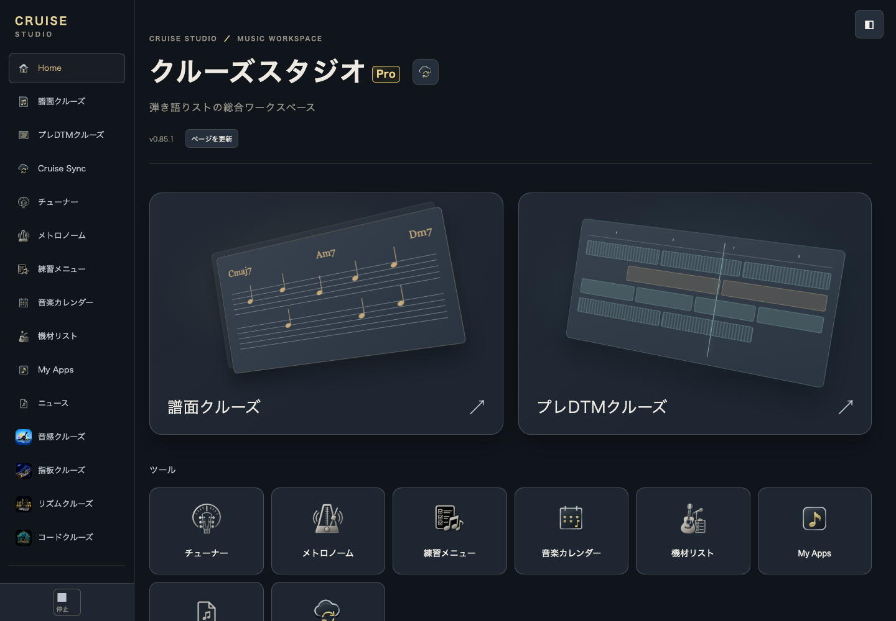
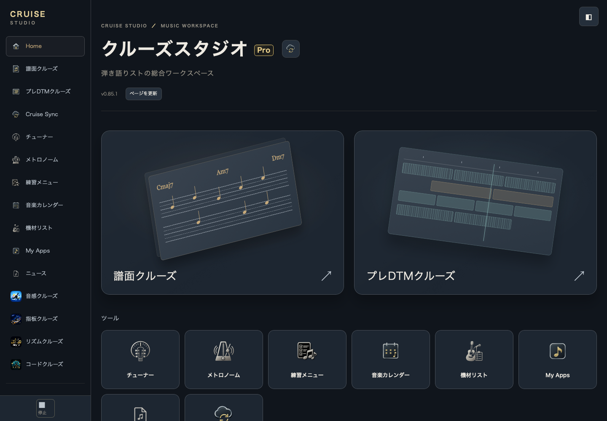

# Studio 0.85.1 / Port 1.27.2 — NEWS and logo update candidate

Base: `095508029c65c0bd3969d3fbd92c80ddf41ddc1f`. Independent branch/worktree. No merge, Pages publication or production Account/data operation.

## Product changes

1. Port Standard and Pro HTML initially say **ニュースを読み込み中…**. Native provider success / failure / first-party fallback / disabled contracts remain unchanged. A real external fetch failure still shows the existing fallback notice; a failed module import still displays the native load error. No Worker, article or publication code changed.
2. `library/port-surface.js` keeps only authorized NEWS frames during transient document hiding. Same iframe means category / list DOM / parent scroll persist, without a new request. Global Stop, workspace deactivation, failed-load retry and ordinary non-persisted page exit still dispose normally. Persisted pagehide can retain only an authorized NEWS document; pageshow never recreates an explicitly stopped iframe or resumes an unauthorized entry. Full cross-document bfcache behavior in real Safari is not claimed. Native account/editor/Sync-specific preservation logic is unchanged.
3. Home title and sidebar brand are native buttons delegating `.click()` to **the existing `studio-refresh` button**. No new reload path. Header/footer update buttons remain intact. The same dirty/IME/tool-window/commit/input/external-update/conflict guards, Service Worker check, deployment GET and post-GET rechecks remain unchanged. Refresh feedback is now a common live status outside the hidden Home screen, visible from NEWS and other workspaces.

Logo buttons inherit existing brand/title typography, with narrowly scoped overrides to avoid generic nav button padding/font/color. Native Enter and Space activate them. Responsive sidebar brand hiding is unchanged. Hidden elements can retain stale inherited computed colors in WebKit, so the design test compares rendered brand colors only while visible and independently asserts the expected mobile hide breakpoint.

All icon SVGs are byte-identical to main. Existing five themes, Pro URL, large Home art and Pro badge remain. Studio/Port patch versions and relevant cache refs are coherent. Unchanged Sync modules retain their existing module identity/query keys; only Port app-version import and boot entry are updated.

## Focused acceptance

Chrome and WebKit **7/7 each**, captured page errors0:

- Deferred NEWS response: visible loading text before success, without false error.
- Native external popup return + synthetic hidden/visible dispatch: same iframe, category, HTML and scroll; request count unchanged. Headless focus does not reliably expose OS visibility, so both popup behavior and explicit lifecycle dispatch are covered and distinguished from real Safari.
- Native article Back button and browser history Back, workspace leave/re-entry, explicit global Stop and manual resume.
- Actual external fetch503: first-party content retained with failure notice; synthetic external article absent.
- Broken native module: actual load error, no fake success; both HTML entry placeholders checked.
- 5 themes ×1440/1024/768/390px: logo typography, visible brand color, padding, badge placement and horizontal overflow. Both logos Enter/Space refuse a genuine dirty Project; common feedback visible from NEWS. Fresh synthetic profiles successfully reload through both logos, header button and footer button.
- Invalid Pro prevents background NEWS retention/resume.

Node **85/85** scoped tests PASS: safe refresh guards (including state/SW changes during fetch), Port version/provider/presentation/external links/articles, Studio entry, audio coordinator, component cache, package/edition. No wholesale Sync rerun.

Additional legacy library suite:39 PASS /1 FAIL. The same old navigation assertion fails on the pre-change baseline, requiring obsolete `data-workspace="gear"` / `myApps` markup from the retired developer views. Current native workspaces are `portGear` / `portMyApps`; this test and expectations were not changed or skipped. This is recorded as an inherited test issue, not a new UI regression.

Actual Jekyll safe build matches all192 Studio/compatibility manifest hashes and the5 changed Port release resources. Standard entry remains physically absent. Commit-time package is compared to the tested artifact again after commit.

[Sanitized results](acceptance-summary.json), [Chrome matrix](chromium-design-matrix.json), [WebKit matrix](webkit-design-matrix.json).

## Safety and remaining device acceptance

No Pro/Account/Owner contract, schema, CAS, Project Cloud, Outbox or saved Project logic changed. No real Account credentials or saved content were used in fixtures or screenshots. No actual Account changes, save/delete/migration or production writes.

**CONDITIONAL PASS**: isolated product acceptance is complete; after separate publication approval, Mac Safari should open the new candidate in a fresh tab with existing credentials, read NEWS -> open an external article -> return, confirm the same list/category/scroll, and check logo update feedback without editing/saving real data. Existing user tabs must not be force-reloaded. Real candidate Safari/OS bfcache and audio accuracy are not claimed by these synthetic results. No new authentication input is needed or requested in this task.
