# Studio 0.85.0 Pro edition / UI candidate

Base: `7f7e07212ae50554f8eaf703764cd46bccacf53a` (public Studio 0.84.2 / Port 1.27.1). Port version stays unchanged. All browser runs use disposable synthetic profiles and intercepted network; no real Safari or real Account was modified.

## Design

Original metallic SVGs replace sidebar Sheet / PreDTM and Studio My Apps. Sheet uses paper, staff and notes; PreDTM uses multiple tracks and waveform; My Apps uses four app tiles. Home uses a recognizable roof / wall / doorway instead of a line icon. Original Home large Sheet / PreDTM artwork is unchanged. Optical sheet sizing was adjusted after rendering.

Home Pro badge follows Port's thin gold border, small gold type, rounded corners and restrained gradient. Existing title size remains unchanged. Calendar / Sync and the four new icons use authored light-face SVG variants in gray / light; midnight / dark / charcoal keep the darker metallic faces. The existing colorTheme subscriber swaps image URLs immediately without changing theme storage. CSS filters are disabled only on these authored assets.

### Product screenshots (synthetic profile only)

#### midnight / 1440px

Before 0.84.2:

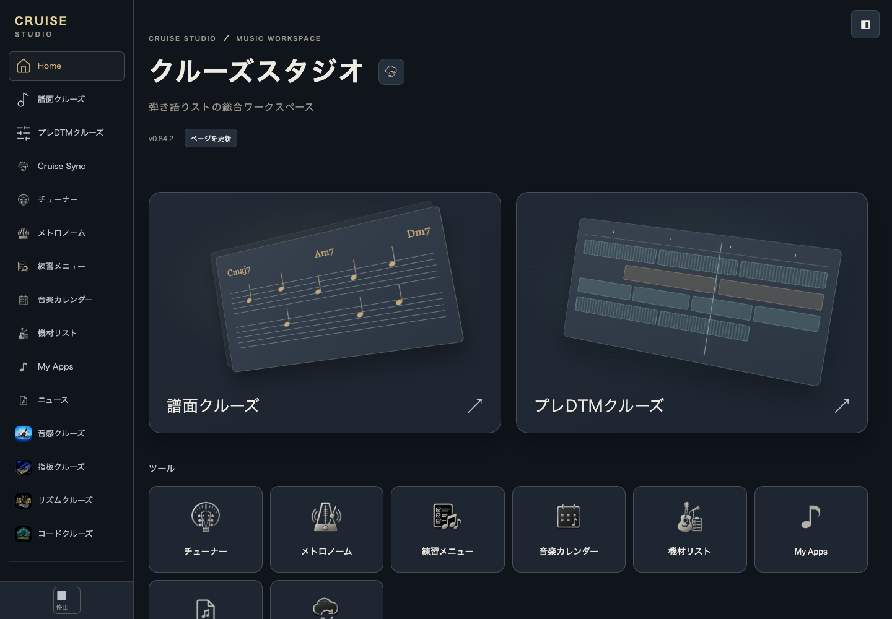

After 0.85.0:

#### midnight / 390px

Before 0.84.2:

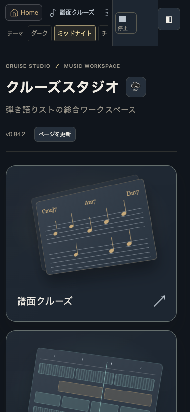

After 0.85.0:

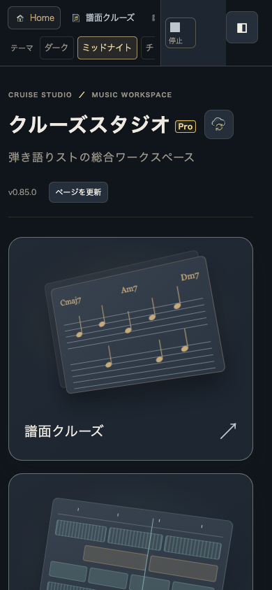

#### dark / 1440px

Before 0.84.2:

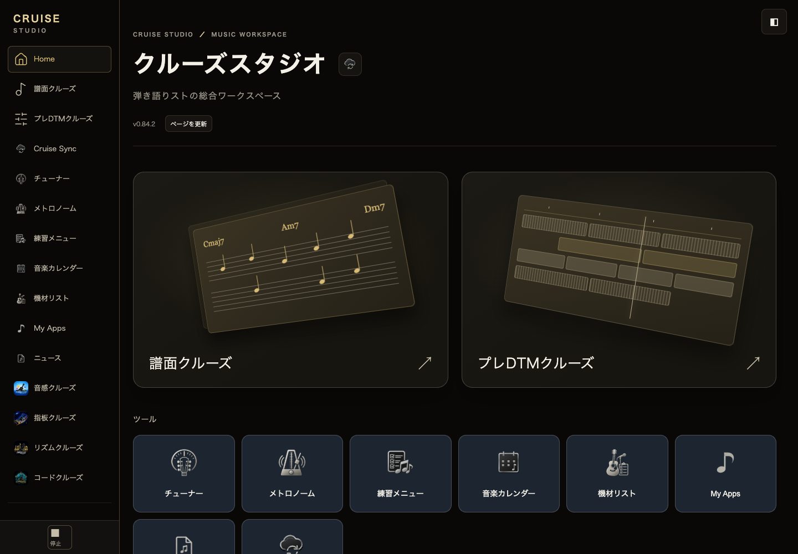

After 0.85.0:

#### dark / 390px

Before 0.84.2:

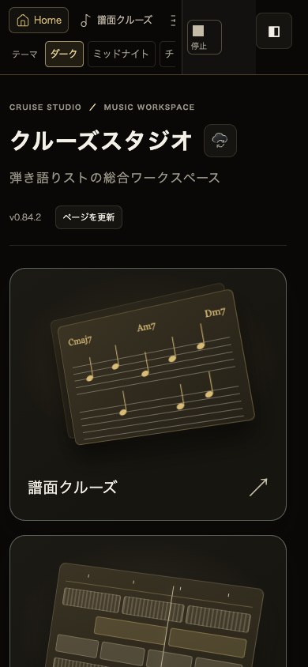

After 0.85.0:

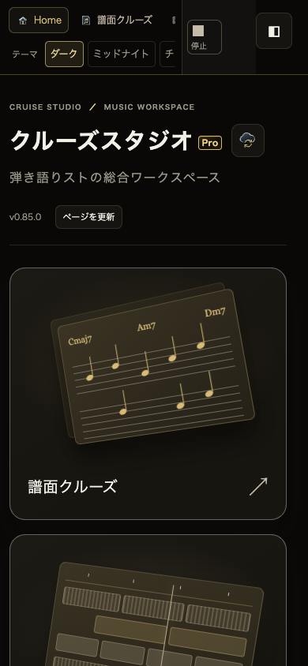

#### charcoal / 1440px

Before 0.84.2:

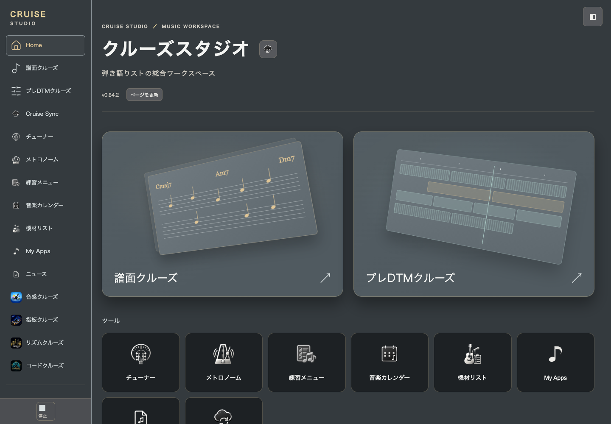

After 0.85.0:

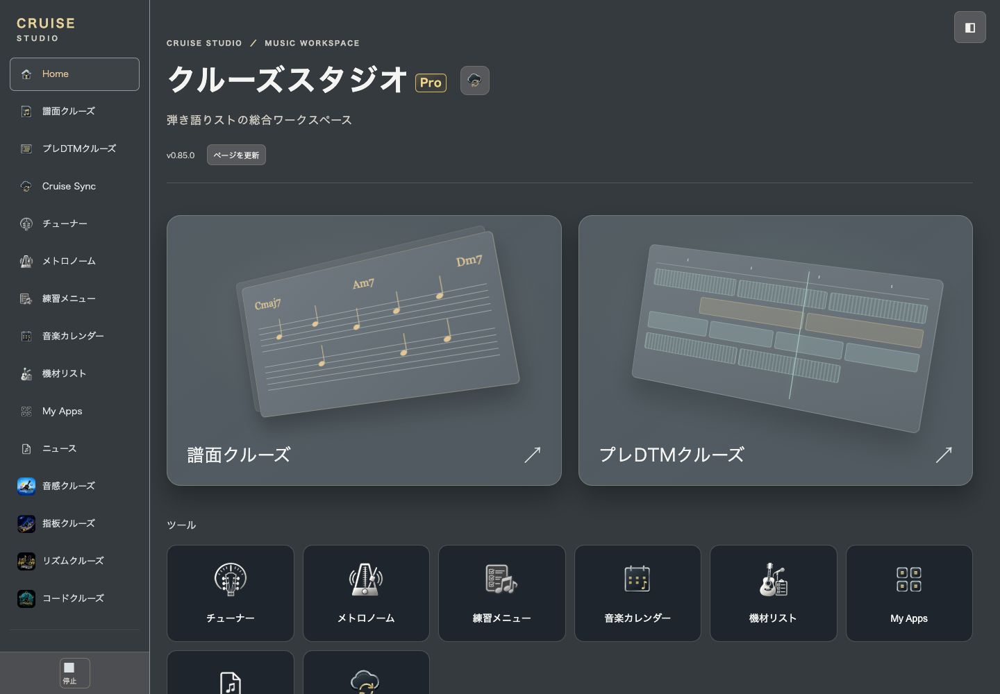

#### charcoal / 390px

Before 0.84.2:

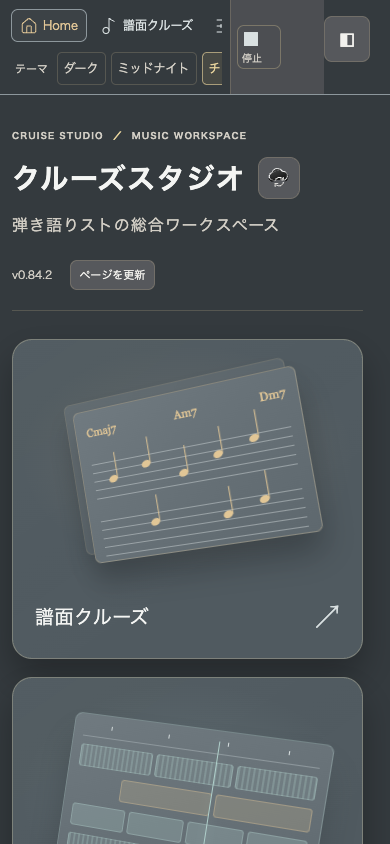

After 0.85.0:

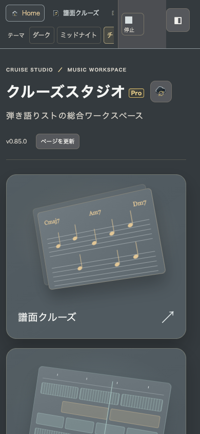

#### gray / 1440px

Before 0.84.2:

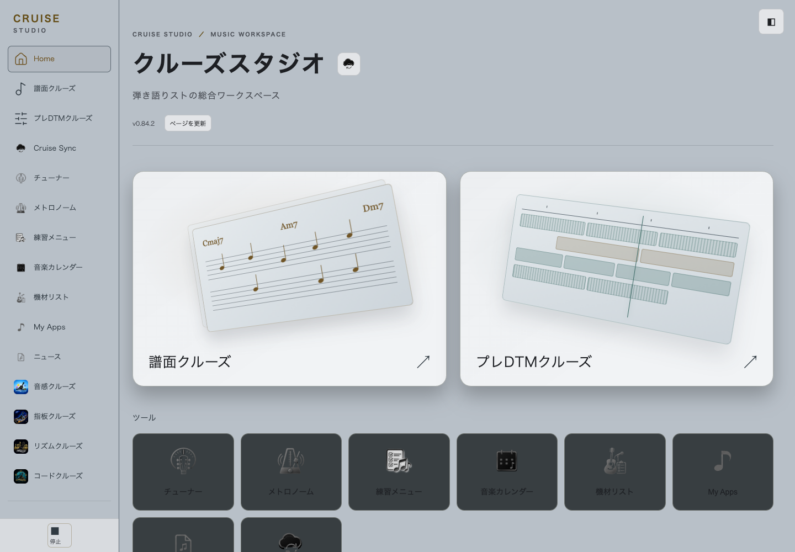

After 0.85.0:

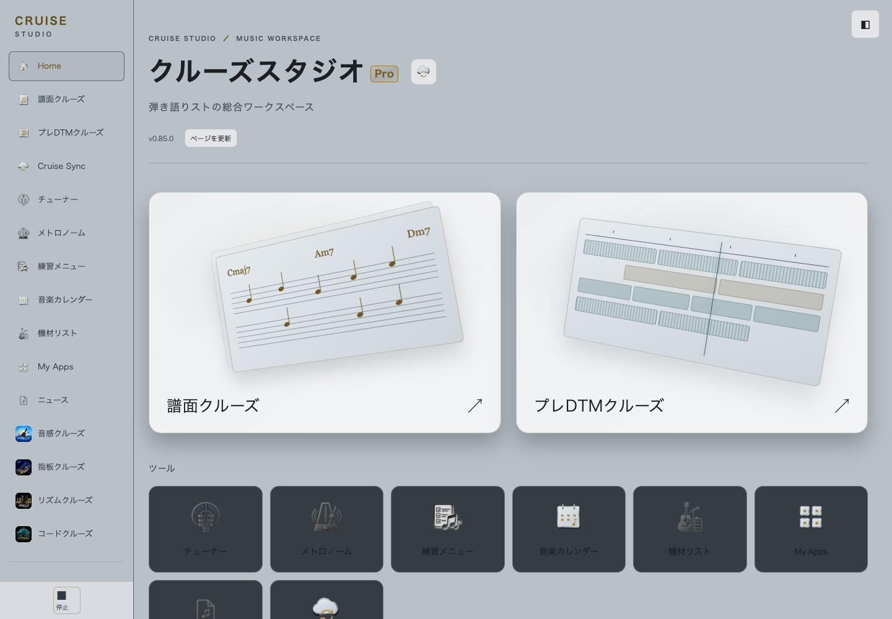

#### gray / 390px

Before 0.84.2:

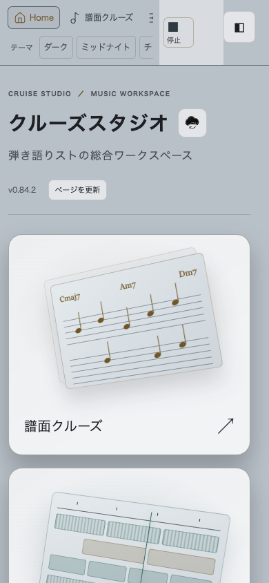

After 0.85.0:

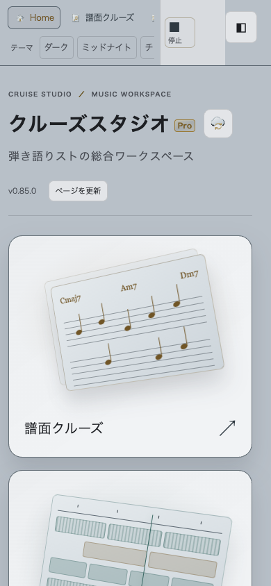

#### light / 1440px

Before 0.84.2:

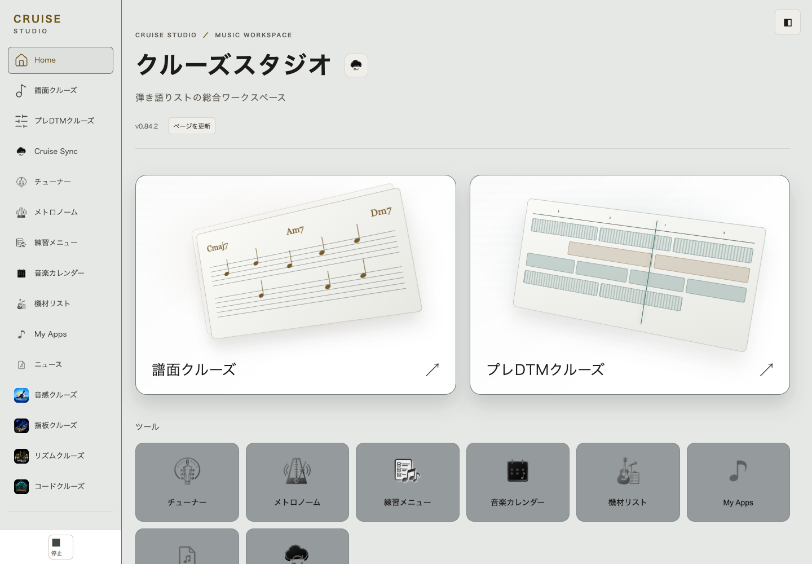

After 0.85.0:

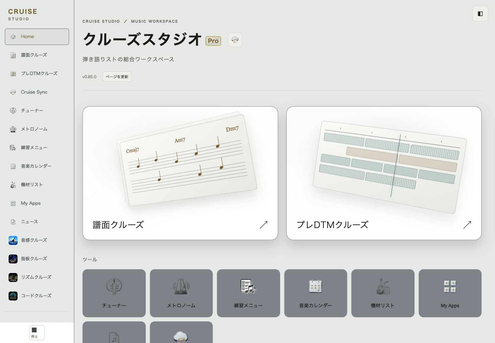

#### light / 390px

Before 0.84.2:

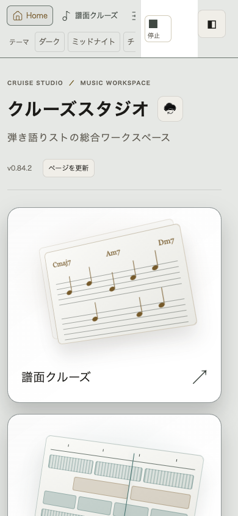

After 0.85.0:

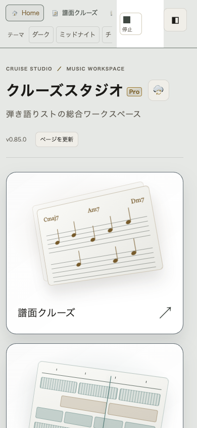

The automated matrix also checks 1024 / 768px: [design-matrix.json](design-matrix.json). Assertions include loaded icons, theme-specific faces, no horizontal overflow, badge within title and before Sync. Screenshots were visually inspected in light desktop and midnight mobile views.

## Stable edition address

Pro: `/apps/cruise-studio/pro_969e958c31433f99c30b/`.

The suffix was generated once with a cryptographically secure 80-bit random value and must remain stable. It is discoverable in this public repository and is **not authorization**. The unchanged Pro gate and existing session / Account / Owner boundaries authorize operations.

`apps/cruise-studio/index.html` remains the **single canonical source template** and is excluded from Jekyll. Run `node apps/cruise-studio/scripts/generate-pro-entry.mjs` after editing it. The generated nested Pro index uses the same JS / CSS / runtime and root-absolute document resource references; no new base tag is added. The packager refuses stale generated HTML. No Standard feature set, Standard app, second Studio implementation or canary development line is introduced.

Relative runtime Port iframe and presentation stylesheet URLs now address existing resources under `/apps/`. ES module imports remain module-relative. Existing Series app srcdoc/base behavior is reused unchanged.

## Distribution / root unavailable

Actual Jekyll 3.10 safe build: `/private/tmp/studio-pro-jekyll-final`. All **192** package file hashes match the generated site (102 Studio + 90 compatibility). Local HTTP server serving that site with Pages-style missing-directory handling returns:

- `/apps/cruise-studio/`: 404, no listing or redirect
- `/apps/cruise-studio/index.html`: 404
- Pro entry: 200

See [distribution-check.json](distribution-check.json). This is a real Jekyll build and local HTTP result, **not a claim about deployed Pages**. Main merge and Pages publication are not performed. Actual public HTTP status must be checked after a separately approved publication. Existing published root still serves the current release until that publication.

The 88 non-entry canary compatibility resources are byte-identical to baseline. Only its two existing redirect HTML entries now address the Pro entry, preserving hash and making no storage changes. Port, shared, four native apps, NEWS, Worker and schema code are unchanged.

## Storage / navigation acceptance

Synthetic existing 0.84.2 tab -> new Pro tab on the same origin preserves exact stored schema2 Project bytes, Account credentials, nonempty scoped UNKNOWN, and old-tab unsaved edits. Reload preserves the saved Project. Pro without Account enters Home; unauthenticated entry remains inert. All embedded tools, calendar, four native apps and Sync open from the deeper URL. Native app iframe documents intentionally use the existing srcdoc mechanism and native base URL; tests check their actual document base origin rather than treating about:srcdoc as a network URL.

Score / PreDTM existing acceptance verifies save / re-edit / reload, legacy Project retention, JSON roundtrip, MIDI, undo/redo, draft across navigation, print layout and themes / widths. Chrome generates PDF bytes. WebKit does not expose Playwright PDF generation; it checks A4 print layout only and reports `pdf: false` rather than claiming PDF generation.

No save key, schema, IndexedDB name, Web Lock name, raw revision CAS, Account credential format, admission or sync engine is changed. Qualification / generation / CAS guards are exercised separately on existing native Port APIs.

## Migration / publication checklist

1. Review icons / Pro badge in the before-after images and approve this candidate separately.
2. On publication, change operator-controlled membership / distribution links and bookmarks to the stable Pro address. Root will no longer be an entry or advertise Pro. Existing user-owned My Apps / saved links are not autoedited.
3. Do not force-reload existing tabs. Save or export unsaved drafts before voluntarily reloading or replacing an old root tab. The old tab's in-memory draft is retained while open, not magically copied to a new tab.
4. Same origin means no data migration / reset is required. Keep frozen legacy resources for existing tabs.
5. After approved Pages publication, confirm actual root/index HTTP404, Pro200, assets, unchanged Pro gate and normal reload. Smoke-check real Safari / iPhone UI without modifying Account or data.
6. Future Standard can generate another entry using shared runtime, but features / restrictions remain undecided and are not implemented here.

## Judgment

**CONDITIONAL PASS** as a reviewable unpublished candidate. Product and local distribution checks pass; final design approval and actual Pages HTTP verification remain. No merge / deploy is authorized or performed by this change. No real microphone, real audio accuracy, real Safari migration or iPhone device PASS is claimed.

## Final results

Chrome: 6 edition/URL cases + 5 qualification/CAS guards PASS. WebKit: same 6 + 5 PASS; zero captured page errors. Related Node249/249 + Account/session guards77/77 PASS. [Sanitized acceptance summary](acceptance-summary.json). Owner admission uses only disposable fixture activation: eligible synthetic owner receives canary session, a different synthetic Account is rejected with activation-scope while Pro Home stays usable. Production activation is untouched.

NEWS uses the native standard Port screen (no componentState marker); app frames use existing srcdoc. Initial added smoke-test waits assumed the wrong signals; tests now wait for actual NEWS view and srcdoc document load/base origin. No product readiness behavior or timeout was changed. An explicit synthetic enroll request initially raced normal initialization; acceptance now observes the existing automatic session path, with no second enrollment.
