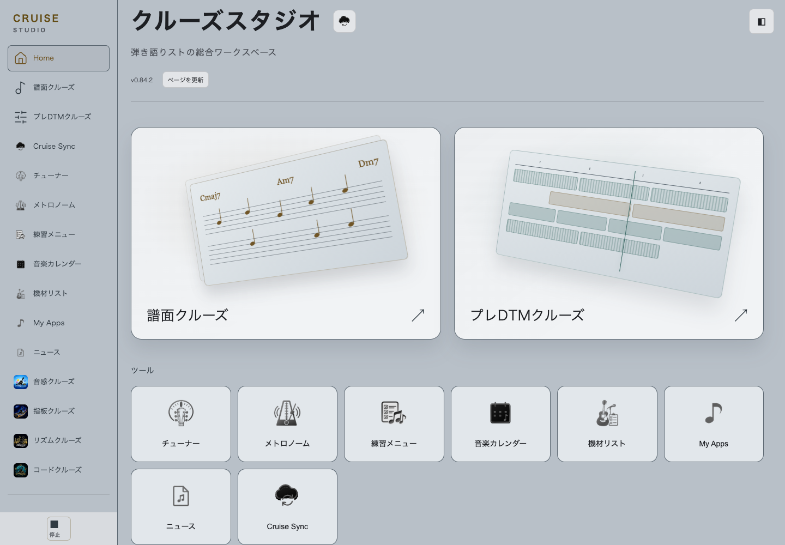
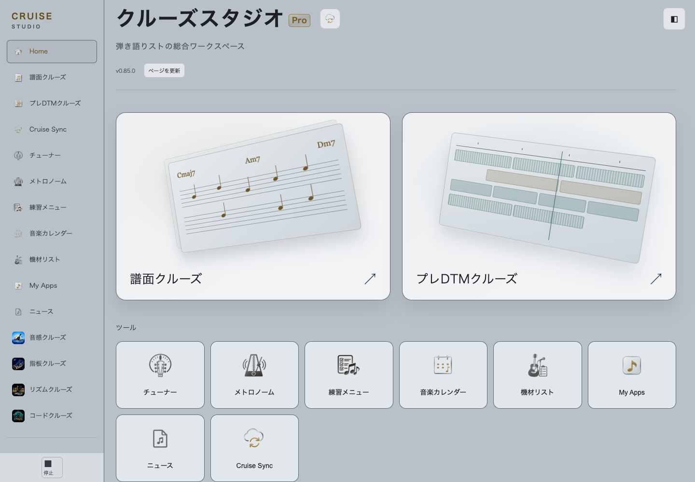
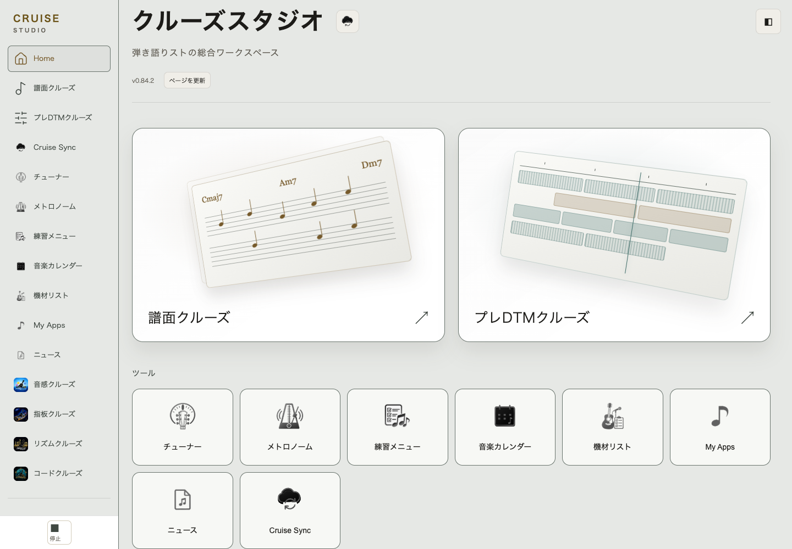
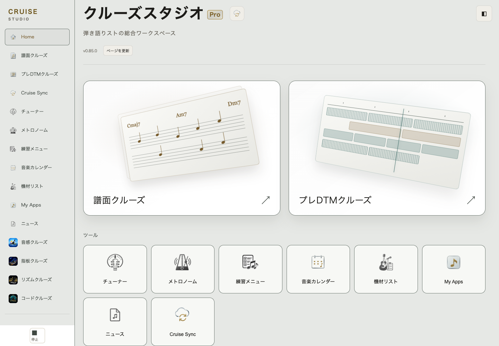
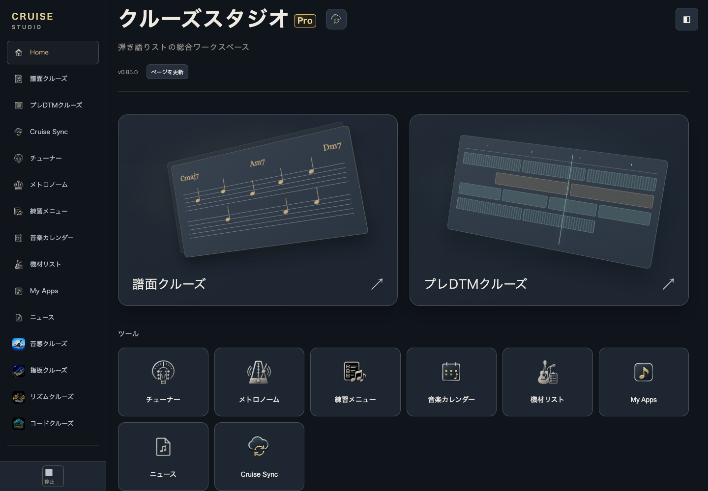

# PR #209 final design revision

This record supersedes the original comparison images for palette review. Candidate stays Studio **0.85.0**, unpublished. Port stays 1.27.1. No merge/deploy or production Account/data operations.

## Cause: transition captured before it finished

Product card/page/text/border CSS did not change in PR #209. The live public 0.84.2 `studio-home.css` was fetched read-only (HTTP200) and exactly matches the retained baseline; SHA256 `be8238f2f6a24b27a30d4e50c8ceabd061f5d2aba82553f0e2fe40aba4edbf64`.

The old screenshot loop applied themes consecutively and waited only for images, not the **0.4s background-color transition**. Immediately after charcoal -> gray, both published and revised documents report card background `rgb(67, 77, 82)` with 12 active background transitions. This is the prior charcoal color. After the native transitions finish, gray is `rgb(226,231,235)`; light is `rgb(247,248,245)`. Main text is respectively `rgb(29,31,35)` / `rgb(28,27,24)`.

The corrected test forces style calculation and waits for finite Web Animations `finished` promises, then compares computed page background / card background / text / borders for published vs revised **5 themes x 4 widths**, independently in Chrome and WebKit. All match exactly. Product CSS and transition duration are unchanged. Initial archived before/after images are retained as history, not used as final color references.

## Icon changes

- Calendar light: punched-out transparent interior with the existing metallic perimeter, bindings, gold dates and music symbol. The former opaque inner face and underlying shadow fill no longer block the background.
- Sync light: transparent cloud interior, existing metallic outline and gold arrows. Removed the dark backing stroke; no fixed white face is substituted.
- Browser canvas pixel checks confirm alpha=0 at the intended internal center for both light SVGs, so Home and sidebar show their different native backgrounds.
- Midnight/dark/charcoal Calendar/Sync source SVGs are unchanged.
- My Apps: one rounded app square, thin metallic rim and a large central gold eighth note. Dedicated light face preserves the same shape and subdued material; the four-tile grid is removed. Used by existing Home/sidebar bindings.

## Comparisons

### Gray / published 0.84.2 vs revised 0.85.0

### Light / published 0.84.2 vs revised 0.85.0

### Midnight / revised

All revised five-theme/four-width Home images and gray/light tool views at1440/390 are included in this directory. Synthetic profiles only, no real user data. Desktop gray/light/midnight were visually inspected after rendering.

## Focused results

- Chrome and WebKit: 3/3 scoped checks each PASS (root/Pro gate; 20 exact baseline palette comparisons + loaded assets/Pro badge geometry; transparent-face pixel check). Captured page errors0.
- Node:4/4 edition/package/icon checks PASS.
- Actual Jekyll safe build:192 package hashes match, Standard root index remains absent. Only the4 intended SVG distribution files changed; other188 resources are byte-identical to the previous candidate.
- No full Account/Cloud/Project regression rerun: runtime, URLs, auth, persistence and Sync code unchanged. Previous PR #209 regression evidence remains applicable.
- Pro URL, future Standard structure, Pro logo, Sheet/PreDTM/Home icons, large visuals, all saving contracts unchanged. No version bump beyond the existing unpublished0.85.0 candidate.

Machine records: [Chrome palette](chromium-palette-comparison.json), [WebKit palette](webkit-palette-comparison.json), [transition evidence](chromium-transition-evidence.json), [transparency](chromium-transparent-faces.json), [acceptance](acceptance-summary.json), [distribution](distribution.json).
