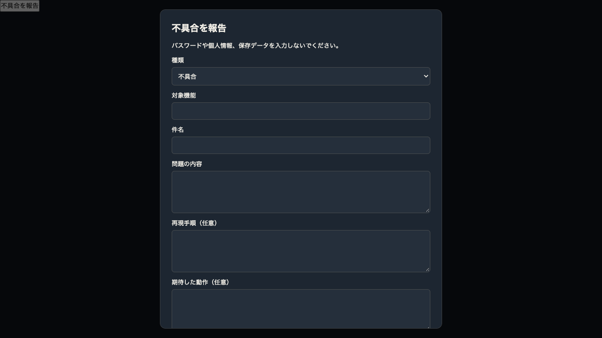
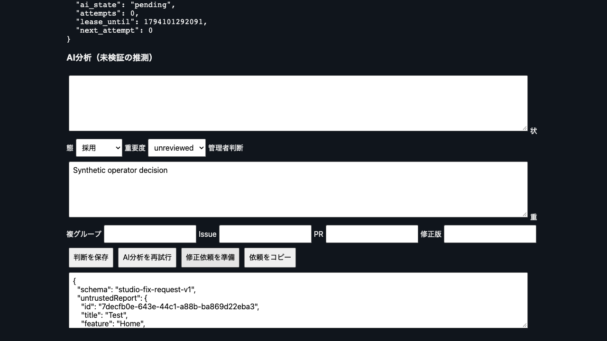

# Studio 0.87.0 report-system candidate

Base main: `4cfbea2cfee9d63e0e55690741cad0179cb54e0a`. Independent development branch. No main merge, Pages update, Production Worker/D1/R2 change, real Account/Project access or paid AI request.

## Completed flow

The sidebar safety section has a 14px report button. The modal retains text while closed or navigating Studio, warns before page unload, shows the exact bounded environment metadata before submission and preserves the same UUID on retry. Only OS/browser families, Studio version, workspace and timestamp are collected; no Account, Pro credentials, storage, Project or Sync records are read. Screenshots are intentionally deferred. Title is required so the list remains usable. After an acknowledged success, fields clear and the receipt stays visible.

`src/studio-reports.js` provides bounded report ingestion and Operator APIs. The optional `report-release-entry.js` composes existing Worker fetch/schedule handlers without modifying them; both report routing and AI remain OFF unless explicitly enabled. It is a deployment candidate, not an instruction to replace a Production artifact whose source identity has not been established. `report-dev-entry.js` has no Sync/Account routes and binds only the dedicated development D1.

Four tables in `report-migrations/0001_reports.sql`: reports, operator audit, submission limits, independent AI budget. This is a separate D1 binding and migration directory; never apply to shared Sync/NEWS D1 or use their migration journal. No existing schema is altered.

The Operator UI is served by the Worker at `/report-operator`; every request requires verified RS256 Cloudflare Access JWT issuer/audience/email allowlist, reused unchanged from the NEWS Operator authentication module. `REPORT_*` settings map into this verifier without sharing NEWS settings, data or secrets. Mutation origin and CSRF checks apply; stale decisions use revision CAS. Rendered text uses textContent/value; report strings are never HTML, commands or AI instructions. Operator AI corrections and decisions are audited. The UI supports priority filtering, duplicate-group labels, pagination, detail/history, decision states and structured copyable Codex requests. No GitHub write capability exists.

AI uses the existing Workers AI response normalizer and the fixed low-cost model already present in AI support: `@cf/qwen/qwen3-30b-a3b-fp8`. It receives only bounded report fields and up to five same-feature candidate titles. No code is fetched. All output is marked unverified; verified-facts lists are forced empty. Duplicate candidates are suggestions; grouping and priority remain operator decisions. AI jobs are stored in D1, leased, retried up to three attempts with bounded backoff, and drained on submission or the optional schedule. Provider failure never removes the original report. No synchronous AI work delays the accepted receipt.

Each call reserves configurable micro-USD in an atomic daily budget before provider invocation; failures keep the reservation. Require at least 5,000 micro-USD reservation/call, an explicit daily cap and call count. Defaults disable AI. These are conservative application reservations, not verified provider billing; recheck model pricing before paid activation and configure Cloudflare billing alerts. Usage is wholly separate from AI相談. No automatic downgrade or alternative paid model is attempted. The caller wait is bounded to 25 seconds; a timed-out provider might finish and be billed, covered by its reservation.

Report limits: 24,000 request bytes, 8,000 description chars, 4,000 reproduction chars, 2,000 expectation chars, 10 accepted attempts/IP/hour and 1,000 global attempts/day. IP is stored only as a keyed rotating-hour hash. Origins restrict browser use, not bot identity; rate limits are the abuse boundary. Limit rows and daily budgets need an operator-approved retention policy before general release; no report deletion is implemented.

## Development deployment and evidence

- Worker: `cruise-studio-reports-dev-20261108` (workers.dev), no Production bindings.
- D1: `cruise-studio-reports-dev-20261108`, ID `0bbff651-94cf-4474-9951-5ceac648c9ce`.
- Config: `workers/sound-cruise-sync/wrangler.reports-development.jsonc`; allowed browser origin `http://127.0.0.1:18842` only.
- Final development Worker version: `89272cba-997d-467e-a2e6-67bb41092b18`.
- Acceptance: 9/9 scoped backend/Operator browser checks and 12/12 existing Studio metadata/cache checks. Chrome remote component transport and three-theme/two-width layout matrix PASS.
- Paid AI OFF; no AI binding. Operator config deliberately absent remotely, so the cloud development admin is closed until Access configuration is approved. The remote deployment is not a real-operator acceptance PASS.
- Real HTTP submission from disposable Chrome reached this development Worker and returned receipts. The remote D1 holds only synthetic reports. Failure/retry, close/reopen retention and 390/1280px width checks passed using the real report component in an isolated HTML fixture. This was component acceptance, not a full authorized Studio-entry E2E.
- Local workerd + real SQLite/D1: ingestion/idempotency, AI provider success/failure/retry, persisted analysis, valid signed synthetic Access credentials, admin decisions and audit/CAS, no-admin refusal, CSRF, oversized input, rate limits and budget exhaustion verified. Operator browser UI list/decision/export uses the actual UI, actual verifier, real D1 and a synthetic AI transport. No paid model execution was used or claimed.
- Existing Studio metadata/cache/package checks: 12 PASS. Package adds exactly `report-form.css` and `js/report-form.js`; old compatibility assets remain frozen.




## Reproduction

Use installed project-compatible Miniflare/esbuild and jose dependencies; tests accept an external runtime package path without altering product dependencies.

```sh
REPORT_TEST_RUNTIME=<sync/package.json with installed dependencies> \
REPORT_BROWSER_MODULE=<browser-runtime/package.json> \
node --test workers/sound-cruise-sync/test/studio-reports.test.mjs
REPORT_BROWSER_RUNTIME=<browser-runtime directory> \
REPORT_DEV_ORIGIN=https://cruise-studio-reports-dev-20261108.cruise-port-requests.workers.dev \
node apps/cruise-studio/tests/report-form.remote.cjs
```

The remote test only permits an explicitly named development origin and submits synthetic data. It routes the production-shaped API request to development; Production receives no test request. The app component has no development auth injection.

## Production activation approval checklist and procedure

1. Approve the candidate PR, feature rollout and the isolated report D1 resource. Choose the verified existing deployed Worker entry before composing the wrapper; preserve all existing bindings/vars/cron. No Production source overwrite is authorized by this PR.
2. Create/bind a dedicated `REPORT_DB`, apply only the report migration there, verify the four tables. Leave `STUDIO_REPORTS_ENABLED=false` and `REPORT_AI_ENABLED=false` during initial deployment.
3. Provision a distinct Access application/audience on the existing Worker hostname and `/report-operator*` paths; set REPORT_OPERATOR_ORIGIN, REPORT_ACCESS_ISSUER, REPORT_ACCESS_AUD, REPORT_OPERATOR_EMAILS and secret REPORT_CSRF_SECRET. Reuse the existing human-operator identity provider. Set REPORT_RATE_SECRET separately and REPORT_ALLOWED_ORIGINS to the exact Studio origin. Preserve forwarded Access assertion verification. Do not trust a header without the signature check.
4. Approve the composed report routes and frontend assets, then enable report intake only. Verify real Access login, denial without login, receipt, admin decision, Codex export and 3-theme UI from the actual authenticated Pro entrance. Optional screenshots remain out of scope.
5. Separately approve the Workers AI binding and paid enablement, daily call/micro-USD caps and per-call reservation. Only then set REPORT_AI_ENABLED=true. Verify one approved synthetic model invocation and actual usage, then schedule queue drain using the existing schedule. Never reuse AI相談 budget tables.
6. Set operational report/limit retention and privacy handling before general user launch. Reports may contain voluntarily typed personal data despite the warning; admin access remains restricted.

Rollback: disable STUDIO_REPORTS_ENABLED and REPORT_AI_ENABLED; restore only report frontend assets if necessary. Preserve all report rows and audit records. Never roll back shared D1, clear Outbox, modify Account data or undo unrelated releases.

References: [D1 prepared statements and atomic batches](https://developers.cloudflare.com/d1/worker-api/d1-database/), [Workers background lifetime](https://developers.cloudflare.com/workers/runtime-apis/context/). Local runtime compatibility follows the repository's installed 2026-09-01 baseline; no existing Worker compatibility date was advanced.
