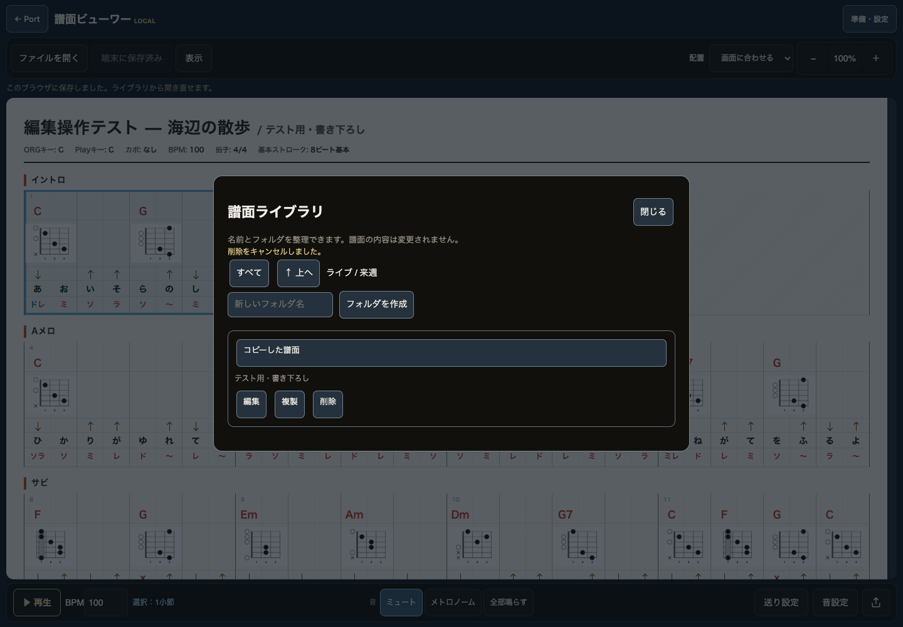
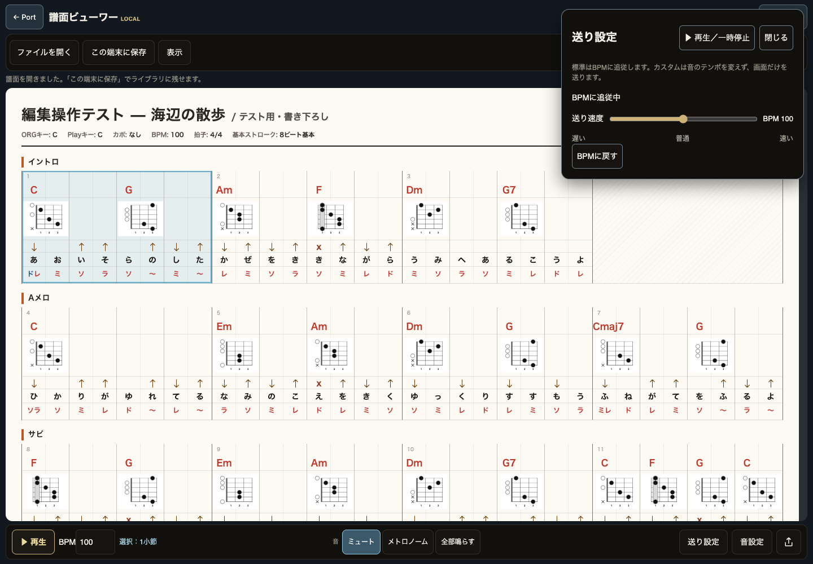
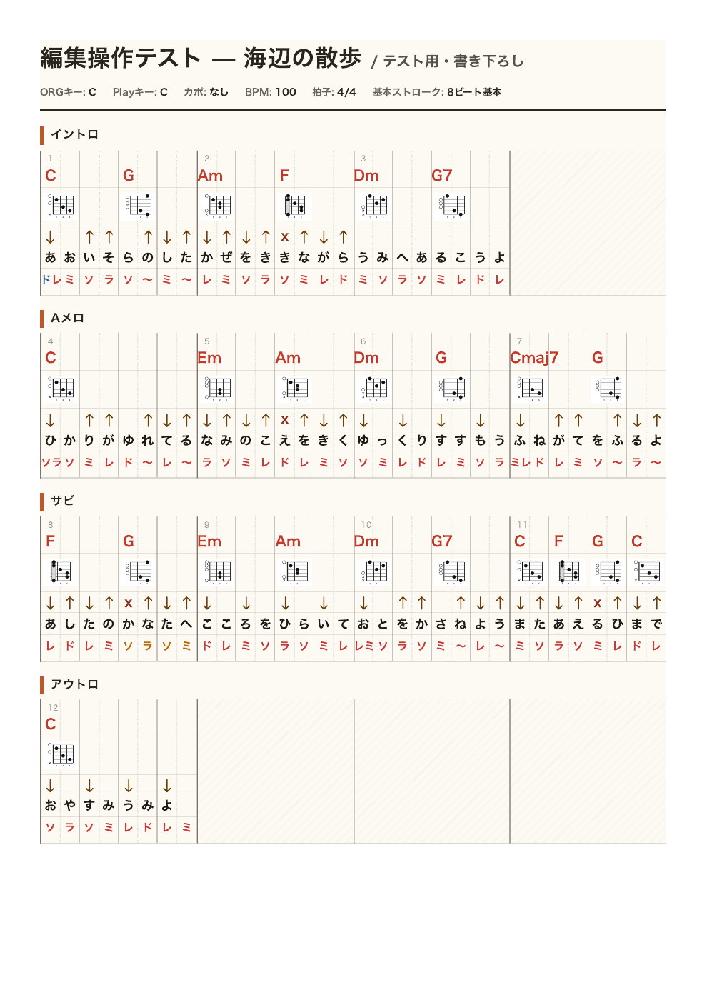

# 譜面ビューワー：ライブラリ整理・書き出し・送り設定

2026-11-16。Studioローカル候補 **0.151.0-dev.1**、Viewer **0.8.0-dev.1**。基準`28de7fb0`／`codex/score-toolbar-ui`。前候補0.150の未コミット差分を保持し、今回もコミット・pushなし。正式Studio **0.88.1**、本番配信・公開Port・実Account・認証／Sync設定・Worker・shared・既存他アプリは変更していない。

## 操作

- 譜面クルーズの曲メニュー→ファイルの先頭「譜面ビューワーに書き出す」で、端末のViewerライブラリに追加する。完了カードから「譜面ビューワーに移動」または「閉じる」。同名があれば上書き／別名／キャンセルを選ぶ。複数の同名がある場合は格納先も表示して上書き先を選択する。
- 「PDFで書き出し」もファイル項目に追加。既存の印刷処理を呼び、ブラウザの印刷ダイアログでPDFとして保存する。元のJSON出力・読み込み・印刷も維持。
- Viewer上部の「ファイルを開く」に「ライブラリから開く」「PCからファイルを開く」をまとめた。
- ライブラリで名前・格納先の編集、複製、削除、フォルダ作成・入れ子・移動が可能。**編集は名前とフォルダの整理で、音楽内容は読み取り専用のまま**。削除は確認あり、空でないフォルダの削除は拒否。開いているファイルを削除すると表示は保持し、離脱時の保存確認の対象になる。
- 下部中央に「ミュート／メトロノーム／全部鳴らす」。右側に「送り設定」「音設定」と書き出しアイコン。「…」「先頭」を表示する旧メニューは廃止。
- **「自動追従に戻る」**は、再生中などに自分で先の譜面・前の譜面へスクロールした後、演奏位置への追従に戻す操作。手動で追従を外した時だけ表示する。
- 書き出しアイコン→「PDFで書き出す」。独自譜面は現在の表示設定を別窓へ読み取り専用で投影し、印刷ダイアログでPDF保存。PDF入力は元のPDFバイト列をそのままダウンロードする。音楽編集用ファイルの再出力とは区別する。

## 送り設定

独自譜面は初期状態が**BPMに追従**。「送り速度」のスライダーを操作すると**カスタム速度**になり、画面だけを独立した秒数／小節で送る。音のBPM、伴奏・メロディの発音時刻は変えない。「BPMに戻す」を1回押すと、現在の音の位置へ戻り、BPM追従に復帰する。開いている設定カードの状態・数値も同期する。

独立した音楽時計は増やさず、カスタムでもAudioContext時刻の経過を読む。停止中の時間を送りに加算しない。位置選択・再開・曲末・端末設定の復元を扱う。カスタムでは意図的に音の位置と画面位置が先行／遅延する。

PDFの送り設定は開いたまま自動送りを開始／一時停止でき、スライダー操作を即時反映する。遅い120秒／普通30秒／速い7.5秒が基準。既存の正確な秒・BPM・拍数・ページ個別設定は「さらに詳細」に保持。「完了」または「閉じる」でカードを閉じる。設定はモデルレスなので、背後の譜面や再生操作を止めない。

送り速度・表示・位置・音設定は端末のライブラリ項目／版ごとに保存する。音楽の原本・共有表示プリセットには混ぜない。ファイルを即座に切り替えた場合も、遅延保存前の設定を旧項目へ書き終えてから切り替える。

## 保存境界

Viewer専用IndexedDBをv2→v3へ更新し、ライブラリの`entries`と`folders`を追加。既存の原本・版履歴・端末設定・最後の位置・共有プリセットを保持して元の項目をルートへ移す。ファイル形式v1は変更しない。

名前・フォルダ・複製はライブラリ索引の操作で、JSON／PDFの原本を再符号化しない。複製は固有の項目IDと端末設定を持ち、保存時点の原本の版を参照する。片方の上書き・削除がもう片方の原本を変更しない。削除はライブラリからの除去で、共有する原本・版履歴の物理消去ではない。

上書きは項目versionのCASと同名検査を保存トランザクション内で実施。名前確認中の他タブ変更、原本の同版別bytes、容量不足、保存直前に元の編集が変わった場合は破壊的な書き込みを拒否する。フォルダ循環・深すぎる入れ子・存在しない格納先も拒否する。実Syncスキーマや実アカウントは変更しない。模擬Syncの選択UIだけ項目IDに対応する。

## 検証

- 全Node：**2,320成功、失敗0、既存専用環境1skip**。ライブラリ移行・複製・フォルダ・CAS・容量不足ロールバック・PDF原本保持・旧版参照・共通時刻による送りを含む。
- 新規UI：**14成功**（Chrome／WebKit、親groupを含む）。完了カード・上書き／別名／取消・移動先の一致、Studio PDF入口、フォルダ整理・複製・削除、原本保持、独自譜面のカスタム送り・BPM復帰・即時切替時保存、PDFのモデルレス即時送り、PDF原本バイト一致、独立した印刷投影を確認。
- 既存関連：**96成功**。ローカル編集2、契約10、Stage1 18、Stage2 20、モバイル10、PDF20、模擬Sync16。既存の操作性回帰14も成功。PDFの200ページ差し替え試験は、隠れたファイルメニューの表示状態で入力先を判定していた古いfixtureを、reader種別判定へ修正して再実行した。
- 最初の新規UI試験では、Studioの独立した未保存Projectへの既存離脱確認をfixtureが処理していなかった。確認を明示的に操作し、実際に別名項目の読み込み完了を待つよう修正した。Viewerの未保存ガードを迂回したものではない。
- 画面確認で見つかった、外側のBPM復帰時の設定カード表示の更新漏れと、印刷別窓に表示設定CSSが入らない不具合を修正。PDFをA4で生成し画像化して、日本語・フォーム・各段の整列・斜線・表示設定の反映を確認した。
- Python模擬ストア：**9成功**。ブラウザの外部リクエスト・予期しないJS例外なし。容量不足は例外注入による試験で、端末の空き容量を使い切ってはいない。
- 受信済みファイルで実TCP断：**3成功**。Chromeは全ブラウザプロセス再起動、WebKitは新規pageから、独自譜面・実音源予約・同一PNGの日本語PDF・送り・ローカルPortへの戻りを確認。サーバーを同じ18874へ復旧した。現PIDは`/private/tmp/viewer-stage4-restored-server.pid`。APIはキャッシュしない。**関連ブラウザ合計127成功**（96＋既存操作性14＋新規14＋TCP断3）。
- 静的依存255件／11,815,906bytes、manifest `0.151.0-dev.1-8a7676b7b8a7`。原本は静的キャッシュに含めずIndexedDBへ分離。

ログ：`/private/tmp/viewer-library-node-verified.log`、`viewer-library-ui-pass.log`、`viewer-library-regression-first.log`（PDFのみ次の再試験へ置換）、`viewer-library-browser-final.log`、`viewer-library-python.log`、`viewer-library-cold.log`。同一ケースの再試行は重複加算しない。

## ローカルで確認するには

Studio：<http://127.0.0.1:18874/>。専用Viewer：<http://127.0.0.1:18874/apps/score-viewer/local/index.html>。

Studioは再読込。旧SWの専用Viewer／Port画面は開いている該当タブをすべて閉じて開き直す。強制SW更新や、保存原本の初期化は行わない。

スマホ実機、OS印刷ダイアログでの手動保存、物理的な消灯防止、WebKit全プロセス再起動、実Syncは未確認のまま。
