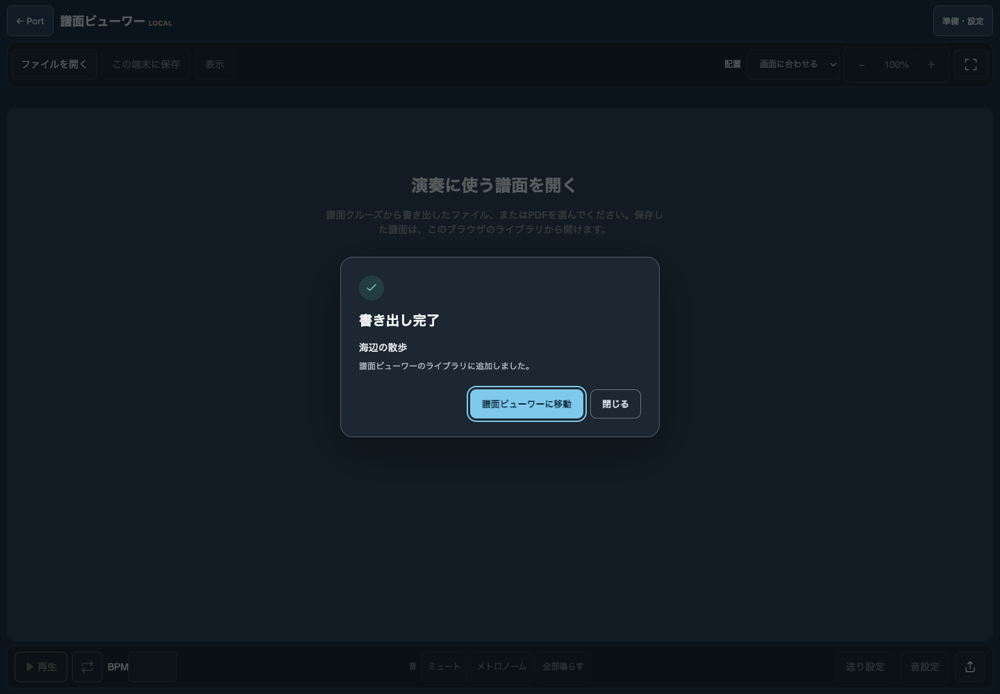
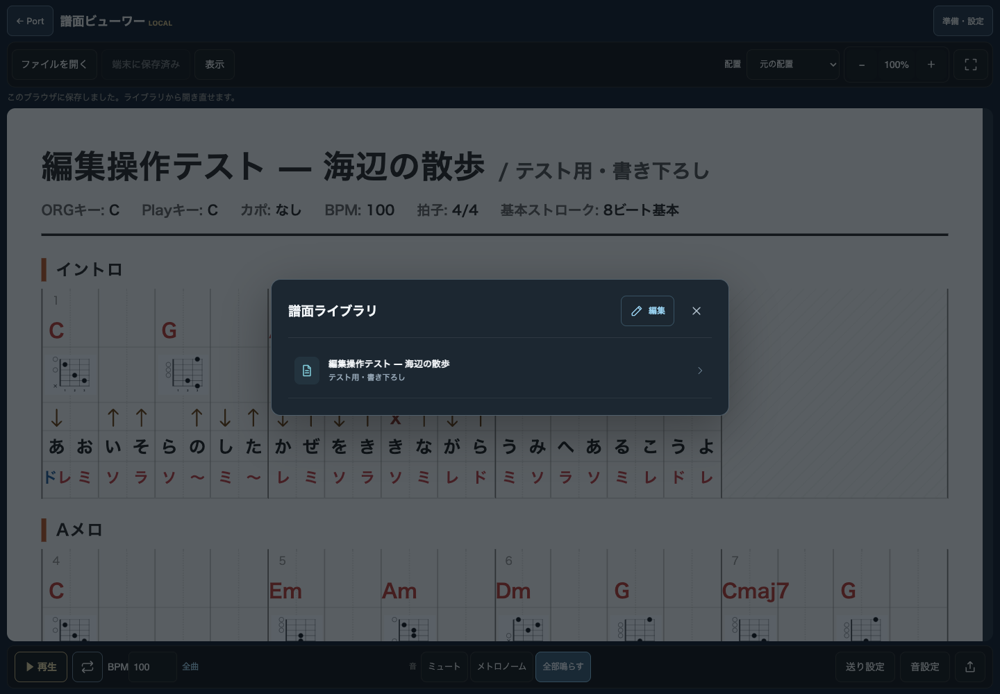
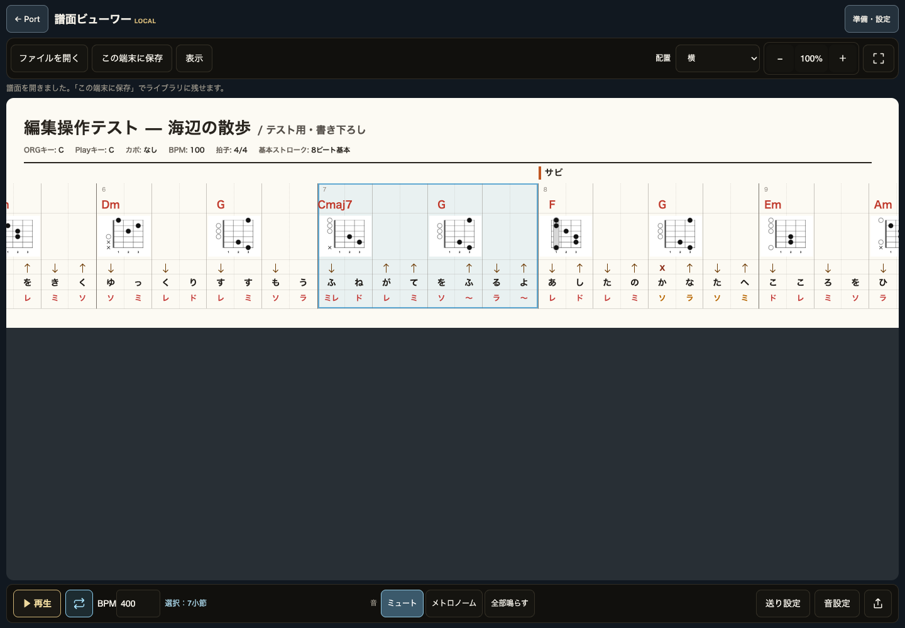
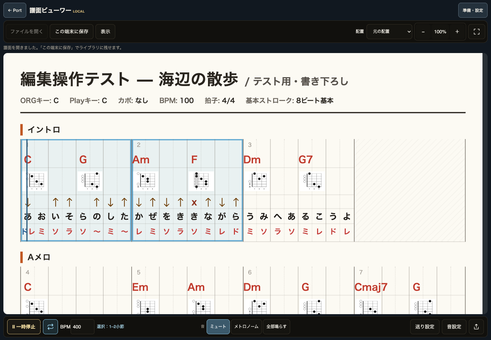
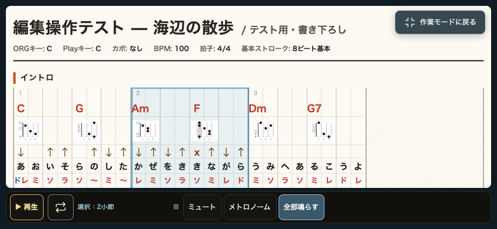

# 譜面ビューワー：一覧・横表示・範囲再生・集中モード

2026-11-17。Studioローカル **0.152.0-dev.1**／Viewer **0.9.0-dev.1**。基準`82e4e8a7`、`codex/score-toolbar-ui`。コミット・pushなし。正式Studio **0.88.1**、公開HTML・本番配信・実Account・認証／実Sync設定・Worker・shared・既存他アプリは変更していない。

## 操作と表示

- **書き出し完了**：幅460pxを上限に、見出し・曲名・短い説明・操作欄を分けた。移動を青い主操作、閉じるを補助操作として、フォント・余白・フォーカスを統一。
- **譜面ライブラリ**：通常時は保存曲だけをコンパクトに一覧表示。曲名・アーティスト／PDF種別・格納先を示す。ヘッダーの「編集」で管理へ入り、名前・格納先変更、複製、削除、フォルダ作成・移動・入れ子が使える。「完了」で一覧へ戻る。各行の操作はラベル付きSVGアイコンにし、削除は赤・確認あり。音楽内容は編集しない。既存の原本・版・項目ID・フォルダ・保存設定を維持しDB形式は変更しない。
- **配置→横**：実小節を1行に並べて横へ送り、斜線の空き枠／行末の埋め枠を表示しない。音楽の小節ID・番号・tickは保つ。セクション名を開始小節の上に置き、曲名・曲情報は横スクロール中も読める。ズーム・音量・テンポ・カスタム送りを引き続き使える。
- **元の配置**：元の小節数・行の個別配置を保ち、論理幅794pxの紙面を閲覧幅へ合わせる。100%は幅に合わせた倍率。自動設定の場合も元のrendererの段組判断を保持する。ズームでさらに拡縮できる。縦の配置同士は小節DOMを再利用し、横モードとの切り替え時だけ新しい投影を作る。
- **右窓で表示**：Studio中央のViewer見出しに追加。同じreaderを右窓へ移すため、ファイル・選択・再生位置を別インスタンスへ複製しない。既存の中央へ戻す操作も維持。ローカルadapterの操作許可は、既登録のscoreViewerだけを含める。
- **初期再生設定**：カウントイン・メトロノームをONへ。保存済みの明示的なOFF設定は維持する。ミュートの音モードでは拍音・カウントインも無音になる。
- **範囲選択**：クリックで1小節、マウスドラッグ／Shift＋クリックで連続範囲を選択。紙面の余白からもドラッグを始められる。単なる余白クリックで解除。タッチは通常のパン／ズームとタップを維持。選択表示は再生・停止・配置切替中も保持する。
- **繰り返しアイコン**：OFFなら選択範囲の末尾で停止、ONなら選択範囲を繰り返す。1小節も同様。選択なしでは全曲が対象。再生中に繰り返しだけを切り替えても現在tickと鳴っている音の尾を保持する。繰り返しフラグは端末設定で、範囲選択は閲覧セッションのUI状態。
- **集中モード**：右上の拡大アイコンから入る。ファイル・表示・詳細設定などを隠し、譜面、再生／一時停止、繰り返し、選択位置、音モードと戻る操作を残す。右上の「作業モードに戻る」またはEscapeで復帰。Fullscreen APIを使える場合は利用し、非対応・拒否時も画面内で拡大する。独自譜面・PDF・右窓で利用でき、離脱時に解除する。

## 音・位置・読み取り専用の境界

rangeStart／rangeEnd／loop／iterationを既存の共通拍時計に追加。別AudioContextや独立した曲時計は作らない。範囲外のseek／予約を拒否し、範囲末尾で音の尾を切る。次の周の先頭は短い先読み窓で予約し、テンポ変更で古い未来の予約を取り消して作り直す。音源の実音高・曲BPM・元Project・原本bytesは変更しない。選択の変更は停止中に行い、再生中の選択表示だけを維持する。

カウントインは明示的な開始時の1回で、各周には挿入しない。停止・中断・全停止・離脱で未来の発音を取り消し、所有権を解放する。選択範囲のカスタム送りはその範囲内に収め、ループで閲覧位置も戻す。通常の配置の縦座標と横モードの横座標を、同じ小節tickから補間する。

専用ファイル形式v1とライブラリDB v3は維持し、表示設定のflowへhorizontalを追加。プリセットと端末表示設定にも保存できる。古い譜面は引き続き読み込める。横モード付きの新しい表示設定を古いViewerが扱えるという互換性は主張しない。

## 検証

- **全Node：2,329成功、失敗0、既存の専用環境1skip**。新規9件は、範囲の正確な停止・音の切り詰め・無効範囲拒否、次周の先行予約・テンポ変更時の再予約、停止／再開、200周近い反復でのノード上限・カウントイン1回、Repeat変更時の鳴り尾、clockの残余時間と予約世代、横表示の音楽不変、初期ON／明示OFF保持、カスタム送りの範囲内制限。
- **新規UI：16成功**（Chrome／WebKit、親groupを含む）。完了カード、通常一覧／編集切替・複製、元の段組と画面幅、横1行・斜線省略・横送り、初期ON、余白からのドラッグ、選択表示を維持した停止とループ、Shift選択・行またぎ・配置変更、独自譜面／PDFの集中表示・Escape・スマホ相当縦横、元の自動段組保持、同一readerの右窓移動を確認。Fullscreen APIを明示的に無効にした右窓・中央でも、集中表示が画面左上から全幅・全高になることを確認。
- **既存Viewer関連：112成功**。ライブラリ14、モバイル10、PDF20、Stage1 18、Stage2 20、模擬Sync16、操作性14。新しい一覧UIに合わせ、旧管理試験は編集ボタンを明示してから操作し、旧タイミング試験はカウントインOFFを明示した。新規試験ではONが初期値であることを別途確認。
- **既存の境界／ローカル編集：12成功**。Viewer契約10、ローカル編集2。元Projectの保存・出力・読み取り専用の分離を維持。
- **Python模擬ストア：9成功**。実アカウント接続は使用していない。
- **実TCP断：3成功**。保存した独自譜面・音源・同一描画の日本語PDF・ローカルPortを、サーバー停止中に確認。Chromeはブラウザ全プロセス再起動、WebKitは同じ一時contextの新規page。試験後は同じ18874へ復旧。**関連ブラウザ計143成功**。再試行の同一ケースを重複加算しない。
- 静的依存258件／11,837,859bytes、manifest `0.152.0-dev.1-3141568cacfc`。ユーザーファイルやAPIを静的キャッシュへ混ぜない。

ブラウザ確認で見つかったクリック時のpointer captureによる選択解除、空の集中モードアイコン、ローカル入口での右窓ボタン無効化、通常配置切替のDOM再利用漏れを修正して再確認した。集中表示中はホストのCSS query containerを一時解除し、Fullscreen APIなしでも親の幅・位置に閉じ込めない。初回の旧管理試験や設定カードの「閉じる／完了」の旧前提は、アプリの不具合と区別して更新した。

ログ：`/private/tmp/viewer-performance-node-verified.log`、`viewer-performance-core-complete.log`、`viewer-performance-ui-fallback.log`、`viewer-performance-ui-final.log`（既存の契約／ローカル編集12件）、`viewer-performance-regression-first.log`（Stage1・ライブラリは次の再試験結果へ置換）、`viewer-performance-regression-recheck.log`、`viewer-performance-python.log`、`viewer-performance-cold-final.log`。

実機SafariのFullscreen、iPhone／Android実機、物理的な画面ロック防止、OS印刷、聴感、WebKitの全プロセス再起動、実Syncは未確認のまま。Chrome／WebKitの画面サイズ模擬と実機を混同しない。

ローカルStudio：<http://127.0.0.1:18874/>。専用Viewer：<http://127.0.0.1:18874/apps/score-viewer/local/index.html>。Studioは再読込し、旧SWの専用Viewer／Portは該当タブをすべて閉じて開き直す。強制更新や保存データの初期化は行わない。
