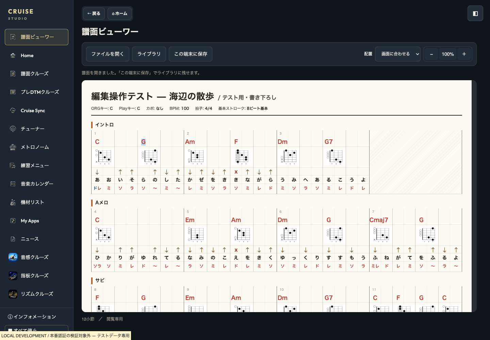
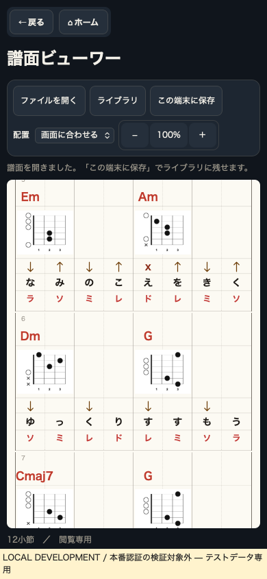
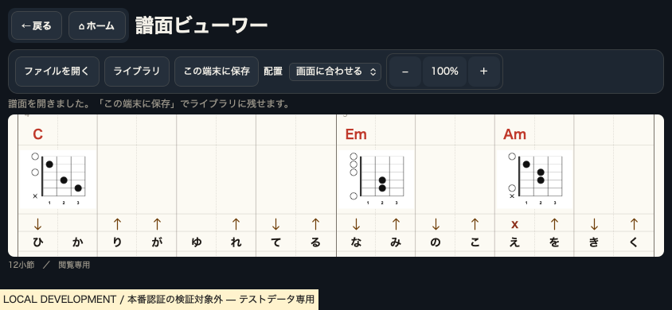

# 譜面ビューワー 段階1 — ローカル閲覧画面

2026-11-16。Studio候補 **0.145.0-dev.1**／Viewer基盤 **0.2.0-dev.1**。基準HEAD `bf533fe4`、作業ブランチ `codex/score-toolbar-ui`。先行の[Astra設計](../SCORE_VIEWER_DESIGN_20261116.md)・[段階0](../SCORE_VIEWER_STAGE0_20261116.md)の未commit差分を保持して実装した。コミット・pushなし。

## 使い方

既存サーバー **http://127.0.0.1:18874/** で確認する。新規サーバー起動なし。

1. 譜面クルーズの「曲メニュー」→「ビューワー用に書き出す」。`.cruise-score.json` をダウンロードする。編集中の未保存の内容も、確定・検証済みなら書き出せる。元Projectの保存/履歴/更新日時は変更しない。
2. Studioホームの「ツール」→「譜面ビューワー」、または左メニューから開く。右の細いツール枠ではなく、中央の独立画面で表示する。
3. 「ファイルを開く」で閲覧用ファイルを選ぶ。編集機能はない。曲のJSONを書き戻す経路もない。
4. 「この端末に保存」で、このブラウザ専用のライブラリに保存する。保存完了後にボタンを無効化し「端末に保存済み」と表示する。「ライブラリ」から再度開ける。
5. ページ再読込後にビューワーを開くと、最後に保存/閲覧したファイルと閲覧位置・表示を復元する。配置は「画面に合わせる」「元の配置」、倍率は50〜300%。

現在は専用形式の読み込みに限定する。編集元JSONを誤ってProjectとして取り込む処理はビューワーに持たせない。PDF、再生・テンポ変更・自動スクロール、表示パートの切替/プリセット共有は後続段階。スマホ向けPort入口はまだ追加していない。

## 実装・保存契約

`apps/score-viewer/ui/viewer.mjs` はホストから描画adapter・codec・保存adapterを受け取り、Studioのグローバルや認証には依存しない。Studioとの接点は除外対象のローカルscript `local-viewer-bootstrap.js` / `local-viewer-studio.mjs`。公開HTML・Studioテンプレートには入口を追加せず、`local-ui-entry.mjs` がローカル画面だけに入口/画面/CSS/初期化scriptを生成する。Shellには画面IDとadapter枠だけを追加し、該当DOMがない正式入口では有効化しない。新しい権限・認証・Sync設定は追加しない。

### ファイル書き出し

- 確定していない入力・不正入力・保存/競合等の既存ガードを再利用。書き出し途中の元Session変更・画面移動・曲変更・入力変更ではダウンロードを中止する。
- documentIdは元Project IDのSHA-256から安定して導出し、revisionIdは書き出しごとに新規発行。音楽snapshotは段階0の完全なschema2形式。
- 現行の文字/色/書体/フォーム/表示/グリッドと、存在する小節/空き枠に対応する行設定を封入。削除済み小節を指す古い行設定は除外する。元の表示設定自体は変更しない。
- 曲名はファイル内では保持し、OS用ファイル名だけ長さ・使用文字を制限する。書き出したファイルを自動でライブラリへ保存/Sync登録しない。

### 端末内ライブラリ

専用IndexedDB `cruiseStudio.viewer.library.v1`、DB version 1。エディターのlocalStorage/RepositoryやSync DBから分離する。

| store | 内容 |
|---|---|
| documents | 文書ID、現在の保存revision、曲名・アーティスト・小節数・保存日時・byteHash |
| revisions | 文書ID＋revisionIdごとの元UTF-8 bytesとSHA-256。既存revisionは上書きしない |
| preferences | 文書ID＋revisionIdごとの端末設定・閲覧anchor |
| state | 最後に開いた保存ファイル |

保存前に再検証し、ファイル実体・索引・最後のファイルを同じtransactionで確定する。同じrevisionの同じbytesは冪等に扱い、異なるbytesでは競合として拒否する。新しい版を保存しても古いrevisionの実体を消さない。前版を選ぶUIは後続工程とし、現段階のライブラリは文書ごとの最新保存版を並べる。

取得時もcodec・byteHash・文書/revision IDを確認する。破損実体や破損索引を成功扱いにせず、自動削除もしない。容量不足/保存不可/transaction abort時は現在の閲覧を残し、保存済みと表示しない。保存後も元bytesは表示設定から変更されない。

これはブラウザ内保存であり、アプリのオフライン冷起動・クラウド保存完了を意味しない。

### 描画と縦横レイアウト

- 独立したviewportと読み取り専用ownerを使い、編集用属性・ボタン・入力・イベントリスナーを持ち越さない。
- 元の譜面と同じ音楽投影・フォーム描画・表示CSSを再利用。表示設定のownerはメモリ内で別に作り、エディターのAppSettingsを読んだり書いたりしない。
- ストロークに基づく8/16分の共有グリッドをエディターに合わせ、コード/ストローク/歌詞/ドレミの表示内容を比較する。
- 自動配置は倍率を考慮した幅で1/2/4小節へ折り返す。「元の配置」は元の列数/個別行ルールを優先し、狭い画面では横スクロールできる。
- 倍率は紙面全体のtransformと実寸wrapperを使用。CSS zoomのWebKit座標差を避け、フォーム・文字・線をまとめて拡縮する。
- 小節ID＋小節内の相対位置で閲覧anchorを保持。再配置のためのscrollを手動操作として記録せず、行がまとまって先頭の小節が変わる場合も、元の小節をanchorとして維持する。縦横切替・倍率/配置変更・再読込を確認。
- 行再配置/倍率変更では小節とフォームSVGを再利用する。スマホ幅/短い横画面ではStudioサイドバー/共通フッターを畳み、戻る/ホームとファイル操作は残す。他の画面のレイアウトには適用しない。

ファイルの読み込み・最初の描画準備が成功してから現在の紙面を置き換える。失敗した入力、古い非同期処理、画面離脱後の結果では、前の譜面を壊さない。

## 検証結果

- **全Node：2,269成功、0失敗、既存の専用環境向け1skip。** 新規の保存adapter7件と表示設定出力1件を含む。原bytesの再取得、同一版の競合、新版保存時の旧版保全、設定分離、破損実体/索引、容量不足のtransaction rollbackを検証。
- **新機能Chrome/WebKit：18成功。** ネイティブのファイル選択、実ダウンロード→読込、元Session/履歴/localStorage不変、端末保存・ライブラリ・再読込、破損入力、保存不可、書出し中の変更、128小節のDOM/SVG再利用・実際の拡大、縦横の反復切替と閲覧小節の保持。
- **既存譜面：Chrome73・WebKit73成功。** 既存の入力/選択/編集/保存等を確認。
- **関連ブラウザ：24成功。** ローカル入口、段階0の読み取り専用契約、長い曲の幾何変更の回帰確認。
- 合計ブラウザ188成功。JS例外・外部URLへの要求がないことを各隔離試験で確認。
- PC 1440×1000／縦390×844／横844×390の画面を確認。WebKitはデスクトップの自動試験であり、iOS/Safari実機・本番資格・実Sync・OS印刷の確認ではない。

試験ログ：`/private/tmp/viewer-stage1-all-node.log`、`viewer-stage1-browser-final.log`、`viewer-stage1-score-chrome.log`、`viewer-stage1-score-webkit.log`、`viewer-stage1-related-browser.log`。

## 残る範囲・境界

次は設計の段階2：表示項目・文字調整・共有プリセット、伴奏/メロディ/拍音、練習テンポ、一時停止、共通時計と連続スクロールの結合。現時点では音を含む初期製品版は未完成。

本番配信・公開HTML・実Account/Sync・認証設定・Worker・Service Worker・manifest・shared・Port/他アプリは変更していない。スマホ実機・Port入口・オフライン冷起動・PDF・模擬Syncは後続。本番公開・実アカウント接続は別の承認工程とする。
