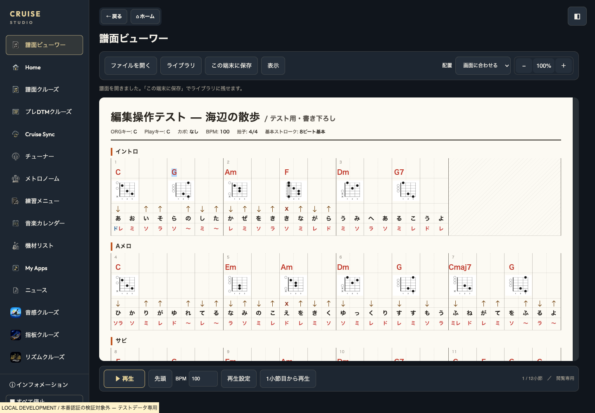
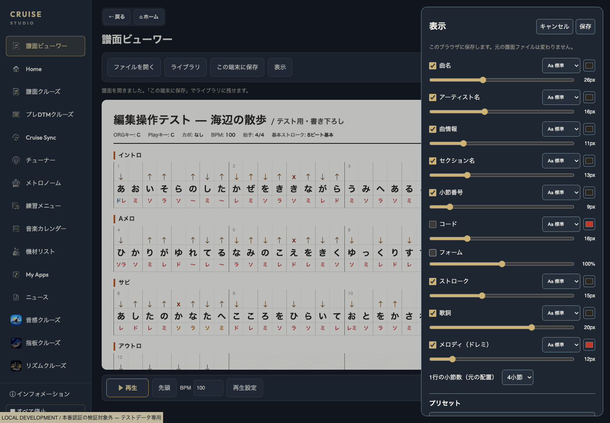
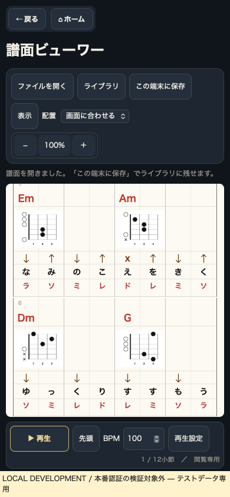
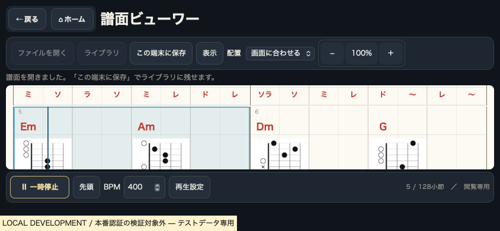

# 譜面ビューワー段階2 — ローカル候補

2026-11-16。Studio local **0.146.0-dev.1**／Viewer **0.3.0-dev.1**。正式Studioは0.88.1のまま。基準HEAD `bf533fe49b9cc5d28a7f9cbfab86e6479992fcb4`、作業ブランチ `codex/score-toolbar-ui`。段階0・1と設計書の未commit差分を保持。

## 使い方

既存のローカル入口 `http://127.0.0.1:18874/` →「ツール」→「譜面ビューワー」。譜面クルーズの曲メニュー「ビューワー用に書き出す」で作った `.cruise-score.json` を開く。

- **表示**：曲名／アーティスト／曲情報／セクション／小節番号／コード／フォーム／ストローク／歌詞／メロディの表示切替。文字サイズ・書体・色、フォーム倍率、1行の小節数を実際の紙面でプレビュー。キャンセルで復帰、保存でこのブラウザへ確定。
- **プリセット**：表示画面の下で名前をつけて新規保存、選択して呼出し。`.cruise-view-preset.json` を書き出して別の端末・ブラウザから読み込める。読込直後はプレビューで、キャンセル／保存を選べる。同名保存を勝手に上書きしない。
- **▶ 再生／一時停止**：登録フォームによるアコギ伴奏とメロディのピアノを同時再生。Spaceも使用可能。入力中・IME・ボタン／ダイアログ内ではSpaceを奪わない。
- **BPM**：20〜400の練習テンポ。再生中でも現在の拍と音程を保って変更。原曲BPMは不変。「再生設定」で原曲のテンポへ戻せる。
- **再生設定**：コード／メロディ／メトロノーム・カウントインを個別に0〜100%。カウントインとメトロノームは既定OFF。「?」内で動作を説明。表示を隠しても音量は変わらない。音だけ消すには音量を0%へ。
- **連続スクロール**：共通の拍時計に合わせ、行の座標を補間してゆっくり送る。青い小節全体の表示と現在地の棒。手動スクロールで追従だけ解除し、音は継続。「現在の演奏位置へ」で追従を再開。
- **停止中の移動**：譜面の小節をクリックして「○小節目から再生」、または左右キーで移動。「先頭」で先頭へ。曲末は停止し、自動ループ・自動巻戻しはしない。

設定と停止位置は閲覧ファイルの文書ID＋revision単位で、このブラウザの専用保存先へ保存。再読込は停止状態で復元する。元ファイル、元Project／Session／履歴／AppSettingsへ書き戻さない。ライブラリに残すには、別途「この端末に保存」を使用する。

## 実装と契約

`apps/score-viewer/core/` のplayer・preset codec・scroll mapと、`ui/` の専用操作を追加。Studio adapterは既存の音楽投影・紙面・同梱音源を利用する。共有音源ファイル・ライセンスは変更しない。

### 音と時計

- AudioContext.currentTimeが唯一の演奏時計。25msのタイマーは120ms先まで予約を補給するだけで、独立した演奏時間を積算しない。紙面は同じ拍snapshotをRAFで読む。
- 音楽上の開始・消音・次の弦の再打音をtickで保持。物理的なピック移動と自然減衰は秒で保持し、高速テンポでは必要な範囲だけ移動幅を縮める。固定BPMで既存のseconds発音計画と比較する。
- 同じ音高の別弦を統合せず、上下ストロークの弦順・強弱・消音を維持。登録フォームがないコードを推測和音へ置き換えない。未対応リズムでは案内し、メロディと拍音だけに限定する。
- テンポ変更で将来の予約を取り消して再計算。ストロークの拍が過ぎていても、まだ鳴っていない弦を落とさない。鳴っている音は新しい拍境界に合わせて終了し、再アタックしない。
- 一時停止からは鳴っていたサンプルの途中と、ピック移動の残りを引き継ぐ。カウントインは明示的な開始前だけで、通常の再開では繰り返さない。
- 全曲分のAudioNodeを一括作成しない。所有権はStudioの既存coordinatorへ登録。全停止・画面離脱・非表示・破棄で予約とノードを解放しContextを閉じる。遅い音源読込の完了で再生が勝手に始まらない。
- 音声中断／予約に追いつけない長い停止では、一時停止して位置を保持する。隠れていた時間を後から飛ばして再生しない。

### 表示と保存

- `.cruise-score.json` 自体のformatVersionは1を維持。練習BPM・音量・位置を元JSONに追加しない。
- 表示プリセットは `sound-cruise/view-preset` version1、最大64KiB。許可済みの表示設定・倍率・配置だけを含む。曲ID・個別行の小節ID・音源URL・音量・BPM・演奏位置を含めない。プリセット適用時は曲固有の行割付を解除し、プリセットの全体配置を使う。
- ビューワー専用IndexedDB `cruiseStudio.viewer.library.v1` をDB version2へ更新。既存4storeを保持して `presets` だけ追加。v1の元bytes・revision・設定・最後の選択を残す移行を試験する。名前つきプリセットは20件まで。
- プリセットの「新規保存」は独立した明示保存で、表示プレビューをキャンセルしても保存したプリセットは残る。取消／読込失敗で現在の紙面や元ファイルを失わない。
- 設定の保存完了表示は、保存transactionの成功後に出す。保存不可は閲覧を継続しつつ失敗を案内する。
- 行座標は再配置時に測定し、RAFごとに全小節の寸法を読まない。回転・文字／表示変更後も現在の小節の表示と棒を再接続する。

## 検証

使用データは自社の合成12／128小節。使い捨てのChrome／WebKit profileとローカルサーバーだけを使用。実ユーザーデータ・実資格・実Syncは使用していない。

- 全Node **2,284成功、0失敗、既存の専用環境1skip**。tick発音計画と既存計画をBPM20／50／100／120／400で比較。開始・終了・弦・音高・音量の許容差1e-7。テンポ変更、ストローク途中の停止再開、遅い読込の取消、終了、時計、preset検証、v1保存先からの移行を含む。
- 新機能Chrome／WebKit **20成功**。プリセットの別profile往復、保存復元、実音源decode、ライブテンポ、各音量、カウントイン／メトロノーム、継続送り・手動解除／復帰、縦横、4回ずつの画面離脱とContext解放、元bytes／音楽JSON／localStorage不変を確認。
- ブラウザのOfflineAudioContextで同梱の実ギター／ピアノを2秒の波形へ生成し、出力が非ゼロ、消音が完全な0、個別出力の和と混合出力が一致することを確認。固定テンポの既存計画との波形RMS相対差はChrome約7.1e-8、WebKit約8.1e-6。WebKitは微小な時刻丸めで波形のbinary一致にならないため、開始／終了時刻の独立比較に加えてRMS相対差0.1%未満・最大振幅差0.001未満を判定基準とする。

- 既存譜面編集の回帰は **Chrome73・WebKit73成功**。段階0／1、ローカル入口、長い曲の描画を含む最終関連ブラウザ **62成功**（上の新機能20件を含む）。今回のブラウザ試験は合計 **208成功、0失敗、0skip**。JS例外と想定外の外部要求がないことも確認。

聴感評価や実際のスピーカー出力の確認ではない。WebKit自動試験はSafari／iPhone実機の確認ではない。

ログは `/private/tmp/viewer-stage2-all-node-final.log`、`viewer-stage2-score-chrome.log`、`viewer-stage2-score-webkit.log`、`viewer-stage2-related-browser-final.log`。画像と波形測定値を本ディレクトリへ保存。

## 残る範囲

次は段階3のPDF読込と送り。Port入口、スマホ実機、オフライン冷起動、画面ロック防止、模擬Syncは後続。全画面モード、A–Bループ、セットリスト、足踏みペダルは今回追加していない。

本番配信・公開HTML／template・実Account／Sync・認証設定・Worker・Service Worker・manifest・shared・Port／他アプリは変更していない。新規サーバー起動なし、既存localhost:18874を継続。コミット・pushなし。
