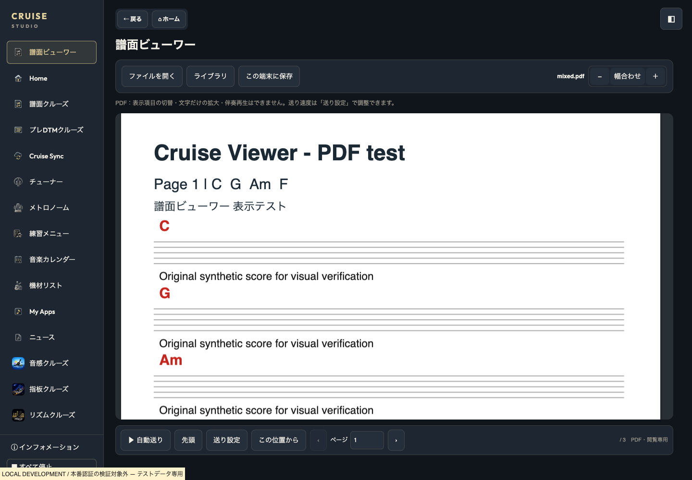
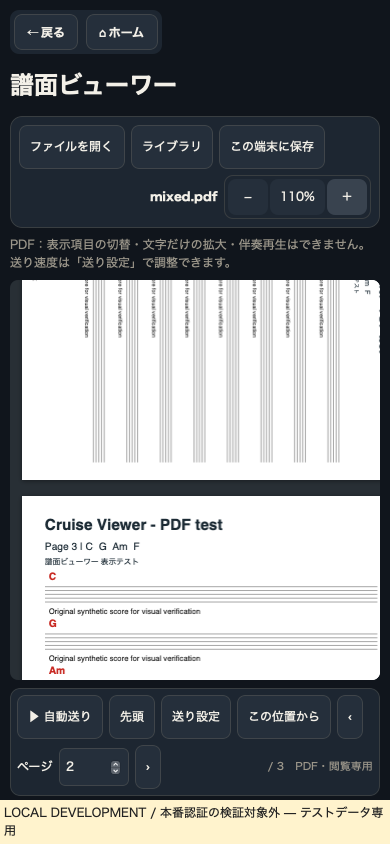
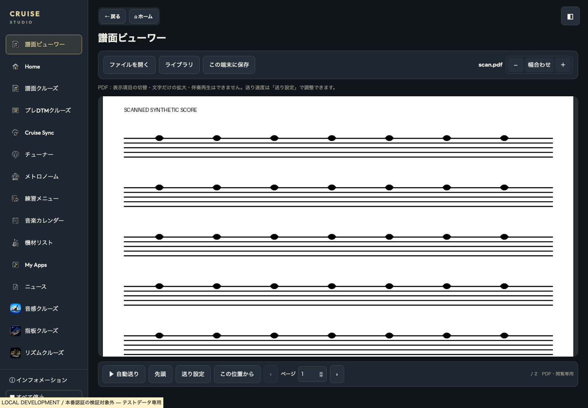

# 譜面ビューワー段階3 — PDFのローカル閲覧

2026-11-16。Studio local **0.147.0-dev.1**／Viewer **0.4.0-dev.1**。正式Studioは0.88.1のまま。基準HEAD `bf533fe49b9cc5d28a7f9cbfab86e6479992fcb4`、`codex/score-toolbar-ui`。段階0〜2の未commit差分を保持。

## 操作

既存ローカル入口 `http://127.0.0.1:18874/` → ツール → 譜面ビューワー → **ファイルを開く**。独自譜面ファイルに加え、一般的なPDFを同じ入口で開ける。

- PDF専用の幅合わせ、50〜300%のズーム、ページ番号による移動、前後／先頭への移動。
- **送り設定**で「時間で送る」または「拍数で送る」を選び、保存してから **▶ 自動送り**。開いただけでは送らない。
- 時間モードは1ページの秒数（1〜3,600秒）。拍数モードは送り用BPM（20〜400）と1ページの拍数（1〜1,024拍）。現在のページだけ拍数を上書きすることもできる。
- ページ内を等速で連続スクロールし、ページ間の余白にも座標を連続的につなぐ。ページ間隔のための演奏時間は追加しない。PDFの小節・音符・反復を自動認識する機能ではない。
- 再度押すと一時停止。Spaceでも送り／一時停止。「この位置から」で今見ている場所から開始。「送り位置へ戻る」で手動スクロールから追従へ復帰する。
- 手動スクロールでは送り時計を進めたまま追従だけ解除。画面非表示やStudio内の画面離脱では一時停止し、勝手に再開しない。末尾も停止し、自動ループ・巻戻しをしない。
- **この端末に保存**で元のPDFをブラウザの専用ライブラリへ保存。ズーム、閲覧位置、送り設定、停止位置は元PDFとは別に保存し、再読込は停止状態で復元。

PDFではコード／歌詞／メロディ等の表示切替や文字だけのサイズ変更はできない。伴奏・メロディの生成、OMR、PDFの編集、外部リンク操作、PDFフォーム入力は追加していない。PDFの送りは無音。音付きの独自譜面は段階2の操作を継続する。

## ファイルと読み取り専用の境界

- 独自譜面とPDFは別のreader／transport／操作画面を持つ。最初のページの描画が成功してから表示を入れ替え、失敗した入力では前の譜面を残す。
- 読込中の再生開始、演奏／送り中の差し替えを防ぐ。古い読込結果や画面離脱後の結果で譜面が入れ替わらない。
- PDF原本をSHA-256で識別し、元bytesをそのまま保存。専用libraryの既存documents／revisions storeへ `kind:pdf` のrecordを追加。PDF IDは `pdf:<hash>`、revisionはhash。独自譜面・preset・元Project／Session／履歴／AppSettingsを書き換えない。DB version2と独自譜面ファイルversion1は維持。
- PDFの設定と位置はPDF byte hashに紐付ける。別のPDFへ古い座標を流用せず、一般表示presetにも送り設定を含めない。
- PDFエンジンは **PDF.js 6.5.438**。公式npm配布物のintegrityを確認し、対応する本体とWorker、CMap、フォント、画像・色の資産とライセンスを固定して同梱。実行時のCDN参照はない。[配布元・ライセンス・hash](../../../score-viewer/vendor/pdfjs/README.md)。
- canvas描画だけを利用し、PDFのスクリプト実行環境、注釈UI、外部リンク、XFA、フォーム編集は組み込まない。QuickJS評価資産とsandboxも同梱しない。
- ローカルサーバーのCSPは、従来の通信全面禁止から **同梱PDF資産の固定パスだけ** を接続許可する形へ変更。Workerも同梱のparser Workerの固定URLだけを許可。外部API・Account／Sync・他のWorkerは許可しない。Service Workerの変更ではない。

## 上限と描画

| 項目 | 初期上限／動作 |
|---|---|
| ファイル | 20MiB／200ページ |
| 暗号化・パスワード | 未対応として拒否。保護解除はしない |
| ページ寸法 | 各辺8〜14,400pt、面積50,000,000pt²以内 |
| 読込／ページ描画 | 30秒／15秒で中断 |
| 描画資源 | 表示中と隣接ページのみ。1canvas最大4MP／辺4,096px、表示面の合計20MPまで |
| 高倍率／高DPR | DPR最大2。必要なら描画解像度を下げて上限内に収める |
| 描画失敗 | 送りを停止し、該当ページ番号と再試行ボタンを表示 |

全ページの寸法だけを先に索引化し、遠いページのcanvasを解放する。横長で短いページが複数見える場合も、表示範囲を描画しつつ画素予算を分配する。PDFを入れ替える準備中は、旧表示に加えて候補の先頭ページが一時的に存在する。

位置の正本はページ番号＋ページ内比率。縦横・ズーム変更後に座標へ変換し直す。横スクロールは利用者の位置を保ち、自動で横へ移動させない。RAFでは索引から送り座標を求め、全ページのDOM寸法を毎回読み直さない。

これは表示canvasの画素予算であり、PDF内部の画像・フォントの復号を含むブラウザ全体のメモリ上限を保証する値ではない。PDF.js自身が修復して読める軽微な破損もある。あらゆる壊れ方を事前に検知する完全なPDF検証器ではない。

## 検証

- **全Node：2,288成功、0失敗、既存の専用環境1skip。** 送り時計の停止／再開・モード／BPM変更・ページ別拍数・終端、原bytesとhash、PDFと独自譜面／presetの保存分離を追加。
- **PDF Chrome／WebKit：20成功。** 日本語CMap、通常／スキャン／回転ページ、ファイル選択、保存・再読込、元bytes一致、縦横とズーム位置保持、秒／拍モード、手動解除／復帰、末尾停止、200ページ、高倍率、20回の実際の入替、読込中離脱、暗号化／破損／上限拒否を確認。
- canvas割当を意図的に失敗させる試験で、途中の送り停止・ページ番号付き再試行・再描画後の復帰・PDF hash不変を確認。破損PDFの全種類を再現したという意味ではない。
- **既存譜面編集：Chrome73／WebKit73成功。** 段階0／1／2、ローカル入口、長い曲と模擬本棚を含め、ブラウザは最終的に **244成功、未解決の失敗0**。
- 拡張回帰の初回は模擬本棚の見出し非表示プローブが失敗。対象の製品コードはHEADと同一。`display:block` の見出しを試験内で `hidden=true` にしても縮まない前提を修正し、フォーム単独表示のプローブを `display:none` で行うよう更新。製品UIは変更せず、模擬本棚16件を再試験して成功。
- 初期表示の計測：合成200ページはChrome **146ms**／WebKit **193ms**。3倍時は両エンジンとも4canvas・約16MP。20回入替後はparser Worker1つ・現在の3ページ分のplaceholderだけ。
- 25フレームの短い送り計測はp95約 **16.7ms／17ms**。スマホ実機・10分連続・全種類のPDFの性能保証ではない。
- 独自譜面の表示／再生／設定、保存と元データ不変、JS例外・予期しない外部要求がないことを確認。

使用データはreportlab／pypdfで作った自社合成PDF。日本語を含む実canvas PNG、PC／縦の画面とスキャン表示を目視した。Popplerの参考画像も生成したが、同梱PopplerにAdobe-Japan1の言語データがないため、日本語はブラウザの実描画で確認した。Safari／iPhone／Android実機の確認ではない。

ログ：`/private/tmp/viewer-stage3-all-node.log`、`viewer-stage3-score-chrome.log`、`viewer-stage3-score-webkit.log`、`viewer-stage3-related-final.log`、`viewer-stage3-bookshelf-final.log`。最後の模擬本棚再試験の結果で初回の失敗を解消している。

## 次の範囲

段階4のPort入口・スマホ実機・オフライン冷起動・画面ロック防止は未実装。段階5の模擬Syncも未実装。本番配信・公開HTML／template・実Account／Sync・認証・Worker backend・Service Worker・manifest・shared・Port・既存他アプリは変更していない。

PDF資産を扱うため既存のローカルサーバーだけを同じ `127.0.0.1:18874` で再起動した。ローカル検証用の使い捨てprofileを使用し、実アカウントには接続していない。コミット・pushなし。
