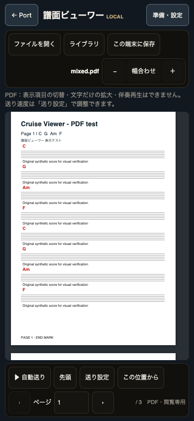
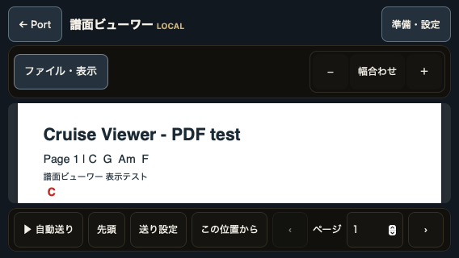
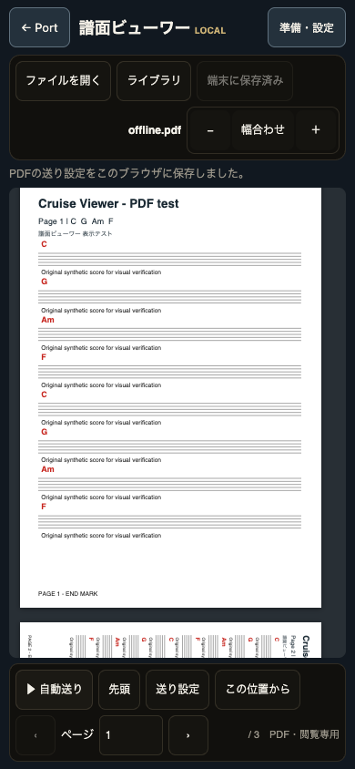

# 譜面ビューワー段階4 — ローカルPort・モバイル・オフライン

2026-11-16。Studio local **0.148.0-dev.1**／Viewer **0.5.0-dev.1**。正式Studio0.88.1と公開Portは変更しない。`codex/score-toolbar-ui`、基準HEAD `bf533fe49b9cc5d28a7f9cbfab86e6479992fcb4`。段階0〜3の未commit差分を保持。

## 入口と操作

- [ローカルPort](http://127.0.0.1:18874/apps/score-viewer/local/port.html) → ツール → **譜面ビューワー**。
- [専用ビューワー](http://127.0.0.1:18874/apps/score-viewer/local/index.html) から直接開くこともできる。
- Studioの既存ビューワー画面には **スマホ・オフライン画面** のリンクを追加。専用画面とStudioは、同じブラウザ内のビューワー専用ライブラリを使う。
- 専用画面右上の **準備・設定** に、オフライン準備と画面ロック防止をまとめた。
- 背の低い横画面では、ファイル・表示操作だけをメニューへ畳む。再生／停止・送り・ズームは押せるまま。ボタンは44px以上のタッチ領域を確保し、safe-areaと縦横の画面寸法を反映する。

ローカルPortは、既存Portのツール欄の実マークアップとCSSを使って生成する検証入口。他のツールは未接続。公開PortのHTML／router／認証／capability／Syncは変更していない。専用ビューワーは編集Session、Project Repository、アカウントSDKを起動しない最小の読み取り専用ホストとして動く。元の譜面・コードルール・紙面・音源は既存実装を再利用する。

## オフラインの使い方と保存の区別

1. 通信がある状態で専用画面を開く。
2. 使う譜面やPDFを開き、各ファイルの **この端末に保存** を押す。
3. **準備・設定 → オフラインの準備** を押し、**オフライン準備済み（本体・PDF描画・音源）** を確認する。
4. 専用URL、ローカルPort、または対応ブラウザのホーム画面追加から使う。

「この端末に保存」は譜面／PDF原本と閲覧設定の保存。「オフラインの準備」はアプリ本体・PDF描画資産・音源の保存であり、未保存の譜面を自動保存する操作ではない。準備済みでもブラウザのデータ消去・容量整理で保存が失われる場合があるため、元の書出しファイルは残す。

初期スナップショットは **244ファイル、11,745,876bytes（約11.2MiB）**。依存するモジュール、紙面CSS、静的フォーム、PDF.js／CMap／フォント／画像資産、ギター・ピアノ音源、ローカルPortとアイコンを含む。

### Service Workerと更新

- 新設のService Worker／manifestは **`/apps/score-viewer/local/` だけ** を対象にし、HTTPの `127.0.0.1:18874` と正確なscopeを検査。既存アプリのService Worker／manifestを変更しない。
- ビルド用スクリプトで静的な依存一覧とSHA-256を生成。認証、Sync、API、編集Session／Repositoryを依存に含めない。ユーザーの譜面原本は従来の専用IndexedDBで保存し、SWへ渡さない。
- 準備時と準備状態の確認時に、必要な各ファイルの実体とhashを確認する。欠損・改変・容量不足・通信失敗では準備済みと表示しない。再試行で修復できる。
- キャッシュするのは固定一覧の同一originのGETだけ。未知URL、API、POST、外部URLはキャッシュしない。接続先の実アカウント情報や認証応答を保存しない。
- 新版は別のcacheへ準備する。準備失敗で旧cacheを消さず、`skipWaiting` による演奏中の強制切替もしない。更新待ちはローカルのビューワー・Port画面をすべて閉じて開き直すよう表示する。
- 削除対象も、このビューワーのcache名prefixだけ。他アプリのcache／SW登録は触らない。
- 初期化が終わるまではファイル操作をinertにし、資産読込に失敗した場合は通信復帰と再読込の案内を出す。

独自譜面の伴奏・メロディ、保存済みPDFの描画と送り、端末設定、ローカルPortへの戻りは通信なしで利用できる。Studioの本体や公開Port全体をオフライン化したわけではない。通信がない場合の戻り先はローカルPortにする。

## 画面ロック防止

**再生・自動送り中の画面ロック防止** を既定ONとし、好みはビューワー専用の端末設定へ保存する。譜面や共有presetには入れない。

- ネイティブ譜面の再生／カウントイン、PDFの自動送りに合わせてScreen Wake Lockを要求。
- 実際に取得できて初めて **画面ロック防止中** と表示。
- 一時停止、終了、非表示、画面離脱、破棄で解放。再開時は再取得する。遅れて返った取得結果も、停止済みなら直ちに解放。
- 非対応、取得拒否、端末による自動解除を区別して表示。自動解除後に無限再要求せず、**もう一度試す** または再開で取得する。
- OSの省電力設定そのものは変更しない。バックグラウンド再生や強制ロック解除も行わない。

取得／解放／visibilityの扱いは[Screen Wake Lock API](https://developer.mozilla.org/en-US/docs/Web/API/Screen_Wake_Lock_API)に従い、対応有無を実行時に検出する。

## 検証

- **全Node：2,299成功、0失敗、既存の専用環境1skip**。ロックの遅い取得、停止／非表示／破棄、拒否／OS解放、再試行、非対応、端末設定保存を追加。SWの準備失敗時の旧cache保全、改変検出と修復、他アプリcache保全、API／scope外メッセージ拒否も確認。
- **関連ブラウザ92件成功**。段階0〜3、ローカル入口、長い曲、PDF、モバイル10件を含む。初回は既存編集試験で最初のコードが確定する前に次の編集へ進み、後続検査で空コードを検出。setupでTabによる確定とデータ反映を待つよう整え、Chrome／WebKitのローカル操作2件を再試験して成功。
- **実ネットワーク断の検証3件成功**。ローカルサーバーを本当に停止し、TCP接続不可を確認してから起動。Chromeはプロセス終了＋同じ一時profileでブラウザを再起動。WebKitは全ページを閉じ、保持した一時browser context内で新しいページを作成した。
- サーバー停止中でも、保存済みの独自譜面が元hash／全音楽JSONどおりに開き、フォームが表示され、ギター・ピアノの実音源がdecode／発音予約できることを確認。試験の音量は0で、聴感評価ではない。
- 保存済みPDFの日本語CMapを含む描画がオンライン時のcanvas PNGと一致し、自動送りも動作。ローカルPortへの戻りと再表示も成功。最後に同じポートのサーバーを必ず復旧した。
- 390×844、844×390、568×320、320×568のtouch相当画面で、停止操作が画面外へ出ないことと44pxの高さ、縦横での読取りを確認。
- Chrome／WebKitとも、このMacのAPIは実際の取得結果 `held` を返し、停止後に解放された。さらにfake APIでOS解放・拒否・遅い応答を制御して確認した。物理スマホが消灯しないことを測定した結果ではない。
- 合計 **ブラウザ95件成功**（初回失敗項目の修正後再試験を含む）、未解決のアプリ試験失敗0。予期しない外部要求・実Account／Sync要求・JS例外なし。

WebKitの `setOffline(true)` はSW制御のnavigationでも内部エラーになる既知の試験環境問題があり、[Playwright #42775](https://github.com/microsoft/playwright/issues/42775)と同じ挙動を再現した。routeによる遮断もnavigation自体が止まったため、サーバー停止によるTCP断で代替検証した。また、このMacのWebKit runtimeはpersistent context起動がprotocol errorになった。従って **WebKitのブラウザ再起動／ディスクからのcold startは未確認**。Chromeのディスク再起動と混同しない。

主なログ：`/private/tmp/viewer-stage4-all-node-final.log`、`viewer-stage4-regression.log`、`viewer-stage4-local-final.log`、`viewer-stage4-cold-final.log`。初回回帰の入力setup失敗はlocal-finalの再試験で解消。復旧serverのPIDは `/private/tmp/viewer-stage4-restored-server.pid`。

## 未確認・次段階

iPhone／Android実機、ホーム画面からの起動、実機の画面消灯抑制、Safari実機の再起動、長時間演奏は未確認。今回のURLはloopback専用で、別のスマホからそのまま到達するURLではない。LAN公開・TLS証明書・本番への接続設定は追加していない。実機用の検証経路は次に明示して決める必要がある。

段階5の模擬Syncは未着手。実アカウント接続、公開Portの入口・利用資格との統合、本番提供の範囲・公開は別工程。本番配信・公開HTML／template・既存Port／manifest／認証／Sync・Worker backend・shared・既存他アプリは変更していない。ローカル検証専用の新規SW／manifestだけを追加した。コミット・pushなし。
