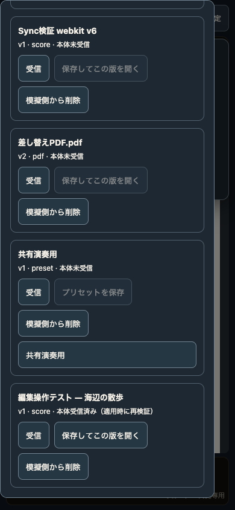
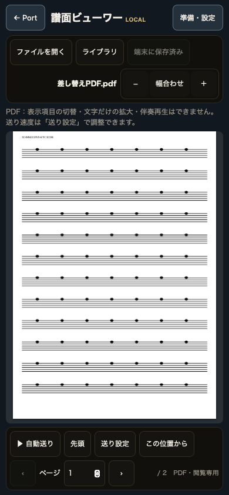
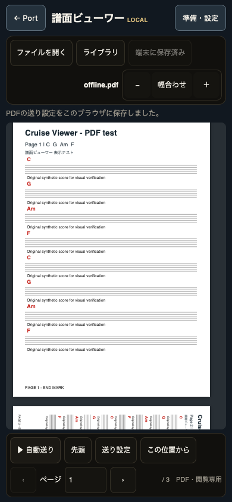

# 譜面ビューワー段階5 — ローカル模擬Sync

2026-11-16。Studio local **0.149.0-dev.1**／Viewer **0.6.0-dev.1**。正式Studio **0.88.1**は変更なし。作業ブランチ`codex/score-toolbar-ui`、HEAD `bf533fe49b9cc5d28a7f9cbfab86e6479992fcb4`。段階0〜4の未commit差分を保持。コミット・pushなし。

## 実装した範囲

[専用ビューワー](http://127.0.0.1:18874/apps/score-viewer/local/index.html) → **準備・設定 → 模擬Sync**。

既存のAccount／SyncクライアントやWorkerを使用せず、同じloopbackサーバーの専用ルートとメモリ上の模擬ストアへ接続する。公開Port、実Account、認証・利用資格、既存Sync設定、Worker、共有コードへの変更はない。これは実Syncに接続する完成版ではなく、候補契約と転送・保存・適用境界の検証実装。

### 操作

1. 譜面・PDFを開いて **この端末に保存**。表示プリセットは「表示」の詳細設定で保存する。
2. **模擬Sync** を開き、送るファイルを選ぶ。新規または一覧内の差し替え先を指定して **送る**。
3. 別の保存領域のブラウザで同じローカルURLを開き、**一覧を更新**。
4. **受信** で本体を取得・検証。これだけでは表示中の譜面は変わらない。
5. 一時停止後、**保存してこの版を開く** で明示的に差し替える。
6. プリセットは **プリセットを保存**。同名で内容が違う場合は別名を入力する。現在の表示には自動適用せず、譜面の「表示」から選ぶ。

模擬ストアはサーバープロセス内の一時データで、**サーバー再起動で消える**。端末へ保存済みの譜面・PDF、受信箱、設定は専用IndexedDBへ残る。オフライン起動には段階4の「オフラインの準備」も必要。実スマホはこのloopback URLへ直接接続できず、今回は別端末間のネットワーク試験ではない。

## 候補契約

| 項目 | この段階の契約 |
| --- | --- |
| 接続先 | `http://127.0.0.1:18874/apps/score-viewer/local/mock-sync/v1/` のみ。URLの設定・本番へのfallbackなし |
| 所有範囲 | `namespace: viewer-local-fixture-v1`、`appId: score-viewer`。実アカウント／編集元Projectの所有関係に流用しない |
| record | `viewer_document`、`viewer_preset` |
| asset | `viewer_score`、`viewer_pdf`、`viewer_preset` |
| MIME | `application/vnd.sound-cruise.score+json`、`application/pdf`、`application/vnd.sound-cruise.view-preset+json`。既存添付種別への偽装なし |
| サイズ上限 | 独自譜面13MiB、PDF20MiB・200ページ、プリセット64KiB。模擬ストア64MiB、record500件、送信intent1000件 |
| 索引 | descriptor（種別・ID・題名・サイズ・MIME・SHA-256）＋整数version＋削除状態。本体を含まない |
| 転送 | `capabilities → prepare → content PUT → commit`。本体はSHA-256、サイズ、MIMEを照合後にcommit |
| 差し替え | `baseVersion`によるcompare-and-swap。競合時は一覧の再取得と利用者の再判断が必要 |
| 再試行 | descriptor＋baseVersionからintentを生成。commit応答を失っても同じ結果を返し、既に進んだheadを巻き戻さない |
| 新規送信中の再読込 | ACKまでrecord IDを端末に保持。再読込後の再試行でも重複recordを作らない |
| 削除 | 模擬側にversion付きtombstoneを保存。各端末の保存／旧revisionは自動削除しない |

独自譜面は元の`viewerDocumentId`を維持する。別の独自譜面を同じrecordへ紛れ込ませず、同じ音楽revisionで異なるbytesを受け入れない。PDFとプリセットは本体hash由来のIDを持ち、明示選択した同一remote recordへ新版を送れる。旧ファイル実体は保持する。PDFの異なる版は端末ライブラリでは異なるPDFとして残る。

`capabilities`と対応typeの一覧取得を分離。未知recordは読み飛ばし、一覧にないことを削除と解釈しない。未知typeや旧protocolでの書込・削除は拒否。既存のAccount／Syncのschema交渉やcapability定義は変更しない。この候補契約を実Syncへ採用するには、実装・運用上の提供範囲と所有関係を別途決める必要がある。

### 境界と保存

- サーバーの公開headは、検証済み本体のcommitと同時に更新。不完全なuploadやprepareだけでは一覧に公開しない。
- 本体取得は固定URLのGETだけ。Cookie・認証情報を送らず、redirectを拒否。応答サイズと時間を制限。
- 実体はSHA-256・サイズ・MIMEに加え、独自譜面codec、表示preset codec、同梱PDF parserでも確認。hashだけ合う不正なファイルでは受信完了にしない。
- 受信箱DB **`cruiseStudio.viewer.mockSync.v1`** は既存のViewer／編集元DBと分離。一覧だけ／本体受信済みを区別し、本体と受信記録は同一トランザクションで保存。
- 適用時にも再検証。譜面／PDFの適用中は再生・開く操作を抑え、playing／counting／loading中の差し替えを拒否。受信自体は演奏中も可能。
- 表示中のreaderと共通時計を同期処理から変更しない。適用の保存が失敗しても、現在のreader・以前の保存・最後の選択を保持。
- 端末別の練習BPM、音量、位置、wake設定を送らない。既存の端末別設定はrevision別に保持。受信プリセットも手動適用。
- 更新中の一覧は完成してから一括表示。途中のカードに対する操作を防ぐ。
- API応答・ユーザーファイルはService Workerへcacheしない。静的依存のみ248ファイル／11,769,910bytes。既存のSW本体・manifest、公開Portの変更なし。
- loopback Host、Origin、専用ヘッダーを確認し、外部Origin／未知ルート／旧protocolを拒否。CORSや実資格を追加しない。模擬APIは外部公開用の認証を備えるものではない。

主な追加実装：`apps/score-viewer/sync/{contract,store,client}.mjs`、`apps/score-viewer/local/mock-sync.mjs`、`apps/cruise-studio/scripts/local-viewer-sync.py`。既存Viewerライブラリには「保存時に最後の選択を進めない」内部オプション、Viewerには適用中の操作ロックを追加。DB version／専用譜面formatVersionは変更していない。

## 検証結果

- **全Node：2,311成功、0失敗、既存の専用環境1skip**。新規12件は、索引のみ、受信箱の再読込、破損・MIME・サイズ・music ID不一致、不正codec、本体保存quota、演奏中適用拒否、適用quota、端末設定保持、preset競合、PDF parser失敗、未知契約、送信IDのACK前後、破損した保存索引を検査。
- **模擬ストアPython：9成功**。未commitの非公開、失われたACKの再試行、後のheadを巻き戻さないこと、同時差し替えの競合、同版内容の不正変更、quota時の保全、未知record／旧client、削除と旧実体保持、MIME／namespace／上限、PDF差し替えを確認。
- **新規Syncブラウザ：16成功**（Chrome／WebKit各8、親groupを含む）。それぞれ2つの独立browser contextを使い、Cookie／IndexedDB／localStorageを分離。実本体をHTTP転送し、UIで送信・受信・手動適用、元の音楽内容一致、端末別の練習BPM・表示倍率・wake保持、演奏中の旧版固定を確認。
- content PUTの中断、commit応答の消失、ページ再読込後の新規送信再試行、同時更新409、破損bytes、受信箱quota／適用quotaの後も元の版を保持。quota試験はDOMExceptionの注入であり、Macのディスクを実際に満杯にはしていない。
- PDFバイナリの転送、異なるPDFへの明示差し替え、旧PDF実体保持、共有presetの手動保存と非自動適用、remote tombstone後のライブラリ保持を確認。外部要求・実Account／Sync要求・予期しないJS例外なし。
- **既存関連ブラウザ：92成功**。ローカル編集、長い曲、契約、段階1／2／PDF／モバイル・wake・オフライン準備の回帰。
- **受信済みファイルの実ネットワーク断：3成功**。別のブラウザから模擬転送した独自譜面・PDFを受信・保存した後、ローカルサーバーを実停止し、TCP18874へ接続できないことを確認。Chromeは同じ一時profileでブラウザプロセス再起動、WebKitは保持した一時context内の新規ページ。元hash／全音楽JSONが一致し、実音源のdecode・発音予約、PDF日本語CMapのオンラインと同一PNG、PDF送り、local Portへの戻りが成功。保存索引は読めるがSync更新は失敗し、APIがSWへcacheされないことも確認。音量は0で聴感評価ではない。
- 最終セットは **ブラウザ計111成功**（92＋16＋3）。初回のOrigin拒否試験は試験URLの誤記を直して403を確認。一覧の部分描画が露出する不具合も修正し、Sync全件を再試験して成功。

ログ：`/private/tmp/viewer-stage5-all-node-complete.log`、`viewer-stage5-node-final.log`、`viewer-stage5-sync-final.log`、`viewer-stage5-regression.log`、`viewer-stage5-received-offline.log`。Python試験は`python3 apps/cruise-studio/tests/viewer-mock-server.test.py`。

## 未実施と次の判断

実Account・実Sync・本番Worker・公開Portへの組込、実スマホ間の転送、スマホ実機のA2HS／消灯防止、長時間・実容量不足・実回線切断／復帰の評価は未実施。WebKitのブラウザプロセス再起動・ディスクcold startは段階4と同じ試験環境制約で未確認。Chromeの再起動結果と区別する。

段階0〜5のローカル候補を統合確認できる状態。次の判断は、スマホ実機へ安全に届ける検証経路、実Sync上のappId／所有単位・対応schema・削除／保持方針、Standard／Proの提供範囲。実アカウント接続や本番公開はそれぞれ明示承認を受ける別工程。

既存のloopbackサーバーを模擬ルート追加時に再起動し、実断試験でも意図して停止した。試験後は同じ`http://127.0.0.1:18874/`へ復旧済み。現在のPID記録は`/private/tmp/viewer-stage4-restored-server.pid`（共通cold試験の記録名）。模擬ストアはこの復旧時に空へ戻っている。
