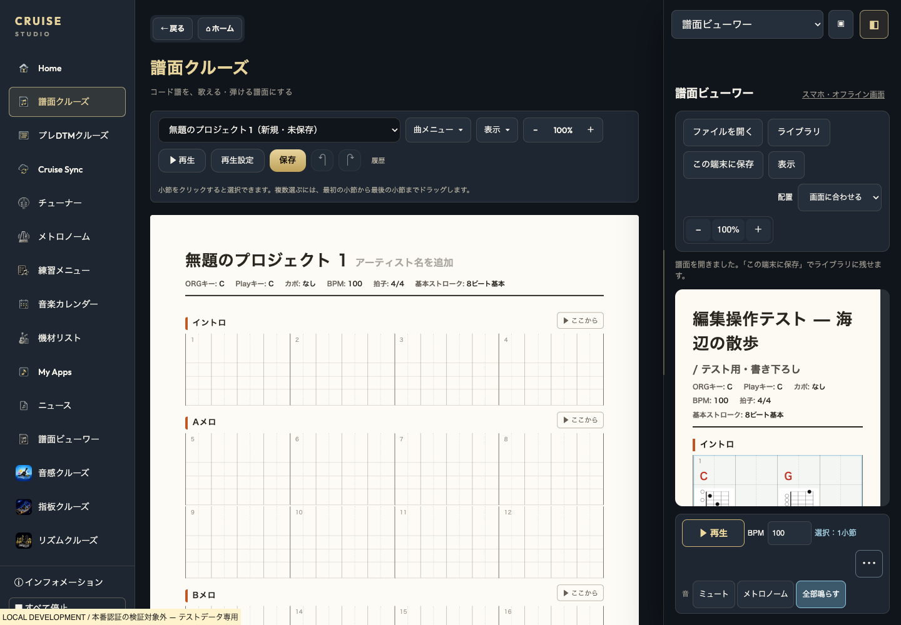
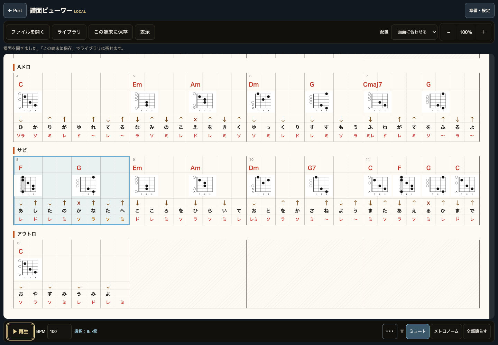
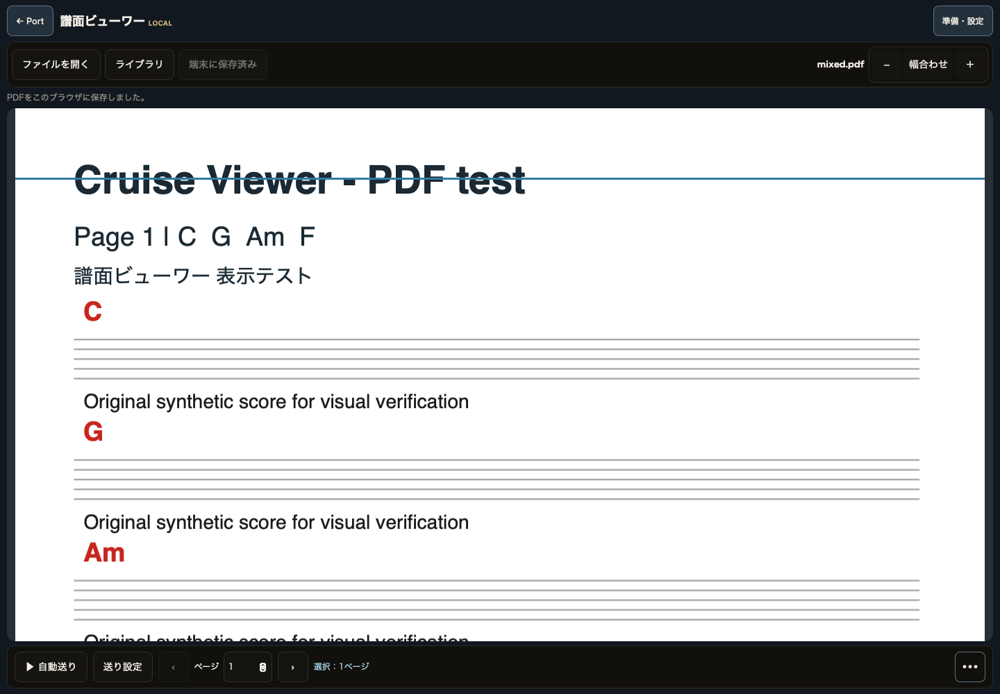

# 譜面ビューワー — 入口・直接書き出し・再生UIの整理

2026-11-16。Studio local **0.150.0-dev.1**／Viewer **0.7.0-dev.1**。基準commit `28de7fb0`。今回の差分は未commit・未push。正式Studio0.88.1、公開HTML／Port、実Account・認証・Sync設定、既存Worker、shared、他アプリは変更しない。

## 変更

- Studioトップの譜面ビューワーを **ニュース → 譜面ビューワー → Cruise Sync** の順へ。左メニューでもニュースの直後へ。
- 右窓のツール選択に譜面ビューワーを追加。中央の譜面クルーズと別のreaderで閲覧・再生でき、中央へ移動する際にも同じreaderと表示を維持する。
- 譜面クルーズの曲メニュー「ファイル」の先頭を **譜面ビューワーに書き出す** へ変更。閲覧ファイルをViewer専用ライブラリに直接追加する。元のProject・編集履歴・表示設定へ書き戻さず、既に閲覧中の譜面も自動的に置換しない。初回のViewerで最後の選択がない場合は最新の保存ファイルを開く。
- エクスポートのencode中・保存直前に編集状態が変わった場合は保存を中止。保存トランザクション直前のvetoで以前のrevisionと最後の選択を守る。
- ファイルとして持ち出す場合はViewerの **⋯ → ファイルに書き出す**。音楽内容／元bytesをそのまま出力する。ファイル出力と「この端末に保存」は別操作で、ダウンロードだけでライブラリ保存済みとは扱わない。
- 再生ボタン、BPM、選択位置、**音：ミュート／メトロノーム／全部鳴らす** を見える位置へ。選択中の音モードを押下状態で表示。ミュートは音量0で共通時計と画面送りを続ける。メトロノームは伴奏・メロディ0、拍音のみ。全部鳴らすは各音量100・メトロノームON。詳細な音量・カウントイン設定は「⋯」へ。
- **先頭／音量・カウントイン** を「⋯」内へ。別の「○小節目から再生」ボタンは廃止し、青く選んだ小節から通常の再生ボタンで開始する。手動スクロール後に演奏位置へ戻るボタンは、その時だけ表示する。
- クリック・左右キーで選択した小節を青い枠と背景で表示。再生中は現在小節と滑らかな棒、停止後は停止位置の小節を選択表示する。PDFもページ上のクリック位置に青い線を出し、そこから送れる。
- Spaceの対象をvisibleなreaderに限定してdocument側で判定。bodyへフォーカスが外れた中央／専用画面、再生ボタン上でも開始・一時停止が動く。右窓ではViewer内にフォーカスがある時だけ動かし、中央の音符入力と競合させない。入力欄、select、IME変換中、開いたdialog、メニュー操作は除外する。
- ファイルを開いた後・位置を選んだ後・音モードを切り替えた後は、譜面viewportにフォーカスを置く。最後まで進んだ時も再生ボタンを無効化せず、再度押すと先頭から再開する。読み込み中の中止後に遅い発音が始まらないことも確認した。
- PDFは初期値30秒／ページで、初回のボタンからすぐ自動送りを開始する。**送り設定はスライダー1本**（遅い120秒／普通30秒／速い7.5秒）。設定変更中はプレビューせず「保存」で反映。既存の正確な秒・BPM・拍数・ページ別設定は「さらに詳細」に残し、既存端末設定を維持する。小数秒のHTML step制約も修正した。
- 未保存ファイルを開いた後のファイル切替・中央のホーム／戻る・右窓閉じる／ツール切替・専用画面の戻りで、**保存して続ける／保存せず続ける／キャンセル**。保存に失敗したら移動せず、現在のファイルを保持する。再読み込みやタブを閉じる際はブラウザ標準の警告。元bytesが既にライブラリにある場合は保存済みとして認識する。

## 確認した不具合・試験調整

Spaceがhost内に届かないフォーカス状態、曲末の再生無効、PDFで最初の再生が設定画面になる挙動を修正。右窓の中央移動ボタンが既存CSSにより非表示になる問題もViewer限定で解消した。

旧い回帰試験は「初回PDF再生では設定画面」「曲末の再生は無効」「ここから再生は別ボタン」「書き出しではdownloadイベント」という前提を更新。旧形式・音・PDF回帰の一時ファイル切替では、テスト専用helperが明示的に「保存せず続ける」を選ぶ。新規UI試験はそのhelperを使わず、保存・取消・破棄と失敗時の画面保持をそれぞれ操作して検証している。

Viewerが前回のcommitから追跡対象になったため、既存のreleased-owner境界試験に今回のローカルViewerの明示的な対象ファイルだけを追加。公開用の境界関数、認証、feature資格、配信gateを広げず、vendor資産も対象外のまま。旧来の他アプリ・shared・Worker保護は維持。

## 検証

- 全Node **2,312成功・失敗0・既存専用環境1skip**。直接書き出しの保存直前vetoも追加。
- 新規UIブラウザ **14成功**（Chrome／WebKit、各7件・親group含む）。トップ順、直接追加と同一内容のファイル出力、右窓／中央移動、元Project保持、位置選択、Space、複数回の再生・停止、読み込み中止と再開、3音モード、入力中Spaceの除外、未保存の保存／破棄／取消／容量不足、PDFの速度と選択を確認。
- 既存関連ブラウザ **96成功**：ローカル編集2、Viewer契約10、Stage1 18、Stage2 20、模擬Sync16、モバイル10、PDF20。同じケースを再試行した分を重複加算しない。
- 受信済みファイルの実TCP断 **3成功**。サーバーを意図的に停止し、Chromeは一時profileのブラウザ再起動、WebKitは新規pageから、保存済みの譜面・PDF・実音源・ローカルPortを利用。APIのcacheはない。試験後サーバーを同じ18874へ復旧。
- 最終の関連セットは **ブラウザ113成功**（96＋14＋3）。Python mock store9成功。未解決のアプリ試験失敗0。
- 初回の回帰では旧PDFの前提、非同期の戻り確認、検証途中に更新した古い静的asset manifestによる準備失敗が出たため、前提を更新し、manifestを生成し直した後に該当ケースを再確認。PDF描画失敗時に再生を無効化する既存検査も維持した。新規のファイル出力比較はimport前fixtureではなく、保存後の編集snapshotと比較する。
- 249静的依存／11,782,970bytes。外部要求・実Account／Sync要求・予期しないJS例外なし。音の試験はmuteで実施、聴感評価ではない。

ログ：`/private/tmp/viewer-usability-node-final.log`、`viewer-usability-ui-final.log`、`viewer-usability-regression.log`、`viewer-usability-mobile-pdf-final.log`、`viewer-usability-pdf-ui-complete.log`、`viewer-usability-cold.log`。初回回帰のMobileはmobile-pdf-finalで、PDFはpdf-ui-completeで、新規UIはui-finalで置き換えた結果。保存容量不足はDOMException注入で、端末の空き容量を実際に使い切る試験ではない。

スマホ実機・OSの消灯防止・WebKitのブラウザ全プロセス再起動は従来どおり未確認。実Sync接続と公開は別工程。

ローカルURL：<http://127.0.0.1:18874/>。専用ビューワー：<http://127.0.0.1:18874/apps/score-viewer/local/index.html>。Studioは再読込で更新。以前のSWで動く専用ビューワーは、開いているローカルViewer／Port画面を閉じて開き直す。既存の強制更新を行わない方針を維持している。
