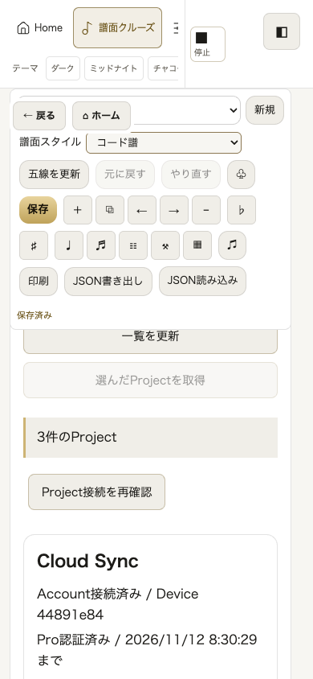
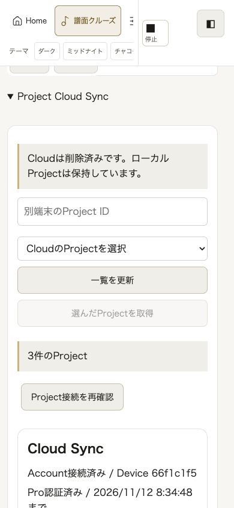
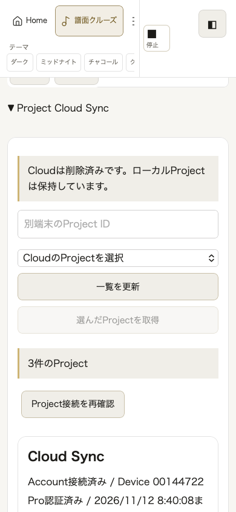
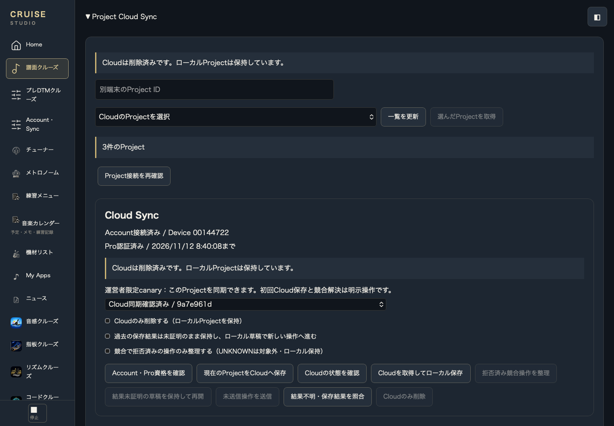
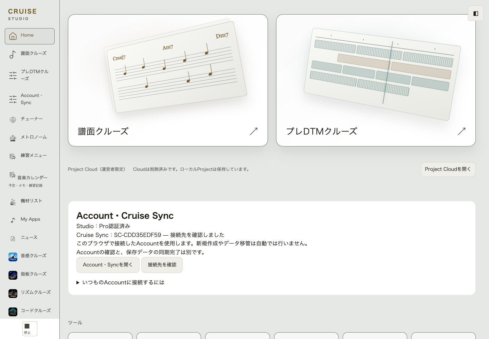
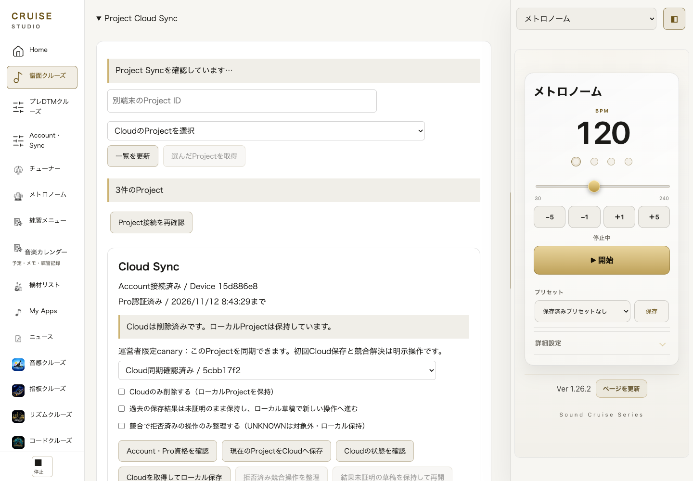
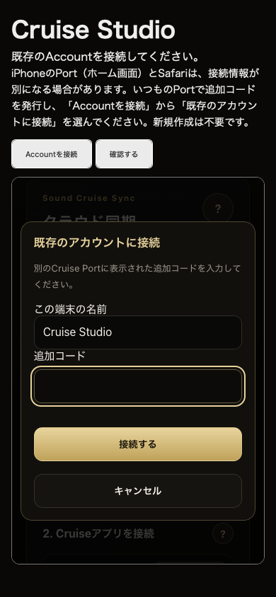

# Studio 実機UI最終調整・第1工程

## 基準と変更境界

- 公開main: `9eb876c64b1c2b07a18e90d608cd660392a7b229`。通常Studio **0.74.1 / 81 files**、別配布canary **0.76.1 / 90 files**。公開HTMLを読み取り確認した。
- canonical sourceはDraft #194 `cf58b47f50f92c8e4521a35c104f335da4d59a0c` / tree `f5b626e8baa5e45045886ec204f28f3e983f03f9`。最新mainの生成canaryを新しい隔離branchへmergeし、既存PR・main・他worktreeは変更しない。
- 本UI成果は#194への積み上げPR。main向けの新しいBackend統合PRではない。Worker/Owner/activation・対象Account/Device/Project・DDLは#194から一切変更しない。
- 候補 **0.77.0**。既存Home欄への操作要素追加はAGENTSのminor更新規則に合わせ、参照cache keyも一括更新。公開版は変更していない。
- 運営者によるProject r1→r2→r3、BPM102の二端末一致とcanary認可PASSはユーザー報告として引き継いだ。本作業で実Account/Projectへの操作・再受入はしていない。

## 再現と修正

### Cloudとツールバーの重なり

390×844の実製品DOMで、Cloud見出しをscrollIntoViewした後もsticky譜面toolbarが同じ包含領域の中に残った。修正前はtoolbar top110.19 / bottom409.58に対してCloud top109.91、summaryのhit testはfalse。固定秒数や余白だけでは解消しない。

既存譜面DOMを動かして`studio-score-content`で囲み、既存Cloud detailsをその外側の兄弟にした。toolbarのsticky範囲が譜面までで終わり、Cloud操作を覆わない。リスナーとschema2 sessionは同じインスタンスを使う。Cloudを印刷対象から除外する。共通mobile shellにはsafe-areaの下余白とscroll paddingを付加。

390pxの修正後Chromeではtoolbar bottom125.91 < Cloud top137.91、summary hit test true。375/390/430/1024/1440pxで横はみ出しなし。safe-areaはCSS値34pxの合成条件でも最下部の各操作ボタンに到達することを検証した。

現在の公開DOMには旧`#shell-dock-toggle`はない。これを存在すると仮定した試験は行わない。実在する下部停止操作・上部ナビと譜面toolbarを表示した状態の検証であり、旧Dock機能の復元ではない。

### Canary Home

既存の「制作ProjectはCruise Sync対象外」という通常版用説明を、canary loader内だけで短い運営者限定ラベル・正規hostの状態文・「Project Cloudを開く」に置換する。新カード/モーダル/第二のSync Centerは作らない。

状態文は既存hostのstatus DOMから表示投影するだけで、Sync判定や保存状態を増やさない。ボタンは既存shell navigation→既存detailsを開く→summaryへfocusする。クリック/Enterで保存・送信・adoptionを開始しない。入場不可時は既存admissionによって無効になる。通常81ファイル版はCloud loaderを持たず、ローカル保存説明を維持。

### Safariの接続案内

Account未接続の既存入口画面と既存Homeガイドだけを修正した。iPhone Portホーム画面とSafariでは接続情報・保存領域が異なる場合がある旨と、いつものPortで追加コード→既存Accountに接続する手順を示す。既存Accountを新規作成/削除しない。別Accountや未同期データが残る場合の保全案内も維持。

正規Account接続とPro認証を変更しない。Account追加コードとPro番号を混同しない。Safari側の未接続表示をPWAのデータ消失とは扱わない。ストレージ共有の断定はしない。

根拠: [Apple WWDC23 Web apps](https://developer.apple.com/videos/play/wwdc2023/10120/)、[WebKit Safari17.2 release](https://webkit.org/blog/14787/webkit-features-in-safari-17-2/)。後者でもホーム画面追加時のCookieと他local storageの扱いが区別される。

## 比較画像

すべて合成Account、使い捨てprofile。画像中のID/Projectはfixtureで実ユーザーではない。Cloud削除後もローカルを保持する既存ケースの途中を記録したため、「Cloudは削除済み」は正しい試験状態である。

| 修正前390px | 修正後390px Chrome | 修正後390px WebKit |
| --- | --- | --- |
|  |  |  |

Mac幅・Midnight Sessionの既存造形を維持:



Homeの既存説明欄を置換（lightテーマの確認例）:



中央Projectと右側の既存メトロノームを同時表示:



Safari相当の未接続状態から既存Port参加画面を開く:



## 検証方法と範囲

既存`project-cloud.browser.mjs` / canary acceptance / Miniflare D1/R2 / 正規native Account・Pro fixtureを再利用。追加UI試験は`tests/ui-final-pass1.acceptance.mjs`だけ。すべてのブラウザ通信を隔離fixtureにrouteし、productionへの資格・API操作はしない。

```sh
STUDIO_TEST_RUNTIME=/private/tmp/studio-project-runtime/package.json \
STUDIO_WORKER_ROOT="$PWD" STUDIO_RELEASE1=1 STUDIO_NATIVE_ROOT="$PWD" \
STUDIO_EXPECTED_PORT_VERSION=1.26.2 \
STUDIO_RELEASE_ARTIFACT=/private/tmp/studio-ui-final-package \
STUDIO_SCHEMA_SEED=/private/tmp/studio070-remaining-rerun/native-score073 \
STUDIO_PROJECT_RELEASE_PROFILE=1 STUDIO_PROJECT_CANARY=1 \
STUDIO_UI_ACCEPTANCE=1 STUDIO_ASSERT_PRODUCTION_SCHEMA=1 \
STUDIO_CLIENT_OUTPUT=/private/tmp/new-disposable-result \
node apps/cruise-studio/tests/project-cloud.browser.mjs
# WebKitは同じ条件にSTUDIO_UI_BROWSER=webkitを付加。
```

WebKitのPlaywright routeではBlobリクエストのpostDataBufferが欠落/変換され、画像fixtureがasset_size_mismatchになった。テスト内だけで元の合成Blob bytesを既存ローカルbindingへ渡し、同じheaders/hash/APIでMiniflareに送る。製品のfetch/API/保存処理を変更せず、画像保護ケースを省略しない。これはSafariの実通信スタックの受入を証明するものではない。

製品E2Eは **Chrome 29/29、WebKit 29/29 PASS**。各々既存23件＋UI6件、pageerror 0。初回受信・自動再開・CAS・UNKNOWN/ACK喪失・削除/新IDコピー・Backup Restore・Account/Device/Pro失効、Port画像Account分離・4アプリrefreshを維持。追加6件は390px到達性、Home/Enter、未保存/print、5テーマ/幅、5ツール/カレンダー/NEWS/右側ツール、未接続Safari案内を確認。[results.json](results.json)に結果を保全。

Node対象: studio-entry / account-status-projection / account-observation / component-version-cache / project-sync-host / pc-shell-layout / pc-tools。78件中74PASS、4FAIL。同一4件が修正前#194でもFAIL（baseline26件中22PASS/4FAIL）。既存の旧Dock・旧独立メトロノームDOM前提の静的試験で、今回の新規失敗ではない。これらを削除/skip/期待値緩和していない。

Jekyll --safeの実build後、通常81 files、canary90 filesの全hash一致。Port/4アプリ/sharedの配布813 filesはbyte同一。ローカルHTTPで通常入口/canary入口200、通常版Cloud loader、development/identity host/Project試験入口/Worker sourceは404。[invariants.json](invariants.json)を参照。

## 変更しなかった契約

- schema2、Web Locks、raw revision CAS、repository、codec、Project client/transport/session/host。
- native Account・Pro資格判定、Account observation、Port・4アプリ・shared tree。
- Worker/DDL/R2、canary scope、Project OFF/ON判定、Cloud削除/復旧/Outbox。
- Midnight Sessionのカード/ナビ/制作機能、既存中央/右側ツールのcontroller。

生成canaryはcanonical sourceから既存packagerで再生成した配布物で、手書きの第二実装ではない。通常81+canary90の境界を維持する。

## 残る実機UI受入と最短工程

UI上の再現不具合A/B/Cは修正済み。実iPhone Safariのアドレスバー伸縮、ソフトキーボード、home indicatorと実safe-areaの組み合わせは合成viewport/WebKitから実機PASSとはしない。Port/Projectの既存実機Sync PASSを再実行する必要はなく、限定配布後の表示・到達性を確認する。

1. 本UI差分と比較画像をレビューし、通常/canaryの配布対象だけを別途明示承認する。#194 Backendを本UIの承認で自動merge/deployしない。
2. 承認した配布commitで既存packager/Jekyll/hash照合を行い、Worker/activation/DBを変えずにUIだけ反映する。
3. 運営者が現在のiPhone Safari/MacでHome→Cloud、最下部ボタン、Account接続案内を確認。既存Account接続や実Sync操作が必要なら運営者が行う。残る表示課題がなければ次のUI工程へ進む。正式リリース/告知は別判断。

main merge、Pages公開、本番Worker/D1/R2、実Account/Project操作は本作業では行っていない。
